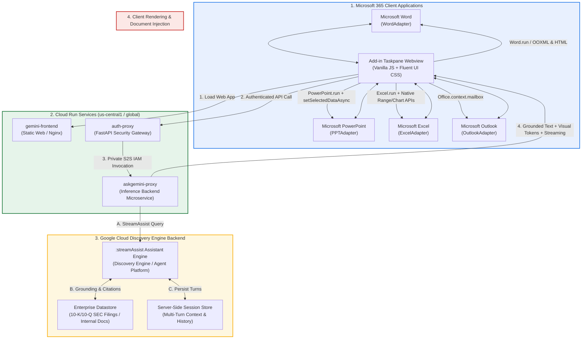

# Gemini for Microsoft 365 (Word, PowerPoint, Excel, Outlook)
**Author:** Sathya AG, Principal Architect, Google  
**License:** Apache-2.0  

An enterprise-ready Microsoft 365 Add-in and Google Cloud backend that integrates **Gemini via Google Cloud Discovery Engine (:streamAssist, Datastore Grounding, and Server-Side Session Management)** directly into **Microsoft Word**, **PowerPoint**, **Excel**, and **Outlook**.

## 📽️ Demo Video

https://github.com/user-attachments/assets/0b3605f8-4013-4cee-a2ea-7fc5ebf6955b

---

## 🌟 Key Capabilities

- **🏢 Grounded Intelligence & Zero Hallucination:** Directly grounded via **Google Cloud Discovery Engine Assistant & Datastores** over enterprise quarterly reports, policies, 10-K/10-Q SEC filings, and research documents.
- **🎨 Interactive Visualizations:** Generates 100% Word, PowerPoint, and Excel-compatible visual charts, process flows, and KPI metric grids.
- **📄 Microsoft Word (`WordAdapter`):** Document summarization, risk analysis, text rewriting, and in-document `@gemini <prompt>` execution.
- **📊 Microsoft PowerPoint (`PPTAdapter`):** Automatic multi-slide executive deck generator with widescreen layouts, data tables, color theme extraction, and native macOS WKWebView dual-pipeline visual injection.
- **📈 Microsoft Excel (`ExcelAdapter`):** Full spreadsheet intelligence engine featuring:
  - **Native Interactive Chart Engine:** Builds clustered columns, lines, and bar charts in-sheet with aggregation and conversational chart modifications.
  - **Taxonomy Categorization:** AI-powered column categorization with automatic adjacent column insertion and category distribution badges.
  - **Table Insights & Statistics:** Pre-parses multi-dimensional sheet matrices with numerical mean, median, min, max, std dev, and correlation calculations.
  - **Formula Generation & Insertion:** Context-aware Excel formula generation (`XLOOKUP`, `INDEX/MATCH`, `SUMIFS`, `LAMBDA`) with 1-click cell insertion.
  - **Range Formatting & Styling:** Generates and applies custom fills, borders, typography, and number formats directly to selected cell ranges.
- **✉️ Microsoft Outlook (`OutlookAdapter`):** Contextual email thread summarization, grounded smart replies, tone coaching (Direct vs Diplomatic), meeting briefing prep, and calendar appointment creation.

---

## 🏗️ Architecture Overview

The system employs a decoupled, least-privilege three-tier architecture:



---

## 📂 Repository Structure

```
gemini-for-office-365/
├── .env.example                                # Documented template for all runtime & deployment variables
├── CONTRIBUTING.md                             # Contributor guidelines, CLA, dev setup, and testing instructions
├── LICENSE                                     # Apache-2.0 License
├── README.md                                   # Project overview, capabilities, and navigation
├── SECURITY.md                                 # Vulnerability reporting policy (g.co/vulnz)
├── deploy.sh                                   # Automated Google Cloud Run deployment script
│
├── baseline-configs/                           # Declarative Cloud Run baseline configurations & rollback guide
│   ├── askgemini-proxy-baseline.yaml           # Baseline backend service spec
│   ├── auth-proxy-baseline.yaml                # Baseline auth gateway service spec
│   ├── gemini-frontend-baseline.yaml           # Baseline static frontend service spec
│   └── README.md                               # Service rollback runbook
│
├── authproxy/                                  # Security & Auth Gateway (Python FastAPI)
│   ├── Dockerfile                              # Cloud Run container definition
│   ├── main.py                                 # JWT verification, IdP auto-discovery & token exchange
│   ├── requirements.txt                        # FastAPI, uvicorn, PyJWT, cryptography, httpx
│   ├── test_authproxy.py                       # Auth proxy unit & token resolution tests
│   └── README.md                               # Microservice reference & environment variables
│
├── geminiproxy/                                # Core Inference Backend (Node.js Express)
│   ├── Dockerfile                              # Cloud Run container definition
│   ├── index.js                                # Discovery Engine :streamAssist, Sessions, Gemini 2.5 Flash
│   ├── package.json                            # Discovery Engine, Vertex AI, and Express dependencies
│   └── README.md                               # Backend service documentation
│
├── microsoft-addin/                            # Office Web Add-in Client (Office.js)
│   ├── Dockerfile                              # Nginx production container
│   ├── nginx.conf                              # Nginx security headers and static routing
│   ├── package.json                            # Build scripts, testing dependencies, and Babel configuration
│   ├── webpack.config.js                       # Production & local development Webpack configuration
│   ├── assets/                                 # Office Ribbon & branding icons
│   ├── tests/                                  # Automated test suites (Excel, Outlook, Word, PPT)
│   │   ├── excel.test.mjs                      # Excel adapter, formulas, charts, and taxonomy tests
│   │   ├── outlook.test.mjs                    # Outlook thread parsing, coach, and briefing tests
│   │   ├── ppt.test.mjs                        # PowerPoint deck builder and slide parser tests
│   │   └── word.test.mjs                       # Word document processing and streaming tests
│   └── src/
│       ├── adapters/                           # Host-specific adapters (Word, PPT, Excel, Outlook)
│       ├── auth/                               # Google OAuth sign-in and callback dialogs
│       ├── commands/                           # Ribbon button action controllers
│       ├── core/                               # authService, geminiClient, markdownParser, sessionManager
│       ├── shell/                              # Reusable taskpane shell components
│       └── taskpane/                           # Unified taskpane UI (HTML, CSS, JS)
│
├── docs/                                       # Project documentation
│   ├── architecture/                           # Deep-dive architecture and identity design guides
│   │   ├── system-design.md                    # Comprehensive system design & host adapter workflows
│   │   └── developer-architecture-guide.md     # Decoupled auth, WIF vs Cloud Identity, and IAM posture
│   │   └── Local-ADC-Testing-Guide.md          # Local Application Default Credentials (ADC) setup
│   ├── deployment/                             # Enterprise deployment runbooks
│   │   ├── cloud-run-deployment-guide.md       # Master Cloud Run deployment runbook
│   │   ├── m365-admin-center-deployment.md     # Microsoft 365 Admin Center centralized rollout guide
│   │   └── multi-developer-onboarding.md       # Multi-developer hub-and-spoke setup
│   ├── adr/                                    # Architecture Decision Records (ADR-0001 through ADR-0004)
│   └── specs/                                  # Host-specific functional specifications
│       ├── common/                             # Cross-host specifications
│       ├── excel/                              # Excel specifications (11 specs)
│       ├── outlook/                            # Outlook specifications
│       ├── powerpoint/                         # PowerPoint specifications
│       └── word/                               # Word specifications
│
├── _agents/                                    # AI Pair Programmer (Jetski / Antigravity) guidelines
│   └── rules/                                  # Coding guardrails & deployment sync enforcement
│
└── scripts/
    ├── generate_manifest.py                    # Dynamic manifest generator for Office (Word/PPT/Excel/Outlook)
    ├── rollback_to_baseline.sh                 # Cloud Run service rollback utility
    └── sideload_mac.sh                         # macOS local sideloading automation helper
```

---

## 🚀 Quickstart & Deployment Guide

Deploying Gemini for Microsoft 365 takes approximately 10 minutes. The repository provides an automated script (`deploy.sh`) that provisions the Cloud Run microservices, configures IAM bindings, builds the production Webpack frontend bundle, and dynamically compiles your customized Office Add-in XML manifest.

---

### Step 1: Prerequisites

Ensure you have the following installed on your local workstation:
- **Google Cloud SDK (`gcloud`)**: Authenticated with privileges to deploy Cloud Run services and assign IAM roles (`gcloud auth login`).
- **Node.js (v18+) & npm (v9+)**: To build the production add-in client.
- **Python 3.10+**: For manifest generation and test execution.
- **Microsoft Entra ID (Azure AD)**: Access to an Azure tenant with permissions to create an **App Registration**.
- **Microsoft 365 Account**: Word, PowerPoint, Excel, or Outlook (Desktop or Web).

---

### Step 2: Microsoft Entra ID App Registration (5 Minutes)

To enable single sign-on (SSO) and secure the API gateway:
1. Navigate to the **[Microsoft Entra Admin Center](https://entra.microsoft.com/)** > **Identity** > **Applications** > **App registrations** > **New registration**.
2. **Name**: `Gemini for Microsoft 365`.
3. **Supported account types**: *Accounts in this organizational directory only (Single tenant)*.
4. **Redirect URI**: Select **Single-page application (SPA)** and enter `https://localhost:3000/taskpane.html` (this will be updated with your Cloud Run frontend URL post-deployment).
5. Click **Register**. Note down the **Application (client) ID** and **Directory (tenant) ID**.
6. **Expose an API**:
   - Go to **Expose an API** > **Application ID URI** > **Set** (Accept default: `api://<MICROSOFT_ENTRA_APP_ID>`).
   - Click **Add a scope**:
     - Scope name: `access_as_user`
     - Who can consent: *Admins and users*
     - Admin consent display name: `Access Gemini via Office Add-in`
     - Admin consent description: `Allows Office 365 to communicate with the Gemini backend.`
7. **Authorized Client Applications**:
   - Add the standard Microsoft Office client application IDs so users are not prompted for consent:
     - `ea5a67f6-b6f3-4338-8e34-c6555373e660` (Office on the Web)
     - `d3590433-b390-4fb2-a521-38d2270ce648` (Office Desktop)
   - For each, check the box for your `access_as_user` scope.

---

### Step 3: Configure Environment Variables

Copy the template configuration file:
```bash
cp .env.example .env
```

Open `.env` and fill in your environment parameters:
```bash
# 1. Cloud Run Deployment Target
PROJECT_ID="your-gcp-project-id"
REGION="us-central1"
SERVICE_ACCOUNT="gemini-office365-sa@your-gcp-project-id.iam.gserviceaccount.com"

# 2. Gemini Enterprise / Discovery Engine Target
GE_GCP_PROJECT_ID="your-gemini-enterprise-project-id"   # Project hosting Gemini Enterprise / Datastores
GE_GCP_LOCATION="us"                                    # "us", "eu", or "global"
GEMINI_ENTERPRISE_APP_ID="your-app-or-engine-id"        # Search/Assist Engine ID

# 3. Microsoft Entra ID
MICROSOFT_ENTRA_APP_ID="your-microsoft-entra-app-id"
MICROSOFT_ENTRA_TENANT_ID="your-microsoft-entra-tenant-id"
REQUIRE_ENTRA_AUTH="true"
USER_AUTH_MODE="cloud_identity"                         # "cloud_identity" or "wif"
```

> **Tip:** If testing locally before setting up Azure Entra ID, set `REQUIRE_ENTRA_AUTH="false"` to allow development testing without JWT enforcement.

---

### Step 4: Run Automated Deployment

Run the one-click deployment script:
```bash
./deploy.sh
```

**What `deploy.sh` does automatically:**
1. Deploys `askgemini-proxy` (internal Node.js inference microservice) with `--no-allow-unauthenticated`.
2. Locks down `askgemini-proxy` IAM so only `auth-proxy` can invoke it.
3. Deploys `auth-proxy` (FastAPI security gateway) with your Entra ID tenant & app IDs.
4. Builds the production Webpack frontend bundle targeting the deployed `auth-proxy`.
5. Deploys `gemini-frontend` to Cloud Run.
6. Runs `scripts/generate_manifest.py` in a single pass to create unified production manifests:
   - `microsoft-addin/manifest-gemini.xml` (for Microsoft Word, PowerPoint, and Excel)
   - `microsoft-addin/manifest-gemini-outlook.xml` (for Microsoft Outlook)

---

### Step 5: Sideload & Test the Add-in

Once deployed, you can immediately test the add-in in Word, PowerPoint, Excel, or Outlook:

#### Option A: macOS Desktop (Automated Sideload)
Run the bundled macOS sideloading script (automatically discovers and installs both Office and Outlook manifests, clears WebKit caches, and enables developer inspection):
```bash
./scripts/sideload_mac.sh
```
Or specify explicit manifest files:
```bash
./scripts/sideload_mac.sh microsoft-addin/manifest-gemini.xml microsoft-addin/manifest-gemini-outlook.xml
```
Then restart Word, PowerPoint, Excel, or Outlook. Look for the **Gemini** button in the ribbon.

#### Option B: Office on the Web (Zero Install)
1. Open [Office.com](https://www.office.com) and launch Word, PowerPoint, or Excel Online.
2. In the ribbon, go to **Home** > **Add-ins** (or **Insert** > **Add-ins**).
3. Click **More Add-ins** > **Upload My Add-in**.
4. Browse and select `microsoft-addin/manifest-gemini.xml`.
5. The Gemini icon will appear in your ribbon. Click it to launch the task pane!

#### Option C: Enterprise-Wide Rollout (M365 Admin Center)
For IT Administrators deploying organization-wide:
1. Open the **[Microsoft 365 Admin Center](https://admin.microsoft.com)**.
2. Go to **Settings** > **Integrated apps** > **Upload custom apps**.
3. Choose **Upload manifest file (.xml)** and select `microsoft-addin/manifest-gemini.xml`.
4. Assign to **Entire Organization** or specific **Pilot Security Groups**.
5. See the [M365 Admin Center Deployment Guide](docs/deployment/m365-admin-center-deployment.md) for full instructions.

---

## 🧪 Testing

```bash
cd microsoft-addin

# Run all test suites across Word, PowerPoint, Excel, and Outlook
npm test

# Or run individual host suites:
npm run test:excel    # Excel formulas, ranges, charts, and taxonomy tests
npm run test:outlook  # Outlook thread parsing, tone coach, and smart reply tests
npm run test:word     # Word document processing and injection tests
npm run test:ppt      # PowerPoint deck parser and slide builder tests
```

---

## 📚 Documentation Directory

| Category | Document | Description |
| :--- | :--- | :--- |
| **Architecture** | [System Design](docs/architecture/system-design.md) | Full architectural deep dive, host adapter lifecycle, and visual pipelines. |
| **Architecture** | [Developer Guide](docs/architecture/developer-architecture-guide.md) | Security posture, S2S IAM, and WIF/Cloud Identity authentication models. |
| **Deployment** | [Cloud Run Runbook](docs/deployment/cloud-run-deployment-guide.md) | Step-by-step master deployment guide for Google Cloud and Microsoft Entra ID. |
| **Deployment** | [M365 Admin Center](docs/deployment/m365-admin-center-deployment.md) | IT Administrator guide for tenant-wide or pilot group rollout. |
| **Deployment** | [Multi-Developer Onboarding](docs/deployment/multi-developer-onboarding.md) | Shared Entra ID hub with distributed developer spokes. |
| **Decisions** | [ADR Index](docs/adr/README.md) | Architectural Decision Records (ADR 0001 through 0004). |
| **Specifications** | [Feature Specs](docs/specs/) | Detailed functional specifications for Word, PPT, Excel, and Outlook. |
| **Local Testing** | [Local ADC Testing Guide](docs/guides/Local-ADC-Testing-Guide.md) | Running and testing the add-in locally against Vertex AI using ADC. |

---

## 🔒 Security & Privacy

- **Zero Client-Side API Keys:** All client-side calls route through authenticated Google Cloud microservices using Microsoft Entra ID SSO tokens or Google OAuth.
- **Enterprise Isolation:** Documents, slides, and spreadsheet data stay strictly inside your Google Cloud tenant boundary.
- **Principle of Least Privilege:** Fine-grained IAM service accounts isolate gateway authentication from backend Gemini Enterprise execution.
- **Vulnerability Reporting:** To report a security issue, please follow our [Security Policy](SECURITY.md) and submit reports via [https://g.co/vulnz](https://g.co/vulnz). Eligibility for the [Google Open Source Software Vulnerability Rewards Program](https://bughunters.google.com/open-source-security) is determined by the [Google Open Source Software Vulnerability Reward Program Rules](https://bughunters.google.com/about/rules/open-source/google-open-source-software-vulnerability-reward-program-rules).

---

## 🤝 Contributing

Contributions are welcome! Please read [CONTRIBUTING.md](CONTRIBUTING.md) for details on signing the [Google Contributor License Agreement (CLA)](https://cla.developers.google.com/about), our [Open Source Community Guidelines](https://opensource.google/conduct/), local development setup, and pull request requirements.

---

## ⚖️ Terms of Service, Disclaimer & License

- **Google Cloud Terms of Service:** This add-in requires and integrates with Google Cloud services (including Cloud Run, Vertex AI, and Google Cloud Discovery Engine / Gemini Enterprise). Use of Google Cloud services is governed by the [Google Cloud Terms of Service](https://cloud.google.com/terms) and the [Google Cloud Service Specific Terms](https://cloud.google.com/terms/service-terms).
- **Sample Code Disclaimer:** This is not an officially supported Google product. This project is intended for demonstration and reference architecture purposes only. It is not intended for direct use in a production environment without independent customer security review and hardening.
- **License:** This project is licensed under the [Apache License 2.0](LICENSE).
