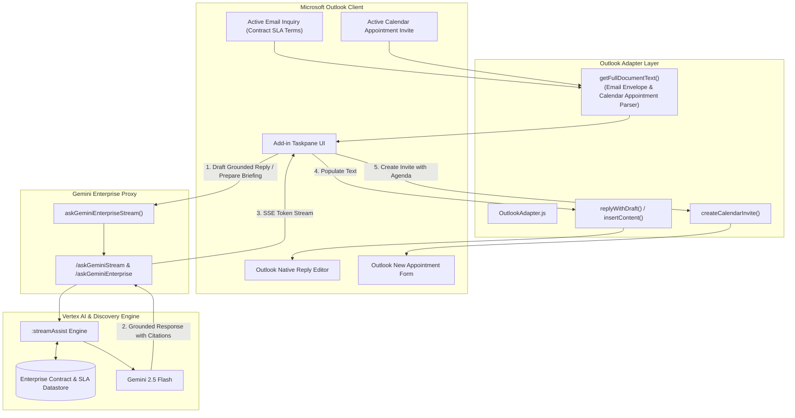

# 0001: Grounded Smart Reply Drafter & Meeting Agenda Briefing Prep for Outlook Add-in

*   **Status**: accepted
*   **Date**: 2026-08-30
*   **Deciders**: veeravigneshk
*   **Shortlink**: [go/gemini-o365-adr-0001](https://goto.google.com/gemini-o365-adr-0001)

## Context and Problem Statement

Customer Success Representatives and Meeting Hosts operating within Microsoft Outlook require enterprise-grade AI capabilities to draft legally accurate, SLA-grounded responses to customer inquiries (`[OUT-02]`) and prepare contextual meeting briefings and agendas from calendar invites and email threads (`[OUT-03]`).

Without grounding against enterprise contract data stores, generative AI models risk hallucinating SLA metrics, response windows, penalty terms, and commitment clauses. Furthermore, preparing meeting agendas manually from scattered email conversations and calendar invite metadata causes preparation toil and poorly structured meetings. The Outlook Add-in must integrate seamlessly with Vertex AI Search and Discovery Engine `:streamAssist` grounding endpoints, ingest both email threads and calendar appointment envelopes, and populate drafts directly into native Outlook compose and appointment forms.

## Decision Drivers

*   **Zero Hallucination on Contract SLA Terms (`[OUT-02]`):** Customer success replies must cite exact clauses, verified turnaround commitments, and contract terms from the enterprise data store.
*   **Multimodal Outlook Context Ingestion (`[OUT-03]`):** Support both email threads (`item.itemType === 'message'`) and calendar appointments (`item.itemType === 'appointment'`) including organizer, start/end dates, location, and attendee lists.
*   **Seamless Office.js Integration:** One-click population into Outlook reply editors (`replyWithDraft` / `displayReplyAllForm` / `insertContent`) and calendar appointment creators (`createCalendarInvite`).
*   **Polymorphic Host Architecture:** Maintain strict isolation in `OutlookAdapter.js` without regressing Word, PowerPoint, or Excel functionality.
*   **Responsive Streaming UX:** Progressive Server-Sent Events (SSE) token streaming via `askGeminiEnterpriseStream` with per-tab history isolation.

## Considered Options

*   **Option 1 (Chosen)**: Native StreamAssist Grounded Reply & Calendar Appointment Envelope Ingestion in `OutlookAdapter.js` and `taskpane.js`
*   **Option 2**: Client-Side Regex Extraction with Static Templates and Non-Grounded Model Inference
*   **Option 3**: Standalone Web Portal / External Iframe Workflow

## Decision Outcome

Chosen Option: **Option 1 (Native StreamAssist Grounded Reply & Calendar Appointment Envelope Ingestion in `OutlookAdapter.js` and `taskpane.js`)**, because it directly integrates with Google Cloud Discovery Engine `:streamAssist` / Vertex AI Search datastores while providing native Office.js Mailbox API lifecycle integration.

### Pros and Cons of the Options

#### Option 1: Native StreamAssist Grounded Reply & Calendar Appointment Envelope Ingestion (Chosen)
*   **Good, because** queries Vertex AI Search / Discovery Engine datastores with `enableGrounding: true` to cite exact contract clauses and terms.
*   **Good, because** extends `OutlookAdapter.getFullDocumentText()` to automatically detect and parse calendar appointment metadata (organizer, attendees, start/end times, location).
*   **Good, because** provides one-click action buttons to populate Outlook reply forms (`displayReplyAllForm` / `displayReplyForm`) and create calendar invites (`displayNewAppointmentForm`).
*   **Good, because** uses Server-Sent Events (SSE) streaming with tab-level history isolation, eliminating duplicate loading text and HTTP 413 payload inflation.
*   **Bad, because** requires active network connection to Google Cloud proxy and configured Vertex AI datastore permissions.

#### Option 2: Client-Side Regex Extraction with Static Templates (Rejected)
*   **Good, because** zero backend dependency and offline operation.
*   **Bad, because** cannot retrieve enterprise contract terms or knowledge not present in the immediate email body.
*   **Bad, because** high hallucination risk when answering SLA or contract questions.
*   **Why Rejected**: Fails the primary acceptance criteria for `[OUT-02]` (grounding against contract data store via `:streamAssist`).

#### Option 3: Standalone Web Portal / External Iframe (Rejected)
*   **Good, because** decouples UI from Office.js framework.
*   **Bad, because** poor user experience requiring manual copy-pasting between browser windows.
*   **Bad, because** cannot access active email selection, compose body, or Outlook calendar APIs directly.
*   **Why Rejected**: Violates user journey requirements for in-add-in execution and direct editor population.

## Confirmation & Verification Strategy

How this decision is verified and enforced across the codebase:

- **Verification Tests**: Run automated test suite via `node --test tests/outlook.test.mjs` verifying:
  - `UT-1`: Profile name and email extraction with fallback parsing.
  - `UT-2`: Forward draft with empty `toRecipients`.
  - `UT-3`: Reply draft defaulting to `replyAll = true`.
  - `UT-4`: 15-turn thread segmentation.
  - `UT-5`: Coach response delimiter parsing.
  - `UT-7` (New): Grounded reply prompt construction citing SLA terms and contract data store.
  - `UT-8` (New): Calendar appointment context extraction in `OutlookAdapter.getFullDocumentText()`.
  - `IT-1` to `IT-7`: UI conformance, button bindings, meeting briefing execution, and reply editor population.
- **Static Analysis & Linter**: Ensure zero syntax errors, type errors, or unhandled promises in `OutlookAdapter.js`, `taskpane.js`, and `taskpane.html`.
- **Presubmit Checks**: Ensure zero regressions on non-Outlook hosts (Word, Excel, PowerPoint).

## Architecture Diagram

## Consequences

### Positive

-   **Deterministic SLA Accuracy**: Replies cite verified contract clauses and agreement terms directly from enterprise datastores.
-   **Automated Meeting Preparedness**: Hosts and attendees receive structured agendas with background context in seconds.
-   **Native Integration**: Zero-friction draft population into Outlook reply editors and calendar forms.
-   **Preserved Modularity**: Outlook-specific changes remain strictly encapsulated within Outlook adapters and taskpane controllers.

### Negative

-   Requires configured `VERTEX_DATASTORE_ID` / `GEMINI_ENTERPRISE_APP_ID` in Google Cloud environment for full RAG retrieval.

### Risks & Mitigations

-   **Risk**: Calendar appointments in Outlook Web vs Desktop may have varying property availability (`item.organizer` vs `item.from`, sync vs async).
    -   **Mitigation**: `OutlookAdapter.js` implements comprehensive property checking with fallbacks to `item.organizer`, `item.from`, `item.requiredAttendees`, `item.to`, and async getters.
-   **Risk**: Grounded replies might accidentally sign off with the customer's name.
    -   **Mitigation**: Prompt explicitly grounds `sender.displayName` vs `currentUser.displayName` with strict negative constraint enforcement.
