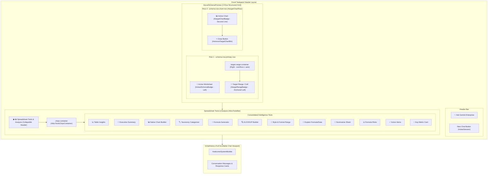

# 0002: Excel Taskpane Header Chip Layout Refactor and Quick Actions Consolidation

*   **Status**: accepted
*   **Date**: 2026-09-14
*   **Deciders**: schiele
*   **Shortlink**: [go/gemini-o365-adr-0002](https://goto.google.com/gemini-o365-adr-0002)

## Context and Problem Statement

The Microsoft Excel Add-in taskpane provides real-time contextual awareness of user selection (active worksheet name, target cell/range coordinates, and locked chart objects) alongside instant AI intelligence tools.

Previously, the header chips (`#sheetSchemaBadge`, `#targetRangeBadge`, and `#targetChartBadge`) shared an unconstrained flex container with simple flex-wrapping. When range coordinates were lengthy (e.g., multi-cell selections like `Sheet1!A1:Z500`), the chips would wrap inconsistently across three rows, pushing primary chat interactions below the fold.

Additionally, the interface rendered a standalone yellow Quick Actions box (`#selectionToolbar`) inside the chat container that duplicated the quick action chips available in the collapsible "Spreadsheet Tools & Analysis" panel (`#docToolsBar`). This redundancy caused visual clutter, duplicated DOM updates, and fragmented the user experience between two separate tool bars.

## Decision Drivers

*   **Predictable Header Geometry:** Ensure the contextual preview bar is strictly structured into a deterministic 2-row layout:
    *   **Row 1 (Primary Context):** Active Worksheet chip positioned on the left; Target Cell/Range chip positioned on the right, anchored left within its allocated space, and horizontally scrollable for long range references.
    *   **Row 2 (Target Chart Context):** Sticky selected chart chip rendered directly below Row 1 on the second line when a chart is active or locked.
*   **Zero UI Redundancy:** Remove the duplicate yellow Quick Actions box from the chat container to maximize vertical chat history viewport real estate.
*   **Comprehensive Tooling in Analysis Panel:** Consolidate all quick action capabilities (Table Insights, Executive Summary, Native Chart Builder, Taxonomy Categorizer, Formula Generator, XLOOKUP Builder, Style & Format Range, Explain Formula/Data, Summarize Sheet, Formula Risks, Action Items, Key Metric Card) into the collapsible "Spreadsheet Tools & Analysis" panel.
*   **Context-Aware Chip Execution:** Ensure tools executed from the "Spreadsheet Tools & Analysis" panel automatically ingest both active selection context and worksheet context.

## Considered Options

*   **Option 1 (Chosen): Structured 2-Row Schema Preview Header & Consolidated Spreadsheet Tools Panel**
    *   Implement `.schema-row.primary-row` holding `#sheetSchemaBadge` (left, fixed width) and `.target-range-container` (right, flex-1, `overflow-x: auto; white-space: nowrap;`).
    *   Implement `.schema-row.chart-row` holding `#targetChartBadge` as a second row directly beneath Row 1 when a chart is selected.
    *   Remove `#selectionToolbar` from DOM entirely.
    *   Enrich `docChips` in `chips.js` with complete selection and sheet tools (`chipFormatRange`, `chipExplainFormula`, etc.).
*   **Option 2: Unconstrained Flex-Wrap with Floating Quick Action Pill**
    *   Allow standard CSS wrapping across dynamic rows with floating Quick Action overlays.
    *   *Drawbacks:* Inconsistent vertical height jumps when selecting varying range lengths; floating overlays obscure active assistant responses.
*   **Option 3: Tabbed Sub-Panels for Selection vs Sheet Actions**
    *   Split the taskpane into distinct "Selection" and "Sheet" navigation tabs.
    *   *Drawbacks:* Adds cognitive overhead, requires extra clicks to switch contexts, and fragments chat conversation history.

## Decision Outcome

Chosen Option: **Option 1**, because it establishes a deterministic, elegant 2-row header layout that handles arbitrary range address lengths gracefully while eliminating redundant UI elements and centralizing all spreadsheet intelligence tools into a single expandable panel.

### Pros and Cons of the Options

#### Option 1: Structured 2-Row Header & Consolidated Analysis Tools (Chosen)
*   **Good, because** guarantees Worksheet (left) and Target Cell (right) remain on Row 1 at all times.
*   **Good, because** long cell ranges expand and scroll horizontally without wrapping or distorting taskpane height.
*   **Good, because** chart target chip appears neatly on Row 2 directly below Row 1 only when active.
*   **Good, because** eliminates duplicate yellow Quick Actions box and frees up full scroll buffer for conversation history.
*   **Good, because** unifies all spreadsheet tools in one collapsible header drawer with full selection and document context awareness.
*   **Bad, because** requires horizontal scrolling or tooltip inspection for exceptionally long multi-range addresses.

#### Option 2: Unconstrained Flex-Wrap with Floating Pill (Rejected)
*   **Good, because** simple implementation.
*   **Bad, because** causes 3-row layout jumps and clips chat bubbles.
*   **Why Rejected**: Fails predictability and layout stability requirements.

#### Option 3: Tabbed Sub-Panels (Rejected)
*   **Good, because** separates concerns into distinct views.
*   **Bad, because** increases interaction friction and hides conversation context.
*   **Why Rejected**: Violates seamless pair-programming design goals of the assistant.

## Confirmation & Verification Strategy

- **Automated Layout Tests (`tests/excel.test.mjs`)**:
  - `UT-31`: Conformance test verifying `#excelSchemaPreview` contains `.primary-row` (with `#sheetSchemaBadge` left, `#targetRangeBadge` right) and `.chart-row` (with `#targetChartBadge` row 2), and verifying absence of `#selectionToolbar`.
  - `UT-32`: Tooling completeness test verifying all quick actions (`docChips`) include Insights, Exec Summary, Chart Builder, Taxonomy Categorizer, Formula Generator, XLOOKUP, Style & Format Range, Explain Formula, Summarize, Formula Risks, Action Items, and Key Metric Card.
  - `UT-33`: Horizontal scroll buffer and CSS style verification.
  - `UT-34`: Session reset and chart target dismissal test.
- **Production Build & Compilation**:
  - Run `npm run build` and verify 0 Webpack errors.
  - Run `npm run test:excel` and `npm run test:outlook` ensuring 100% test pass rate.

## Architecture Diagram

## Consequences

### Positive
- Strict, clean 2-row header alignment regardless of range coordinate length.
- Maximized vertical chat history space by removing the redundant yellow Quick Actions box.
- Unified single access point for all spreadsheet analysis and generation tools.
- Preserved selection-aware workflow execution when triggering tools from the analysis drawer.

### Negative
- Users who relied exclusively on the yellow box within the chat viewport now access tools via the "Spreadsheet Tools & Analysis" bar directly above the chat.

### Risks & Mitigations
- **Risk**: Users might not discover tools if the "Spreadsheet Tools & Analysis" bar is collapsed by default.
  - **Mitigation**: The title bar clearly displays "📊 Spreadsheet Tools & Analysis", includes an intuitive expand/collapse toggle icon (`▶` / `▼`), and provides keyboard accessibility (`Enter`/`Space`).
