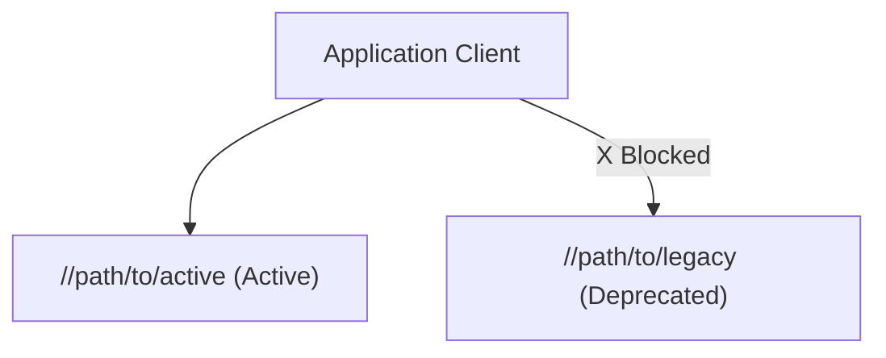

# NNNN: [Short Title of Decision]

*   **Status**: proposed | accepted | deprecated | superseded by [NNNN]
*   **Date**: YYYY-MM-DD
*   **Deciders**: [LDAPs / handles]
*   **Shortlink**: [go/link-placeholder]

## Context and Problem Statement

[2-5 sentences describing the current situation, technical constraints, anti-patterns, or forces motivating this change.]

## Decision Drivers

*   [Driver 1]
*   [Driver 2]
*   [Driver 3]

## Considered Options

*   **Option 1 (Chosen)**: [Short description]
*   **Option 2**: [Short description]
*   **Option 3**: [Short description]

## Decision Outcome

Chosen Option: **Option 1**, because [short rationale highlighting key drivers].

### Pros and Cons of the Options

#### Option 1: [Chosen Option Name]
*   **Good, because** [benefit 1]
*   **Good, because** [benefit 2]
*   **Bad, because** [trade-off 1]

#### Option 2: [Alternative Option Name]
*   **Good, because** [benefit 1]
*   **Bad, because** [drawback 1]
*   **Why Rejected**: [specific reason]

## Confirmation & Verification Strategy

How will this decision be verified and enforced across the codebase?

- **Presubmit Checks**: [Checks to run]
- **Build Visibility**: [Visibility controls]
- **Verification Tests**: [Test suite targets]
- **Migration Path**: [Migration notes]

## Architecture Diagram

## Consequences

### Positive

-   [Benefit 1]
-   [Benefit 2]

### Negative

-   [Trade-off 1]

### Risks & Mitigations

-   **Risk**: [Potential failure mode]
    -   **Mitigation**: [How it is prevented]
