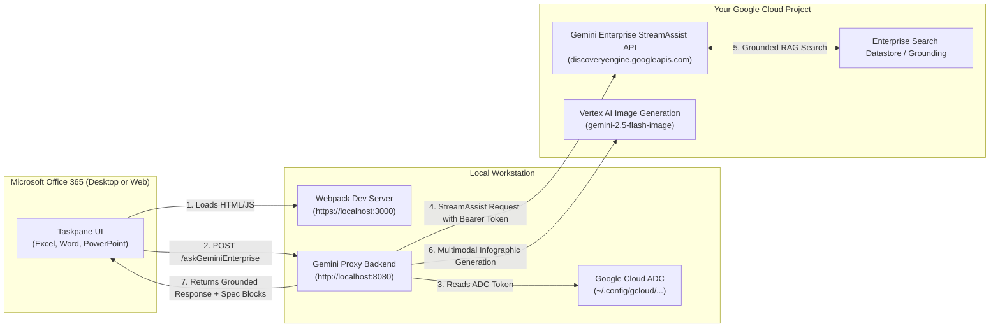

# Local Development & Testing Guide: Application Default Credentials (ADC)

This guide provides step-by-step instructions for engineers, architects, and developers who want to run and test the **Gemini for Microsoft Office 365 Add-in** locally on their machine using **Google Cloud Application Default Credentials (ADC)** against their own **Google Cloud Project** and **Gemini Enterprise (Discovery Engine) App**.

---

## 📋 Table of Contents

1. [Architecture & Local Flow](#-architecture--local-flow)
2. [Prerequisites](#-prerequisites)
3. [Step 1: Google Cloud ADC & Project Setup](#-step-1-google-cloud-adc--project-setup)
4. [Step 2: Retrieve Gemini Enterprise App Details](#-step-2-retrieve-gemini-enterprise-app-details)
5. [Step 3: Configure and Start Gemini Proxy Backend](#-step-3-configure-and-start-gemini-proxy-backend)
6. [Step 4: Configure and Start Add-In Frontend](#-step-4-configure-and-start-add-in-frontend)
7. [Step 5: Sideload Add-In Manifest in Microsoft Office](#-step-5-sideload-add-in-manifest-in-microsoft-office)
8. [Step 6: End-to-End Testing Matrix](#-step-6-end-to-end-testing-matrix)
9. [Troubleshooting & FAQs](#-troubleshooting--faqs)

---

## 🏗️ Architecture & Local Flow

In local development mode, you run two lightweight local services without needing cloud deployments or Microsoft Entra ID SSO configurations:



---

## 🧰 Prerequisites

Before starting, ensure your workstation has:

1. **Node.js**: `v18.x` or `v20.x` LTS installed (`node -v` and `npm -v`).
2. **Google Cloud CLI (`gcloud`)**: Installed and updated (`gcloud --version`).
3. **Google Cloud Permissions**: An active GCP account with access to your target project and the following IAM roles:
   - `Discovery Engine Admin` or `Discovery Engine Editor` / `Discovery Engine Viewer`
   - `Vertex AI User`
4. **Microsoft Office Mac OS Desktop App** (Word, PowerPoint, Excel).
   - **Note**: You cannot test with the Web alternatives (excel.cloud.microsoft, word.cloud.microsoft or powerpoint.cloud.microsoft) for Local ADC based deployment as the askGeminiEnterprise proxy runs locally on your machine.

---

## 🔑 Step 1: Google Cloud ADC & Project Setup

Application Default Credentials (ADC) allow the local backend proxy to authenticate to Google Cloud APIs seamlessly using your personal user credentials.

1. **Log in to the Google Cloud CLI**:
   ```bash
   gcloud auth login
   ```

2. **Generate local Application Default Credentials (ADC)**:
   ```bash
   gcloud auth application-default login
   ```
   > [!NOTE]
   > This opens a browser window requesting access to your Google Cloud account and saves credentials to `~/.config/gcloud/application_default_credentials.json` (macOS/Linux) or `%APPDATA%\gcloud\application_default_credentials.json` (Windows).

3. **Set your active GCP project**:
   ```bash
   export GCP_PROJECT_ID="your-target-gcp-project-id"
   gcloud config set project $GCP_PROJECT_ID
   gcloud auth application-default set-quota-project $GCP_PROJECT_ID
   ```

4. **Verify enabled Google Cloud APIs**:
   Ensure the required services are enabled in your project:
   ```bash
   gcloud services enable \
     discoveryengine.googleapis.com \
     aiplatform.googleapis.com
   ```

---

## 🔍 Step 2: Retrieve Gemini Enterprise App Details

To connect the add-in to your Gemini Enterprise assistant, retrieve your App ID and location settings from the Google Cloud Console:

1. Navigate to the **Google Cloud Console**: [https://console.cloud.google.com](https://console.cloud.google.com).
2. Ensure your target project is selected in the top project picker.
3. Open **Gemini Enterprise**.
4. Click the **Apps** menu on the left pannel.
5. Locate your Gemini Enterprise App and copy the **App ID** (in the **ID** column):
   - Example format: `my-enterprise-search-app_1787603883211`.
6. Note your configuration parameters:
   - **Project ID**: e.g., `my-company-genai-prod`
   - **App ID**: e.g., `company-knowledge-engine_12345678`
   - **Location**: Typically `global` (or regional e.g. `us-central1`).
   - **Collection ID**: Default is `default_collection`.
   - **Assistant ID**: Default is `default_assistant`.

---

## ⚙️ Step 3: Configure and Start Gemini Proxy Backend

The backend proxy sits in [`geminiproxy/`](file:///Users/ravindranv/Code-Local/For-Excel-GE-Add-In/merge-excel-staging/gemini-for-office-365/geminiproxy) and translates add-in requests into grounded `streamAssist` and Vertex AI calls.

1. Navigate to the `geminiproxy` directory:
   ```bash
   cd geminiproxy
   ```

2. Create your `.env` by making a copy of `.env.example`:
   ```bash
   cp .env.example .env
   ```

3. Edit `.env` with your project and app details:
   ```env
   # Backend Execution Mode
   BACKEND_MODE=streamassist

   # Your Google Cloud Project Configuration
   GE_GCP_PROJECT_ID=your-target-gcp-project-id
   GCP_PROJECT_ID=your-target-gcp-project-id
   GCP_REGION=us-central1
   GCP_LOCATION=global
   STREAM_ASSIST_ENDPOINT_LOCATION=global

   # Your Gemini Enterprise (Discovery Engine) App ID
   GEMINI_ENTERPRISE_APP_ID=your-gemini-enterprise-app-id
   GEMINI_ENTERPRISE_COLLECTION_ID=default_collection
   GEMINI_ENTERPRISE_ASSISTANT_ID=default_assistant

   # Models
   GEMINI_MODEL=gemini-2.5-flash
   GEMINI_IMAGE_MODEL=gemini-2.5-flash-image

   # Authentication Mode for Local ADC Testing
   USER_AUTH_MODE=local_adc
   REQUIRE_ENTRA_AUTH=false
   ALLOW_SERVICE_ACCOUNT_FALLBACK=true

   # Server Port
   PORT=8080
   ```

4. Install Node.js dependencies:
   ```bash
   npm install
   ```

5. Start the local backend proxy:
   ```bash
   npm run dev
   ```
   You should see:
   ```
   Gemini Enterprise Proxy HTTP Server running on port 8080
   ```

---

## 💻 Step 4: Configure and Start Add-In Frontend

The Office Add-in UI sits in [`microsoft-addin/`](../../microsoft-addin).

1. In a new terminal window, navigate to `microsoft-addin`:
   ```bash
   cd microsoft-addin
   ```

2. Create your local `.env` file:
   ```bash
   cp .env.example .env
   ```

3. Verify `.env` points to your local proxy:
   ```env
   GEMINI_PROXY_URL=http://localhost:8080/askGeminiEnterprise
   PORT=3000
   ```

4. Install dependencies:
   ```bash
   npm install
   ```

5. Install local SSL certificates (Office Add-ins require HTTPS on `localhost:3000`):
   ```bash
   npx office-addin-dev-certs install
   ```
   *(Select **Yes** if your OS prompts to trust the development certificate).*

6. Start the Webpack development server:
   ```bash
   npm run dev-server
   ```
   You should see:
   ```
   [webpack-dev-server] Project is running at: https://localhost:3000/
   webpack compiled successfully
   ```

---

## 📄 Step 5: Sideload Add-In Manifest in Microsoft Office

To load the add-in to your Mac OS Microsoft Office 365 app, you need to register the local manifest [`manifest-dev.xml`](../../manifest-dev.xml).

### Option A: Mac OS Sideloading (Automated Script)

1. From the repository root, run the macOS sideload script:
   ```bash
   ./scripts/sideload_mac.sh manifest-dev.xml
   ```
   This script copies the manifest into the Office sandbox directories:
   - `~/Library/Containers/com.microsoft.Excel/Data/Documents/wef/`
   - `~/Library/Containers/com.microsoft.Word/Data/Documents/wef/`
   - `~/Library/Containers/com.microsoft.Powerpoint/Data/Documents/wef/`
2. Quit and restart **Excel**, **Word**, or **PowerPoint** on your Mac.
3. Open any document or workbook.
4. On the **Home** tab ribbon, click **Gemini Enterprise (Local Dev)**.

---

### Option B: Windows Sideloading (Shared Folder Catalog)

1. Share a local folder on your Windows PC (e.g. `C:\OfficeManifests`).
2. Copy `manifest-dev.xml` into that folder.
3. In Excel/Word/PowerPoint: go to **File** ➔ **Options** ➔ **Trust Center** ➔ **Trust Center Settings** ➔ **Trusted Add-in Catalogs**.
4. Add the network path (e.g. `\\localhost\OfficeManifests`) and check **Show in Menu**.
5. Restart Office, go to **Insert** ➔ **My Add-ins** ➔ **Shared Folder**, and insert the add-in.

---

## 🛠️ Troubleshooting & FAQs

### 1. `403 Forbidden` / `Authentication Failed`
- **Cause**: ADC token expired or target GCP project lacks Discovery Engine permissions.
- **Fix**: Re-authenticate:
  ```bash
  gcloud auth application-default login
  gcloud auth application-default set-quota-project YOUR_GCP_PROJECT_ID
  ```

### 2. `404 Not Found: Engine or App does not exist`
- **Cause**: `GEMINI_ENTERPRISE_APP_ID` in `geminiproxy/.env` does not match the App ID in GCP.
- **Fix**: Check `geminiproxy/.env` and ensure `GEMINI_ENTERPRISE_APP_ID` matches the exact App ID in Agent Builder Console. Ensure `GCP_LOCATION=global` (or regional if created in a specific region).

### 3. Taskpane Shows Blank White Screen or HTTPS Certificate Error
- **Cause**: Browser / Office webview has not trusted the local development SSL certificate.
- **Fix**:
  1. Open Chrome/Safari/Edge and navigate to `https://localhost:3000/taskpane.html`.
  2. If a certificate warning appears, click **Advanced ➔ Proceed to localhost (unsafe)** to trust it.
  3. Re-run: `npx office-addin-dev-certs install` in `microsoft-addin/`.

### 4. Clearing Office Add-in Cache
If previous changes or older versions of the taskpane remain cached:
- **Mac OS**:
  ```bash
  rm -rf ~/Library/Containers/com.microsoft.Excel/Data/Library/Caches/*
  rm -rf ~/Library/Containers/com.microsoft.Word/Data/Library/Caches/*
  rm -rf ~/Library/Containers/com.microsoft.Powerpoint/Data/Library/Caches/*
  ```
- **Windows**: Delete contents of `%LOCALAPPDATA%\Microsoft\Office\16.0\Wef\`.

---

## 📚 Related Documentation

- [System Design & Architecture Guide](../architecture/system-design.md)
- [Cloud Run Master Deployment Guide](../deployment/cloud-run-deployment-guide.md)
- [Developer Architecture & Security Guide](../architecture/developer-architecture-guide.md)
- [Excel Feature Specifications](../specs/excel/)
