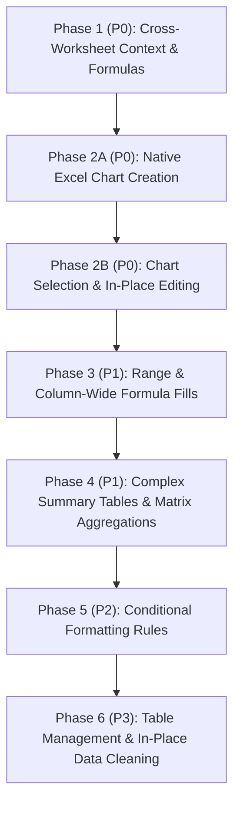

# Plan: Excel Agent Capabilities Review & Prioritized Feature Roadmap

## 1. Executive Summary & Objective

This document provides a comprehensive technical review of the current Microsoft Excel add-in agent implementation ([`microsoft-addin/src/adapters/ExcelAdapter.js`](../../microsoft-addin/src/adapters/ExcelAdapter.js), [`microsoft-addin/src/taskpanes/excel/`](../../microsoft-addin/src/taskpanes/excel/), and [`geminiproxy/index.js`](../../geminiproxy/index.js)).

The objective is to:
1. **Catalog current capabilities:** Review what context is extracted from the spreadsheet and list all basic formula, calculation, and data tasks the agent can perform today.
2. **Identify capability gaps:** Detail essential spreadsheet tasks that the agent does *not* do yet (e.g., native Excel chart creation, cross-worksheet formulas, multi-cell formula propagation, and complex dynamic array summary tables).
3. **Establish a prioritized roadmap:** Define a structured, phased implementation plan (P0 to P3) strictly focusing on generating formulas, visuals, and content grounded in workbook context and native Excel behavior.

---

## 2. Review of Current Architecture & State

### 2.1 Context Learning & Schema Extraction Pipeline
Current spreadsheet context is harvested natively via Office.js in [`ExcelAdapter.js`](../../microsoft-addin/src/adapters/ExcelAdapter.js):

* **Worksheet Schema Discovery ([`getWorksheetSchema`](../../microsoft-addin/src/adapters/ExcelAdapter.js#L122-L198)):**
  * Identifies the active sheet name, `usedRange` address bounds (e.g. `A1:F120`), total row count, and column count.
  * Maps 0-indexed column indices to Excel column letters (`0 -> A`, `2 -> C`, `26 -> AA`) via [`columnIndexToLetter()`](../../microsoft-addin/src/adapters/ExcelAdapter.js#L16-L26).
  * Extracts column header names from the top row and samples up to 3 non-empty values per column to give the model type awareness (e.g., dates, currencies, category labels).
  * Extracts existing named Excel Tables (`sheet.tables`) and captures the top 5 sample rows for tabular preview.
* **Structured Prompt Formatting ([`formatSchemaForPrompt`](../../microsoft-addin/src/adapters/ExcelAdapter.js#L206-L245)):**
  * Compiles column schemas into an LLM-readable manifest:
    ```text
    Worksheet: "Sales_Q1" | Used Range: A1:F100
    Target Cell for Formula / Output: E2

    Column Schema (Letter -> Header -> Sample Data):
    - Column A (A:A): "OrderID" (Samples: 1001, 1002, 1003)
    - Column B (B:B): "Region" (Samples: North, South, East)
    - Column C (C:C): "Revenue" (Samples: 1250, 840, 2100)
    - Column D (D:D): "Status" (Samples: Approved, Pending, Rejected)

    Formula Generation Instructions:
    1. Return the exact Excel formula starting with '=' (e.g. =SUMIFS(C:C, D:D, "Approved")).
    2. Use standard Excel functions (SUMIFS, COUNTIFS, AVERAGEIFS, XLOOKUP, INDEX/MATCH, IF, IFS).
    3. Wrap string criteria inside double quotes ("Approved").
    4. Reference the correct column letters based on the Column Schema.
    ```
* **Selection Context ([`getSelectedText`](../../microsoft-addin/src/adapters/ExcelAdapter.js#L252-L304)):**
  * For single cells: captures target cell coordinates, current content/formula, and attaches full sheet schema.
  * For multi-cell ranges: captures range dimensions, column span (`B:D`), truncated sample matrix, and schema.

### 2.2 Formula Sanitization & Native Injection Engine
* **Normalization ([`normalizeFormula`](../../microsoft-addin/src/adapters/ExcelAdapter.js#L37-L58)):**
  * Ensures a leading `=`.
  * Strips accidental trailing punctuation (periods, semicolons).
  * Converts single-quoted criteria literals to double quotes (`'Approved'` $\rightarrow$ `"Approved"`) while preserving single quotes for sheet names (e.g., `'Q1 Sales'!A1`).
* **Multi-tier Extraction ([`extractExcelFormula`](../../microsoft-addin/src/adapters/ExcelAdapter.js#L67-L109)):**
  * Parses formulas from markdown code blocks (` ```excel =SUMIFS(...) ``` `), inline code backticks (`` `=XLOOKUP(...)` ``), standalone lines, and standard function signatures.
* **Native Excel Execution ([`insertContent`](../../microsoft-addin/src/adapters/ExcelAdapter.js#L341-L483)):**
  * **Priority 1 (Formulas):** Writes `targetCell.formulas = [[detectedFormula]]` to trigger native Excel calculation engine evaluation.
  * **Priority 2 (Tables/Matrices):** Normalizes markdown tables into 2D rectangular matrices, applies `#0078d4` header styling, bold fonts, and executes `autofitColumns()`.
  * **Priority 3 (Text/KPI Cards):** Injects formatted summary rows and executive callout text.
* **In-Cell Interaction ([`checkInDocumentCommands`](../../microsoft-addin/src/adapters/ExcelAdapter.js#L485-L587)):**
  * Listens for `@gemini <prompt>` inside worksheet cells, shows temporary placeholder `⚡ [Gemini generating formula...]`, evaluates via Gemini Enterprise, and writes back the resulting formula or text.

---

## 3. Current Agent Capabilities (Tasks It Can Do Today)

Based on the implemented schema context and formula normalization, the agent is currently capable of executing:

* **1. Conditional Multi-Criteria Aggregations:**
  * Summing by condition (e.g., `=SUMIFS(C:C, D:D, "Approved", B:B, "North")`).
  * Counting by condition (e.g., `=COUNTIFS(D:D, "Pending", C:C, ">1000")`).
  * Averaging by condition (e.g., `=AVERAGEIFS(C:C, B:B, "East")`).
* **2. Standard Mathematical & Statistical Formulas:**
  * Basic aggregations: `SUM`, `AVERAGE`, `MIN`, `MAX`, `MEDIAN`, `STDEV.S`, `LARGE`, `SMALL`.
  * Rounding and thresholds: `ROUND`, `ROUNDUP`, `ROUNDDOWN`, `CEILING`, `FLOOR`.
  * Row counting: `COUNT`, `COUNTA`, `COUNTBLANK`.
* **3. Lookups, Joins & Key Matching (Within Active Sheet):**
  * Modern lookups: `=XLOOKUP(A2, A:A, C:C, "Not Found", 0)`.
  * Index/Match pairs: `=INDEX(C:C, MATCH(A2, A:A, 0))`.
  * Legacy lookups: `VLOOKUP`, `HLOOKUP`.
* **4. Logical Decision Trees & Branching:**
  * Conditional branching: `IF`, `IFS`, `SWITCH`.
  * Boolean logic: `AND`, `OR`, `NOT`, `XOR`.
  * Error trapping: `IFERROR`, `IFNA`, `ISBLANK`, `ISNUMBER`, `ISTEXT`.
* **5. Text Manipulation & Data Normalization Formulas:**
  * String concatenation: `TEXTJOIN(", ", TRUE, A2:C2)`, `CONCATENATE`, `&`.
  * Text extraction and trimming: `TRIM`, `CLEAN`, `LEFT`, `RIGHT`, `MID`, `LEN`.
  * Case conversion: `UPPER`, `LOWER`, `PROPER`.
  * Search and replace: `SUBSTITUTE`, `REPLACE`, `FIND`, `SEARCH`.
* **6. Date & Time Calculations:**
  * Date intervals: `DATEDIF(A2, B2, "d")`, `NETWORKDAYS(A2, B2)`.
  * Month/Year offsets: `EDATE(A2, 1)`, `EOMONTH(A2, 0)`.
  * Dynamic date extraction: `YEAR(A2)`, `MONTH(A2)`, `DAY(A2)`, `TODAY()`, `NOW()`.
* **7. Modern Dynamic Array Formulas (Within Sheet):**
  * Filtering records: `=FILTER(A:D, D:D="Approved", "No matches")`.
  * Deduplication & sorting: `=UNIQUE(B:B)`, `=SORT(UNIQUE(B2:B100))`, `=SORTBY(A2:C50, C2:C50, -1)`.
  * Local variables: `=LET(rev, C2:C100, cost, D2:D100, SUM(rev - cost))`.
* **8. Spreadsheet Explanation & Anomaly Diagnostics:**
  * Explaining existing formulas step-by-step in plain English.
  * Scanning active sheet data for `#N/A`, `#VALUE!`, `#REF!`, inconsistent data types, and duplicate rows.
* **9. Structured Data Generation & In-Cell Workflows:**
  * Generating formatted tabular comparisons and injecting them starting at the active cell.
  * Direct in-cell execution via `@gemini <prompt>` triggers.

---

## 4. Capability Gap Analysis (What It Does NOT Do Yet)

| Feature Area | Current State | Missing Capability | Impact / Limitation |
| :--- | :--- | :--- | :--- |
| **Native Excel Charts** | Taskpane generates and inserts native Office.js chart objects from multi-range data | Full chart creation implemented | Cannot yet modify or reconfigure charts once created on the sheet. |
| **Chart Selection & Editing** | Target indicator only tracks cell and range selections | Detecting active chart selection (`getActiveChartOrNullObject`), displaying chart target chips with Chart ID/Title, and in-place editing (changing chart type, titles, series, axes, formatting) | Users cannot select a chart and ask Gemini to modify it (e.g. "Change this to a doughnut chart", "Add percentage labels", "Update title"). |
| **Multi-Worksheet Intelligence** | Only inspects `context.workbook.worksheets.getActiveWorksheet()` | Inspecting all workbook sheets and creating cross-sheet formulas (`='Q1 Data'!C:C`) | Cannot build consolidation sheets, summary dashboards, or cross-tab lookups. |
| **Multi-Cell Formula Fill** | Injects formula only to the single top-left cell (`range.rowIndex, range.columnIndex`) | Populating an entire column or selected range (e.g., applying `=C2*D2` down `E2:E500` with relative indexing) | Users must manually double-click or drag the fill handle in Excel after formula generation. |
| **Complex Summary / Pivot Tables** | Generates static markdown tables or single-cell formulas | Generating dynamic multi-column summary rollups with category breakdown, sub-totals, and grand totals | Lacks automated creation of executive pivot-like summaries from raw transactional data. |
| **Conditional Formatting** | No conditional formatting support in adapter | Adding color scales, data bars, highlight rules, or custom formula conditions via Office.js | Cannot visually flag outliers, KPI thresholds, or overdue rows automatically. |
| **Range Data Transformations** | Formats only via markdown insertion | In-place transformations: trim whitespace, parse text-to-dates, convert text numbers to floats, remove duplicates | Users must write manual formulas to clean dirty data in existing columns. |
| **Excel Table (`ListObject`) Creation** | Reads existing `sheet.tables` | Creating new formatted Excel Tables (`sheet.tables.add(range, true)`) and Named Ranges | Cannot automatically convert raw data ranges into structured tables with total rows. |
| **Formula Pre-flight Dry Run** | Formula is injected directly without testing | Validating formula calculation result and checking for errors before writing to sheet | Syntax errors or invalid references result in `#NAME?` or `#VALUE!` on the sheet. |

---

## 5. Prioritized Feature Roadmap



---

### Phase 1: Cross-Worksheet Context & Formulas (Priority: P0)
**Goal:** Enable multi-tab workbook awareness so Gemini can write formulas referencing other sheets (e.g., `=SUMIFS('Q1 Orders'!D:D, 'Q1 Orders'!B:B, A2)`).

* **Architecture & Code Changes:**
  1. Update [`ExcelAdapter.getWorksheetSchema()`](../../microsoft-addin/src/adapters/ExcelAdapter.js#L122):
     * Load all worksheets: `context.workbook.worksheets.load("items/name, items/position")`.
     * Extract lightweight schemas (name, used range, column headers) for each sheet in the workbook.
  2. Update [`ExcelAdapter.formatSchemaForPrompt()`](../../microsoft-addin/src/adapters/ExcelAdapter.js#L206):
     * Output multi-sheet structure:
       ```text
       Active Sheet: "Summary" | Target Cell: B2
       Workbook Worksheets & Columns:
       1. Sheet 'Summary' (Active): [Category (A:A), Total Revenue (B:B)]
       2. Sheet 'Transactions_2026': [TxID (A:A), Date (B:B), Category (C:C), Amount (D:D), Status (E:E)]
       3. Sheet 'Customers': [CustID (A:A), Name (B:B), Region (C:C)]
       ```
  3. Update [`ExcelAdapter.normalizeFormula()`](../../microsoft-addin/src/adapters/ExcelAdapter.js#L37):
     * Protect single quotes in sheet references: preserve `'Sheet Name'!A:A` while converting criteria literals `'Approved'` to `"Approved"`.
* **Deliverable:** Full support for cross-sheet `SUMIFS`, `XLOOKUP`, `INDEX/MATCH`, and consolidation formulas.

---

### Phase 2A: Native Excel Chart Creation via Office.js (Priority: P0 - Completed)
**Goal:** Insert real, interactive, native Excel chart objects linked to worksheet data ranges directly onto the sheet.

* **Delivered Capabilities:**
  1. **Multi-Range Chart Spec Detection:** Declarative ```excel-chart blocks supporting `categoriesRange`, `seriesRange`, and `dataRange`.
  2. **Office.js Chart Factory:** Native creation with adjacent column merging and formula helper binding for non-adjacent Pie/Doughnut charts.
  3. **Rich Visual Support:** ColumnClustered, BarClustered, Line, LineMarkers, Pie, Doughnut, Area, Scatter, Waterfall, Sunburst, Treemap.

---

### Phase 2B: Chart Selection Detection & In-Place Editing (Priority: P0 - Active)
**Goal:** Enable active chart selection tracking via the UI target indicator and support modifying existing worksheet charts using natural language.

* **Architecture & Code Changes:**
  1. **Active Chart Selection Tracking:**
     * Use `context.workbook.getActiveChartOrNullObject()` during selection polling and change handlers.
     * Update target indicator chip: when a chart is selected, render `📊 Target Chart: [Title / Name] (Type)` carrying `chartId` and `chartName` metadata attributes.
  2. **Chart Inventory in Worksheet Schema:**
     * Extract existing worksheet charts (`sheet.charts.load("items/id, items/name, items/title/text, items/chartType")`) in `getWorksheetSchema()` so Gemini has full context of existing visuals.
  3. **Chart Edit Specification (`excel-chart-edit`):**
     * Define declarative JSON edit specification:
       ````json
       ```excel-chart-edit
       {
         "targetChart": "Chart 1",
         "chartType": "Doughnut",
         "title": "2026 Regional Revenue Share",
         "categoriesRange": "B1:B10",
         "seriesRange": "E1:E10",
         "legend": { "visible": true, "position": "Bottom" }
       }
       ```
       ````
  4. **Native Chart Mutation Engine ([`ExcelAdapter.editNativeChart`](../../microsoft-addin/src/adapters/ExcelAdapter.js)):**
     * Locate target chart by ID or name (`sheet.charts.getItem(id)`).
     * Apply property mutations: morph chart type (`chart.chartType`), update title (`chart.title.text`), rebind source ranges (`chart.setData` / series values), toggle legend, and resize/reposition.
* **Deliverable:** Dedicated implementation plan documented in [`docs/plans/excel-chart-selection-and-editing-PLAN.md`](../../docs/plans/excel-chart-selection-and-editing-PLAN.md).

---

### Phase 3: Multi-Cell & Column-Wide Formula Propagation (Priority: P1)
**Goal:** Allow users to generate a formula for an entire column range (e.g., `E2:E500`) with automatic relative row adjustment.

* **Architecture & Code Changes:**
  1. Detect multi-cell column selections in [`ExcelAdapter.getSelectedText()`](../../microsoft-addin/src/adapters/ExcelAdapter.js#L252).
  2. If the user selects a range spanning multiple rows (e.g. `E2:E100`):
     * Model generates relative formula for top row (e.g. `=C2*D2` or `=XLOOKUP(A2, Products!A:A, Products!B:B)`).
     * In [`insertContent()`](../../microsoft-addin/src/adapters/ExcelAdapter.js#L341), assign the formula to the full target range:
       ```javascript
       const targetRange = sheet.getRange(selectedAddress); // e.g. E2:E100
       targetRange.formulas = [[baseFormula]]; // Office.js auto-propagates relative references
       ```
  3. Add a quick chip in [`chips.js`](../../microsoft-addin/src/taskpanes/excel/chips.js):
     * `⚡ Fill Formula Down Column`: *"Generate and apply calculation down the selected column range."*

---

### Phase 4: Complex Summary Tables & Dynamic Array Rollups (Priority: P1)
**Goal:** Build complete multi-dimensional summary tables from raw transactional data using modern Excel dynamic array functions.

* **Architecture & Code Changes:**
  1. Add dedicated chip to [`chips.js`](../../microsoft-addin/src/taskpanes/excel/chips.js):
     * `📑 Build Summary Table`: *"Create a structured summary table aggregating key metrics (Total, Average, Count) grouped by categories."*
  2. Provide system prompt recipes for dynamic array generation:
     * Category list: `=SORT(UNIQUE(B2:B100))`
     * Dynamic sums: `=SUMIFS(D:D, B:B, G2#)` (using the `#` spill operator)
     * Two-way matrix summaries: `=LET(cats, UNIQUE(B2:B100), months, UNIQUE(C2:C100), ...)`
  3. Table insertion styling:
     * In [`ExcelAdapter.insertContent()`](../../microsoft-addin/src/adapters/ExcelAdapter.js#L341), automatically format total rows with bold text, top border, and double bottom border (`Excel.BorderIndex.edgeBottom`).

---

### Phase 5: Conditional Formatting Generation (Priority: P2)
**Goal:** Automatically apply visual styling rules to highlight trends, outliers, and thresholds.

* **Architecture & Code Changes:**
  1. Response JSON specification:
     ````json
     ```excel-formatting
     {
       "targetRange": "C2:C100",
       "rule": "colorScale",
       "type": "ThreeColorScale",
       "minColor": "#F8696B",
       "midColor": "#FFEB84",
       "maxColor": "#63BE7B"
     }
     ```
     ````
  2. Implement `ExcelAdapter.applyConditionalFormatting(spec)`:
     * Color Scales: `range.conditionalFormats.add(Excel.ConditionalFormatType.colorScale)`.
     * Preset Highlight Rules: Greater than / Less than / Text contains.
     * Custom Formula Rules: e.g., `=$D2="Overdue"` with red fill.

---

### Phase 6: Excel Table Management & In-Place Data Cleaning (Priority: P3)
**Goal:** Transform raw ranges into official Excel Tables (`ListObject`) and perform direct range cleanups.

* **Architecture & Code Changes:**
  1. **Table Conversion:**
     * `sheet.tables.add(range, true /* hasHeaders */)` with custom table styles (`TableStyleMedium9`).
     * Enabling table total rows: `table.showTotals = true`.
  2. **Range Cleaning Actions:**
     * Trimming text: batch trim all cells in selected range.
     * Number coercion: convert text-formatted numbers (`'1234`) to actual numerical values.
     * Deduplication: `range.removeDuplicates([columnIndex], true)`.

---

## 6. Technical Implementation Details & API References

### 6.1 Multi-Sheet Schema Data Model
```typescript
interface WorkbookSchema {
  activeSheetName: string;
  sheets: Array<{
    name: string;
    usedRange: string;
    rowCount: number;
    columnCount: number;
    columns: Array<{
      letter: string;
      header: string;
      samples: string[];
    }>;
    tables: Array<{
      name: string;
      columns: string[];
    }>;
  }>;
}
```

### 6.2 Native Chart Creation Helper Spec
```javascript
async function insertNativeChart(context, sheet, spec) {
  const sourceRange = sheet.getRange(spec.dataRange);
  const chartType = Excel.ChartType[spec.type] || Excel.ChartType.columnClustered;
  const chart = sheet.charts.add(chartType, sourceRange, Excel.ChartSeriesBy.auto);
  
  chart.title.text = spec.title || "Chart";
  chart.legend.position = Excel.ChartLegendPosition.right;
  chart.legend.visible = spec.showLegend !== false;
  
  if (spec.targetCell) {
    chart.setPosition(sheet.getRange(spec.targetCell), null);
  } else {
    // Default: position 2 columns to the right of data range
    const startCol = sourceRange.columnIndex + sourceRange.columnCount + 1;
    chart.setPosition(sheet.getCell(sourceRange.rowIndex, startCol), null);
  }
  
  await context.sync();
  return chart;
}
```

---

## 7. Verification & Testing Matrix

| Phase | Test Scenario | Expected Outcome |
| :--- | :--- | :--- |
| **Phase 1: Multi-Sheet** | Select cell `Summary!B2` and ask: *"Sum revenue from sheet 'Sales_2026' for Category in A2"* | Returns `='Sales_2026'!D:D` formula. Formula evaluates correctly upon insertion without `#REF!`. |
| **Phase 2: Charts** | Select data `A1:B6` and ask: *"Create a clustered column chart for this data"* | Inserts a live Excel chart object onto the sheet beside `A1:B6` with proper title and data series. |
| **Phase 3: Range Fill** | Select `E2:E50` and ask: *"Multiply Price (Col C) by Qty (Col D)"* | Assigns `=C2*D2` down the entire range `E2:E50` with proper relative row adjustments. |
| **Phase 4: Summary Tables** | Select transactional sheet and click `"📑 Build Summary Table"` | Generates a 3-column table (`Category`, `Total Revenue`, `Order Count`) with header styling and total row. |
| **Phase 5: Conditional Format** | Select column `C2:C100` and ask: *"Highlight values over $5,000 in green"* | Applies native Excel conditional formatting rule to range `C2:C100`. |
| **Phase 6: Tables & Clean** | Select unformatted range `A1:F50` and ask: *"Convert this to an Excel table"* | Range converts to official `Excel.Table` with sort/filter arrows and styled headers. |
