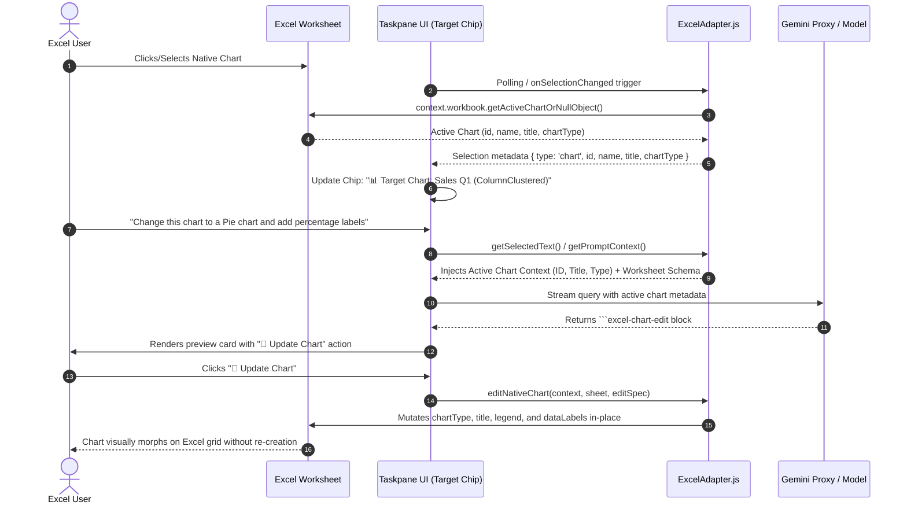
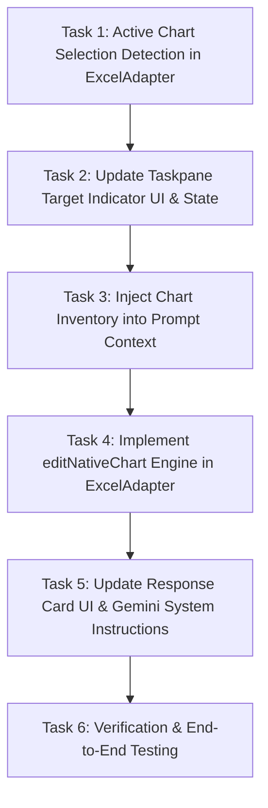

# Plan: Excel Active Chart Selection Detection & In-Place Chart Editing

## 1. Executive Summary & Problem Statement

### 1.1 Context
In Phase 2A, the Ask Gemini Excel add-in gained the ability to generate and insert native interactive Office.js charts from natural language requests, supporting multi-range field selection (`categoriesRange` and `seriesRange`), adjacent range merging, and non-adjacent formula helper bindings for Pie and Cartesian charts.

### 1.2 Current Limitations
1. **Target Chip Ignores Chart Selection:** When a user selects or clicks an existing chart on the Excel worksheet, the top target indicator chip (`#targetCellChip`) continues displaying the last clicked cell (e.g. `🎯 Target Cell: B2`).
2. **Lack of Chart Context in LLM Prompts:** The AI assistant does not receive information about the currently active chart or the inventory of charts existing on the sheet.
3. **No In-Place Mutation Support:** If a user selects a chart and asks *"Change this to a doughnut chart"*, *"Update the title to 2026 Revenue"*, or *"Show percentages on slices"*, the system currently attempts to insert an entirely new chart rather than editing the selected chart object in-place.

### 1.3 Objective
1. **Enhance Target Selection UI:** Update the target indicator chip so that it dynamically reflects active chart selections (e.g. `📊 Target Chart: Actual Sales by Region (ColumnClustered)`), storing the chart identifier (`chartId`) and name (`chartName`).
2. **Enrich Prompt Context:** Extract active chart state and sheet chart inventory into the prompt context for Gemini Enterprise.
3. **Implement Declarative Chart Editing Engine:** Support ````excel-chart-edit```` blocks to mutate chart types, titles, data ranges, legend positions, and data labels directly on existing Office.js chart objects.

---

## 2. Architecture & Selection Flow



---

## 3. Technical Mechanics in Office.js

### 3.1 Active Chart Selection Detection
Office.js provides `context.workbook.getActiveChartOrNullObject()` (available in `ExcelApi 1.9+` across Excel on Web, Windows, and Mac):

```javascript
await Excel.run(async (context) => {
  const activeChart = context.workbook.getActiveChartOrNullObject();
  activeChart.load("id, name, chartType, title/text, width, height, top, left");
  
  const selectedRange = context.workbook.getSelectedRange();
  selectedRange.load("address, rowCount, columnCount");
  
  await context.sync();

  if (!activeChart.isNullObject) {
    return {
      selectionType: "chart",
      chartId: activeChart.id,
      chartName: activeChart.name,
      chartType: activeChart.chartType,
      title: activeChart.title ? activeChart.title.text : activeChart.name,
      dimensions: { width: activeChart.width, height: activeChart.height }
    };
  }

  return {
    selectionType: selectedRange.rowCount === 1 && selectedRange.columnCount === 1 ? "cell" : "range",
    address: selectedRange.address
  };
});
```

### 3.2 Worksheet Chart Inventory
In [`ExcelAdapter.getWorksheetSchema()`](../../microsoft-addin/src/adapters/ExcelAdapter.js), discover all existing charts on the sheet:

```javascript
const charts = sheet.charts;
charts.load("items/id, items/name, items/chartType, items/title/text");
await context.sync();

const chartInventory = charts.items.map(c => ({
  id: c.id,
  name: c.name,
  type: c.chartType,
  title: c.title ? c.title.text : c.name
}));
```

---

## 4. UI / Target Indicator Specifications

### 4.1 Target Chip State Variations
The top `#targetCellChip` in [`microsoft-addin/src/taskpanes/excel/index.html`](../../microsoft-addin/src/taskpanes/excel/index.html) will render four distinct states:

| Selection State | Chip Icon & Text | HTML Dataset Attributes |
| :--- | :--- | :--- |
| **Single Cell** | `🎯 Target Cell: B2` | `data-selection-type="cell"` `data-cell="B2"` |
| **Cell Range** | `📊 Target Range: B2:E20` | `data-selection-type="range"` `data-range="B2:E20"` |
| **Active Chart** | `📊 Target Chart: Actual Sales (ColumnClustered)` | `data-selection-type="chart"` `data-chart-id="{ID}"` `data-chart-name="Chart 1"` `data-chart-type="ColumnClustered"` |
| **No Selection / Loading** | `🎯 Target: Ready` | `data-selection-type="none"` |

### 4.2 Visual Styling & Interactivity
- **Color Accent:** Chart selection chip styled with Fluent blue accent border (`#0078d4`) and light background (`#eff6fc`) to visually distinguish chart focus from cell focus.
- **Click Behavior:** Clicking the target chart chip selects/focuses the chart on the worksheet via `chart.select()`.

---

## 5. Declarative `excel-chart-edit` Specification

When the user asks to modify an existing chart, Gemini emits an ````excel-chart-edit```` code block:

### 5.1 JSON Schema
```json
{
  "action": "edit",
  "targetChart": "Chart 1",
  "chartId": "{optional-guid}",
  "chartType": "Pie",
  "title": "2026 Regional Revenue Share",
  "categoriesRange": "A1:A5",
  "seriesRange": "B1:B5",
  "dataRange": "A1:B5",
  "legend": {
    "visible": true,
    "position": "Right"
  },
  "dataLabels": {
    "visible": true,
    "showCategoryName": true,
    "showPercentage": true,
    "showValue": false
  },
  "dimensions": {
    "width": 500,
    "height": 320
  },
  "position": {
    "targetCell": "G1"
  }
}
```

### 5.2 Supported Mutation Operations
1. **Chart Type Morphing (`chartType`):** Converts between `ColumnClustered`, `BarClustered`, `Line`, `Pie`, `Doughnut`, `Area`, `Scatter`, etc.
2. **Title Update (`title`):** Sets `chart.title.text` and ensures `chart.title.visible = true`.
3. **Data Rebinding (`dataRange` / `categoriesRange` + `seriesRange`):** Re-maps chart source data using `chart.setData()` or series updates.
4. **Legend Control (`legend`):** Toggles visibility and moves position (`Top`, `Bottom`, `Left`, `Right`, `Corner`).
5. **Data Labels (`dataLabels`):** Configures series slice labels (`showPercentage`, `showCategoryName`, `showValue`).
6. **Geometry & Placement (`dimensions`, `position`):** Resizes points and repositions anchor cell.

---

## 6. Implementation Engine: `editNativeChart`

```javascript
/**
 * Modifies an existing native Excel chart object in-place on the worksheet
 * @param {Excel.RequestContext} context 
 * @param {Excel.Worksheet} sheet 
 * @param {Object} spec - Chart edit specification
 * @returns {Promise<Excel.Chart>}
 */
export async function editNativeChart(context, sheet, spec) {
  if (!spec) throw new Error("Invalid chart edit specification.");

  let chart = null;

  // 1. Locate Target Chart by ID, Name, or currently active chart
  if (spec.chartId) {
    try {
      chart = sheet.charts.getItem(spec.chartId);
      chart.load("id, name, chartType");
      await context.sync();
    } catch (e) {
      chart = null;
    }
  }

  if (!chart && spec.targetChart) {
    try {
      chart = sheet.charts.getItem(spec.targetChart);
      chart.load("id, name, chartType");
      await context.sync();
    } catch (e) {
      chart = null;
    }
  }

  if (!chart) {
    const active = context.workbook.getActiveChartOrNullObject();
    active.load("id, name, chartType");
    await context.sync();
    if (!active.isNullObject) {
      chart = active;
    }
  }

  if (!chart) {
    throw new Error(`Target chart "${spec.targetChart || spec.chartId || 'selected'}" not found on worksheet.`);
  }

  // 2. Morph Chart Type if specified
  if (spec.chartType || spec.type) {
    const newType = normalizeChartType(spec.chartType || spec.type);
    chart.chartType = newType;
    console.log(`[Chart Edit] Changed chart type to: ${newType}`);
  }

  // 3. Update Title if specified
  if (spec.title !== undefined) {
    chart.title.text = String(spec.title).trim();
    chart.title.visible = Boolean(spec.title);
  }

  // 4. Rebind Data Range if specified
  if (spec.dataRange || spec.seriesRange) {
    // Execute range rebinding using existing adjacent or helper strategies
    await rebindChartData(context, sheet, chart, spec);
  }

  // 5. Configure Legend
  if (spec.legend) {
    try {
      if (spec.legend.visible !== undefined) chart.legend.visible = spec.legend.visible;
      if (spec.legend.position) chart.legend.position = spec.legend.position;
    } catch (legErr) {
      console.debug("Legend edit notice:", legErr);
    }
  }

  // 6. Configure Data Labels
  if (spec.dataLabels) {
    try {
      const series0 = chart.series.getItemAt(0);
      series0.hasDataLabels = spec.dataLabels.visible !== false;
      if (spec.dataLabels.showCategoryName !== undefined) series0.dataLabels.showCategoryName = spec.dataLabels.showCategoryName;
      if (spec.dataLabels.showPercentage !== undefined) series0.dataLabels.showPercentage = spec.dataLabels.showPercentage;
      if (spec.dataLabels.showValue !== undefined) series0.dataLabels.showValue = spec.dataLabels.showValue;
    } catch (dlErr) {
      console.debug("Data label edit notice:", dlErr);
    }
  }

  // 7. Resize and Reposition if specified
  if (spec.dimensions) {
    if (spec.dimensions.width >= 200) chart.width = spec.dimensions.width;
    if (spec.dimensions.height >= 150) chart.height = spec.dimensions.height;
  }
  if (spec.position && spec.position.targetCell) {
    chart.setPosition(spec.position.targetCell);
  }

  await context.sync();
  return chart;
}
```

---

## 7. Step-by-Step Implementation Tasks



### Task Details:
1. **Task 1: Active Chart Selection Detection in [`ExcelAdapter.js`](../../microsoft-addin/src/adapters/ExcelAdapter.js):**
   - Update `getSelectedText()` to check `context.workbook.getActiveChartOrNullObject()`.
   - Return structured `{ selectionType: "chart", chartId, chartName, chartType, title }` when a chart is focused.
2. **Task 2: Target Chip UI in [`index.js`](../../microsoft-addin/src/taskpanes/excel/index.js) & [`TaskpaneShell.js`](../../microsoft-addin/src/shell/TaskpaneShell.js):**
   - Update `updateTargetIndicator(contextInfo)` to render `📊 Target Chart: [Title] ([Type])` and bind `data-chart-id`.
3. **Task 3: Prompt Context Enrichment in [`ExcelAdapter.formatSchemaForPrompt()`](../../microsoft-addin/src/adapters/ExcelAdapter.js):**
   - List existing charts on the active sheet in the Column & Objects manifest.
   - When a chart is active, format active selection as:
     `Active Target: Chart "Chart 1" (Type: ColumnClustered, Title: "Sales 2026", ID: "{ID}")`.
4. **Task 4: Implement `editNativeChart` in [`ExcelAdapter.js`](../../microsoft-addin/src/adapters/ExcelAdapter.js):**
   - Implement chart mutation logic supporting type conversion, title changes, data rebinding, legend positioning, and data labels.
5. **Task 5: UI Preview Card & Action Dispatcher:**
   - Add parser for ````excel-chart-edit```` in [`markdownParser.js`](../../microsoft-addin/src/core/markdownParser.js).
   - Render **"🔄 Update Chart"** button card in [`responseActions.js`](../../microsoft-addin/src/taskpanes/excel/responseActions.js).
   - Update `geminiproxy/index.js` system instructions to guide Gemini when an active chart is targeted.
6. **Task 6: Verification & Test Automation:**
   - Create unit tests for chart selection normalization and edit spec extraction.
   - Deploy and verify live in Excel Online and Desktop.

---

## 8. Verification Matrix

| Test Scenario | User Action | Expected Output | Verification Criteria |
| :--- | :--- | :--- | :--- |
| **Chart Focus Detection** | Click an existing chart on the sheet | Target chip changes to `📊 Target Chart: [Title] ([Type])` | Chip carries `data-chart-id` attribute; does not stay stuck on previous cell. |
| **Morph Chart Type** | Select Column chart and ask: *"Change this chart to a Doughnut chart"* | Gemini returns `excel-chart-edit` with `chartType: "Doughnut"`. | Chart changes to Doughnut on the worksheet without creating a duplicate chart. |
| **Update Title & Legend** | Select Pie chart and ask: *"Rename title to 'Q1 Breakdown' and move legend to bottom"* | Title changes to "Q1 Breakdown"; legend position updates to bottom. | Properties updated in-place via Office.js. |
| **Add Data Labels** | Select Pie chart and ask: *"Show percentages on slices"* | Slices display percentage data labels. | `series.dataLabels.showPercentage = true` applied. |
| **Rebind Source Range** | Select chart and ask: *"Update chart data to use range B1:C20"* | Chart series data updates to `B1:C20`. | Source data ranges refreshed. |
