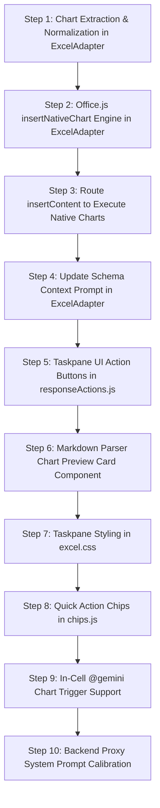

# Implementation Plan: Excel Native Chart Generation via Office.js

## 1. Goal

Implement end-to-end support for generating and inserting live, interactive, native Microsoft Excel chart objects (`Excel.Chart`) onto worksheets via Office.js (`sheet.charts.add(...)`). This replaces static 2D bitmap images and mock HTML bars with dynamic, vector-rendered charts bound to worksheet cell ranges that update automatically when spreadsheet values change.

This plan directly implements the requirements detailed in the feature specification: [`docs/specs/excel-native-chart-generation-SPEC.md`](../../docs/specs/excel-native-chart-generation-SPEC.md).

---

## 2. Context & Prior Art

### 2.1 Existing Codebase Patterns
* **Host Adapter Pattern ([`ExcelAdapter.js`](../../microsoft-addin/src/adapters/ExcelAdapter.js)):** All host-specific Excel operations execute inside `Excel.run(async (context) => { ... })`. Context is harvested via `getWorksheetSchema()` and `getSelectedText()`, and changes are injected via `insertContent()`.
* **Formula Sanitization & Extraction Pattern:** Functions like `normalizeFormula()` and `extractExcelFormula()` extract and clean structured markdown blocks (e.g., ````excel =SUMIFS(...)````) from LLM responses before passing them to the Excel calculation engine. We will follow this exact pattern by introducing `extractExcelChartSpec()` and `normalizeChartType()`.
* **Priority-Based Insertion Pipeline ([`ExcelAdapter.insertContent`](../../microsoft-addin/src/adapters/ExcelAdapter.js#L341-L483)):** `insertContent()` executes an evaluated priority chain:
  1. *Priority 1:* Formula injection (`targetCell.formulas = [[formula]]`).
  2. *Priority 2:* Multi-row table normalization & matrix injection.
  3. *Priority 3:* Text / Callout fallback.
  We will introduce native chart insertion as Priority 1 (or parallel to formulas) when a chart specification is detected.
* **Per-Host Taskpane Modular Architecture ([`microsoft-addin/src/taskpanes/excel/`](../../microsoft-addin/src/taskpanes/excel/)):**
  * [`responseActions.js`](../../microsoft-addin/src/taskpanes/excel/responseActions.js): Dynamically mounts context-aware action buttons (e.g., `➕ Insert Formula`).
  * [`chips.js`](../../microsoft-addin/src/taskpanes/excel/chips.js): Configures document and selection quick chips.
  * [`excel.css`](../../microsoft-addin/src/taskpanes/excel/excel.css): Excel green theme styling (`#107c41`, `#e8f5e9`).
* **Markdown Parser ([`markdownParser.js`](../../microsoft-addin/src/core/markdownParser.js)):** Parses fenced blocks, tables, callouts, and visual tokens into sanitized HTML for taskpane rendering.

### 2.2 Key Files Touched
1. `microsoft-addin/src/adapters/ExcelAdapter.js` — Core chart extraction, type normalization, and `insertNativeChart` Office.js execution.
2. `microsoft-addin/src/taskpanes/excel/responseActions.js` — Detection of chart manifests and mounting the **"📊 Insert Native Chart"** button and preview pill.
3. `microsoft-addin/src/taskpanes/excel/chips.js` — Addition of `"📊 Native Chart Builder"` and `"📈 Visualize Selection"` chips.
4. `microsoft-addin/src/core/markdownParser.js` — Parsing of ````excel-chart```` code blocks to render interactive preview cards in the taskpane.
5. `microsoft-addin/src/taskpanes/excel/excel.css` — Styling for chart action buttons, preview cards, and metadata pills.
6. `geminiproxy/index.js` — System prompt refinement to guide Gemini to emit ````excel-chart```` JSON rather than raster image markers for Excel queries.

---

## 3. Implementation Steps



---

### Phase 1: Core Parsing & Office.js Engine (`ExcelAdapter.js`)

#### Step 1: Implement Chart Specification Extractor & Type Normalizer
* **What:** Add `extractExcelChartSpec(text, htmlContent)` and `normalizeChartType(rawType)` exported helper functions.
* **Where:** Top of [`microsoft-addin/src/adapters/ExcelAdapter.js`](../../microsoft-addin/src/adapters/ExcelAdapter.js) (alongside `extractExcelFormula`).
* **How:**
  1. Define `CHART_TYPE_MAP` mapping common aliases to valid `Excel.ChartType` enum keys:
     ```javascript
     const CHART_TYPE_MAP = {
       columnclustered: "columnClustered",
       columnstacked: "columnStacked",
       columnstacked100: "columnStacked100",
       barclustered: "barClustered",
       barstacked: "barStacked",
       barstacked100: "barStacked100",
       line: "line",
       linemarkers: "lineMarkers",
       linestacked: "lineStacked",
       pie: "pie",
       pieexploded: "pieExploded",
       doughnut: "doughnut",
       area: "area",
       areastacked: "areaStacked",
       scatter: "xyscatter",
       xyscatter: "xyscatter",
       waterfall: "waterfall"
     };
     ```
  2. Implement `normalizeChartType(rawType)` to strip whitespace/symbols, lowercase, and resolve against `CHART_TYPE_MAP`, defaulting to `"columnClustered"`.
  3. Implement `extractExcelChartSpec(text, htmlContent)`:
     * Search `text` and `htmlContent` for fenced code blocks: ```` ```(?:excel-chart|chart|excel_chart)\s*([\s\S]*?)``` ````.
     * Parse the captured JSON string.
     * Validate mandatory fields: `dataRange` (or `range`) and `type` (or `chartType`).
     * Sanitize properties (strip leading `$` from range coordinates, normalize chart type, set sensible defaults for `hasHeaders`, `seriesBy`, `position`, and `dimensions`).
     * Fallback to regex for raw un-fenced JSON objects containing `"type"` and `"dataRange"`.
* **Why:** Decouples raw LLM output parsing from Office.js execution, providing a validated, strongly-typed configuration object.

---

#### Step 2: Implement `insertNativeChart` Office.js Helper Method
* **What:** Add `insertNativeChart(context, sheet, spec)` helper function.
* **Where:** Inside [`microsoft-addin/src/adapters/ExcelAdapter.js`](../../microsoft-addin/src/adapters/ExcelAdapter.js).
* **How:**
  1. Parse `spec.dataRange`. If the range includes a worksheet prefix (e.g., `'Sales Q1'!A1:F10`), resolve the target sheet via `context.workbook.worksheets.getItem(sheetName)` or use the active `sheet`.
  2. Obtain `sourceRange = sheet.getRange(cleanAddress)`. Load `rowIndex, columnIndex, rowCount, columnCount, address`.
  3. Execute `await context.sync()`.
  4. Resolve chart type: `const chartType = Excel.ChartType[normalizeChartType(spec.type)] || Excel.ChartType.columnClustered`.
  5. Resolve series orientation:
     ```javascript
     let seriesBy = Excel.ChartSeriesBy.auto;
     if (spec.seriesBy === "rows") seriesBy = Excel.ChartSeriesBy.rows;
     else if (spec.seriesBy === "columns") seriesBy = Excel.ChartSeriesBy.columns;
     ```
  6. Add chart to worksheet: `const chart = sheet.charts.add(chartType, sourceRange, seriesBy)`.
  7. Apply title:
     ```javascript
     if (spec.title) {
       chart.title.text = String(spec.title).trim();
       chart.title.visible = true;
     }
     ```
  8. Apply legend configuration:
     ```javascript
     if (spec.legend) {
       chart.legend.visible = spec.legend.visible !== false;
       if (spec.legend.position) {
         const posKey = String(spec.legend.position).toLowerCase();
         const posMap = {
           top: Excel.ChartLegendPosition.top,
           bottom: Excel.ChartLegendPosition.bottom,
           left: Excel.ChartLegendPosition.left,
           right: Excel.ChartLegendPosition.right,
           corner: Excel.ChartLegendPosition.corner
         };
         if (posMap[posKey]) chart.legend.position = posMap[posKey];
       }
     }
     ```
  9. Apply position and layout:
     * If `spec.position?.placement === "targetCell"` and `spec.position.targetCell`:
       `chart.setPosition(sheet.getRange(spec.position.targetCell), null);`
     * If `spec.position?.placement === "below"`:
       `const offsetRows = Number(spec.position.offsetRows) || 2;`
       `chart.setPosition(sheet.getCell(sourceRange.rowIndex + sourceRange.rowCount + offsetRows, sourceRange.columnIndex), null);`
     * Default (`adjacent`):
       `const offsetCols = Number(spec.position?.offsetColumns) || 2;`
       `chart.setPosition(sheet.getCell(sourceRange.rowIndex, sourceRange.columnIndex + sourceRange.columnCount + offsetCols), null);`
  10. Set dimensions:
      ```javascript
      chart.width = Math.max(250, Math.min(1200, spec.dimensions?.width || 480));
      chart.height = Math.max(180, Math.min(800, spec.dimensions?.height || 300));
      ```
  11. Apply optional data labels:
      ```javascript
      if (spec.dataLabels && spec.dataLabels.visible) {
        chart.dataLabels.showValue = spec.dataLabels.showValue !== false;
        if (spec.dataLabels.showPercentage) chart.dataLabels.showPercentage = true;
      }
      ```
  12. Execute `await context.sync()` and return the `chart` object.
* **Why:** Encapsulates the entire Office.js chart creation lifecycle, handling positioning, styling, dimensions, and synchronization safely.

---

#### Step 3: Route `ExcelAdapter.insertContent` to Execute Native Charts
* **What:** Update `ExcelAdapter.insertContent(htmlContent, rawText, mode)` to detect and execute chart specs before falling back to formulas or tables.
* **Where:** [`microsoft-addin/src/adapters/ExcelAdapter.js#L341-L365`](../../microsoft-addin/src/adapters/ExcelAdapter.js#L341-L365).
* **How:**
  1. At the start of `insertContent()`, call `const chartSpec = extractExcelChartSpec(rawText, htmlContent);`.
  2. If `chartSpec` is present:
     ```javascript
     console.log("Detected native Excel chart specification:", chartSpec);
     await insertNativeChart(context, sheet, chartSpec);
     return;
     ```
  3. If no chart specification is present, proceed to existing Priority 1 (`extractExcelFormula`), Priority 2 (Table matrix), and Priority 3 (Text).
* **Why:** Integrates chart generation seamlessly into the universal document insertion pipeline called by `TaskpaneShell.performDocumentInsertion()`.

---

#### Step 4: Update Schema Context Prompt Formatting
* **What:** Extend `formatSchemaForPrompt(schema, targetCellAddress)` with declarative chart instructions.
* **Where:** [`microsoft-addin/src/adapters/ExcelAdapter.js#L206-L245`](../../microsoft-addin/src/adapters/ExcelAdapter.js#L206-L245).
* **How:**
  Add a dedicated "Chart Generation Instructions" section to the formatted prompt text:
  ```text
  Chart Generation Instructions:
  1. When asked to create, plot, or visualize data as a chart or graph in Excel, return a ```excel-chart JSON specification code block.
  2. Set 'type' to one of: ColumnClustered, ColumnStacked, BarClustered, BarStacked, Line, LineMarkers, Pie, Doughnut, Area, Scatter, Waterfall.
  3. Set 'dataRange' to the exact range spanning category headers and series values (e.g. "A1:D10").
  4. Provide a descriptive 'title' and optional 'legend' / 'position' settings.
  5. Include a 1-2 sentence plain-English summary explaining the visualization.
  ```
* **Why:** Grounds Gemini on the exact schema keys and chart types supported by the Excel adapter.

---

### Phase 2: Taskpane UI, Action Buttons & Quick Chips

#### Step 5: Update Response Actions Toolbar
* **What:** Detect chart specifications in `renderResponseActions(ctx)` and render the **"📊 Insert Native Chart"** button and chart pill.
* **Where:** [`microsoft-addin/src/taskpanes/excel/responseActions.js`](../../microsoft-addin/src/taskpanes/excel/responseActions.js).
* **How:**
  1. Import `extractExcelChartSpec` from `../../adapters/ExcelAdapter.js`.
  2. Inspect response content:
     ```javascript
     const detectedChart = extractExcelChartSpec(rawText, formattedHtml);
     const detectedFormula = !detectedChart ? extractExcelFormula(rawText, formattedHtml) : null;
     ```
  3. If `detectedChart`:
     * Set button class: `insertBtn.className = "action-btn chart";`.
     * Set button label: `insertBtn.innerHTML = "📊 Insert Native Chart";`.
     * Set button title: `insertBtn.title = "Insert live interactive Excel chart (${detectedChart.type}) into worksheet";`.
     * Create metadata preview pill:
       ```javascript
       const pill = document.createElement("span");
       pill.className = "chart-preview-pill";
       pill.innerText = `📊 ${detectedChart.type}: ${detectedChart.dataRange}`;
       pill.title = `Chart: ${detectedChart.type} on ${detectedChart.dataRange}`;
       primaryActions.appendChild(pill);
       ```
  4. Ensure click handler invokes `TaskpaneShell.performDocumentInsertion(adapter, htmlToInsert, rawText, "smart", "Excel")`.
* **Why:** Provides clear visual affordance and one-click execution for chart creation.

---

#### Step 6: Markdown Parser Chart Preview Card Component
* **What:** Add custom rendering for ````excel-chart```` code blocks in `parseMarkdown(text)`.
* **Where:** [`microsoft-addin/src/core/markdownParser.js`](../../microsoft-addin/src/core/markdownParser.js).
* **How:**
  1. Add a pre-pass in `parseMarkdown()`:
     ```javascript
     sanitized = sanitized.replace(/```(?:excel-chart|chart|excel_chart)\s*([\s\S]*?)```/gi, (match, jsonText) => {
       try {
         const spec = JSON.parse(jsonText.trim());
         const cardHtml = renderExcelChartCard(spec);
         const token = `%%OFFICE_VISUAL_TOKEN_${visualTokens.length}%%`;
         visualTokens.push(cardHtml);
         return `\n\n${token}\n\n`;
       } catch (e) {
         return match; // fallback to standard code block rendering
       }
     });
     ```
  2. Implement helper `renderExcelChartCard(spec)`:
     * Generates a styled HTML card with an Excel green header banner (`#107c41`), a chart icon, the chart title, chart type badge, target data range, and dimension pill.
* **Why:** Replaces raw JSON code blocks in the chat stream with an elegant visual preview card.

---

#### Step 7: Add Styles for Chart Components in `excel.css`
* **What:** Add CSS rules for `.action-btn.chart`, `.chart-preview-pill`, and `.excel-chart-card`.
* **Where:** [`microsoft-addin/src/taskpanes/excel/excel.css`](../../microsoft-addin/src/taskpanes/excel/excel.css).
* **How:**
  ```css
  /* Native Chart Action Highlighting */
  .action-btn.chart {
    background-color: #0e6b38;
    color: white;
    border-color: #0e6b38;
  }

  .action-btn.chart:hover {
    background-color: #094d27;
    border-color: #094d27;
  }

  .chart-preview-pill {
    display: inline-block;
    background-color: #e8f5e9;
    color: #1b5e20;
    border: 1px solid #a5d6a7;
    padding: 2px 8px;
    border-radius: 4px;
    font-family: 'Segoe UI', sans-serif;
    font-size: 11px;
    font-weight: 600;
    max-width: 220px;
    overflow: hidden;
    text-overflow: ellipsis;
    white-space: nowrap;
    vertical-align: middle;
  }

  .excel-chart-card {
    background-color: #f8fcf9;
    border: 1px solid #c8e6cb;
    border-left: 4px solid #107c41;
    border-radius: 6px;
    padding: 10px 14px;
    margin: 12px 0;
    font-family: 'Segoe UI', Calibri, sans-serif;
  }
  ```
* **Why:** Maintains visual consistency with Microsoft Excel brand identity.

---

#### Step 8: Add Quick Action Chips for Charts
* **What:** Add dedicated chart chips to `docChips` and `selectionChips`.
* **Where:** [`microsoft-addin/src/taskpanes/excel/chips.js`](../../microsoft-addin/src/taskpanes/excel/chips.js).
* **How:**
  1. Add to `docChips`:
     ```javascript
     {
       id: "chipChartGen",
       label: "📊 Native Chart Builder",
       title: "Generate an interactive Excel chart from sheet data",
       prompt: "Analyze the active worksheet data and generate an optimal native Excel chart specification (ColumnClustered, Line, BarClustered, or Pie) visualizing key metrics across categories. Return the specification as an ```excel-chart code block."
     }
     ```
  2. Add to `selectionChips`:
     ```javascript
     {
       id: "selChart",
       label: "📈 Visualize Selection",
       instruction: "Create a native Excel chart visualizing the selected data range. Determine the best chart type based on the series dimensions and return an ```excel-chart JSON specification."
     }
     ```
* **Why:** Provides one-click access for users to visualize the active sheet or selected cell range without typing prompts.

---

### Phase 3: In-Cell Triggers & Backend Calibration

#### Step 9: In-Cell `@gemini` Chart Trigger Support
* **What:** Update `ExcelAdapter.checkInDocumentCommands()` to handle chart generation for in-cell commands.
* **Where:** [`microsoft-addin/src/adapters/ExcelAdapter.js#L485-L587`](../../microsoft-addin/src/adapters/ExcelAdapter.js#L485-L587).
* **How:**
  1. Inside `checkInDocumentCommands()`, after receiving `formattedHtml` from `callbacks.executePrompt()`:
     * Check `const chartSpec = extractExcelChartSpec(formattedHtml);`.
     * If `chartSpec` is present:
       - Clear the placeholder text in the trigger cell: `range.values = [[""]]; await context.sync();`.
       - Call `await insertNativeChart(context, sheet, chartSpec);`.
       - Notify status: `callbacks.onStatus("✅ Created native Excel chart: " + (chartSpec.title || chartSpec.type));`.
     * Else fallback to existing formula/table/text injection.
* **Why:** Allows users typing `@gemini create a bar chart for A1:B10` directly inside a cell to have the chart created seamlessly.

---

#### Step 10: Backend Proxy System Prompt Calibration
* **What:** Update `SYSTEM_INSTRUCTION_TEXT` in `geminiproxy/index.js` to distinguish Excel chart requests from Word/PowerPoint image chart requests.
* **Where:** [`geminiproxy/index.js#L114-L129`](../../geminiproxy/index.js#L114-L129).
* **How:**
  Refine Rule 2 in `SYSTEM_INSTRUCTION_TEXT`:
  ```text
  2. DYNAMIC VISUAL CHARTS & DIAGRAMS:
     - For Microsoft Excel requests: When asked for charts, graphs, or visual data plots, emit a declarative ```excel-chart JSON specification block containing type, dataRange, title, and positioning. DO NOT generate raster images (image:) for Excel spreadsheet data.
     - For Word and PowerPoint requests: Embed image visual markers (e.g. ).
  ```
* **Why:** Prevents unnecessary Vertex AI `gemini-2.5-flash-image` API calls and latency when operating inside Excel.

---

## 4. Data Model / Schema Changes

### 4.1 `ExcelChartSpec` Data Interface
```typescript
export interface ExcelChartSpec {
  type: string;
  dataRange: string;
  title?: string;
  hasHeaders?: boolean;
  seriesBy?: "auto" | "columns" | "rows";
  legend?: {
    visible?: boolean;
    position?: "Top" | "Bottom" | "Left" | "Right" | "Corner";
  };
  position?: {
    placement?: "adjacent" | "targetCell" | "below";
    targetCell?: string;
    offsetColumns?: number;
    offsetRows?: number;
  };
  dimensions?: {
    width?: number;
    height?: number;
  };
  dataLabels?: {
    visible?: boolean;
    showValue?: boolean;
    showPercentage?: boolean;
  };
}
```

---

## 5. Integration Points

```mermaid
graph LR
    UserPrompt["User Prompt / Chip"] --> TaskpaneShell["TaskpaneShell.js"]
    TaskpaneShell --> GeminiProxy["geminiproxy/index.js"]
    GeminiProxy --> TaskpaneUI["ChatLog.js + markdownParser.js"]
    TaskpaneUI --> ResponseActions["responseActions.js (Insert Button)"]
    ResponseActions --> ExcelAdapter["ExcelAdapter.js (insertContent)"]
    ExcelAdapter --> OfficeJS["Office.js (Excel.run -> sheet.charts.add)"]
    OfficeJS --> ExcelCanvas["Excel Worksheet Canvas"]
```



* **No Manifest XML Changes Required:** Chart functionality uses standard `Excel.run()` via `ExcelApi 1.1+` already granted under standard add-in permissions.
* **Taskpane Shell Interoperability:** Uses existing `performDocumentInsertion()` and `SelectionWatcher` infrastructure without breaking Word or PowerPoint taskpanes.

---

## 6. Edge Cases & Risks

| Risk / Edge Case | Cause | Mitigation Strategy |
| :--- | :--- | :--- |
| **Invalid / Inverted Range Address** | LLM outputs `B10:A1` or nonexistent cells | Use regex coordinate sanitizer; wrap `sheet.getRange()` in `try/catch` and report clean error bubble to chat log. |
| **Non-Numeric Source Data** | Selected range contains only text | Inspect sampled values in `sourceRange.values`; if entirely non-numeric, log descriptive error before calling `charts.add()`. |
| **Cross-Sheet Range (`'Data'!A1:B10`)** | Data resides on another worksheet | Parse sheet name prefix from address; fetch sheet using `context.workbook.worksheets.getItem(sheetName)`. |
| **Sheet Boundary Overflow** | Positioning chart adjacent to data near Col `XFD` | Check `startCol + chartColSpan > 16384`; wrap position to `below` the used range automatically. |
| **Protected / Read-Only Sheet** | User has locked the worksheet | Catch `WorksheetProtected` error from Office.js and display actionable message: *"Please unprotect sheet to insert charts."* |
| **Duplicate Rapid Clicks** | User spams "Insert Native Chart" button | Button is immediately disabled during async `Excel.run()` execution and re-enabled in `finally`. |

---

## 7. Verification & Acceptance Testing

### 7.1 Manual Verification Test Matrix

| Step / Scenario | Input Prompt / Action | Expected Result |
| :--- | :--- | :--- |
| **Test 1: Clustered Column Chart** | Select `A1:B6` (Products vs Revenue) and click `"📈 Visualize Selection"` | Taskpane renders preview card; clicking **"📊 Insert Native Chart"** inserts a ColumnClustered chart 2 columns to the right. |
| **Test 2: Line Chart with Title** | Prompt: *"Create a line chart showing monthly growth from B1:M2 titled '2026 Monthly Trend'"* | Inserts a Line chart with title `"2026 Monthly Trend"` and right-hand legend. |
| **Test 3: In-Cell `@gemini` Trigger** | In cell `F1`, type `@gemini make a pie chart for A1:B5` and click **Run @gemini** | Cell placeholder clears and a native Pie chart appears on the sheet linked to `A1:B5`. |
| **Test 4: Real-time Data Reactivity** | Modify number in cell `B2` from `100` to `5000` | The chart on the sheet immediately updates its bar height without re-running the add-in. |
| **Test 5: Stacked Bar Chart** | Prompt: *"Build a stacked bar chart for region sales in A1:D8"* | Inserts a `BarStacked` chart with multi-series data orientation. |
| **Test 6: Invalid Range Handling** | Prompt: *"Chart data in invalid range XYZ:999"* | Non-blocking error bubble appears in taskpane: *"🔴 Chart Creation Error: Invalid range address."* |

### 7.2 Automated Unit & Syntax Verification
* Run linter / syntax check on `microsoft-addin/src/adapters/ExcelAdapter.js`, `responseActions.js`, `chips.js`, and `markdownParser.js`.
* Validate JSON parsing test cases for `extractExcelChartSpec` with standard, malformed, and multi-line markdown code blocks.

---

## 8. Open Questions

1. **Theme Color vs Brand Palette:** Should the chart adopt the workbook's native Office Theme colors or Google brand colors?
   * *Decision:* Default to native Office Theme palette (`Chart.format` defaults) so charts blend seamlessly with customer enterprise templates, with optional future support for custom series colors.
2. **Auto-Insertion Option:** Should the chart insert automatically upon generation, or require the user to click **"📊 Insert Native Chart"**?
   * *Decision:* Require button click in the taskpane (consistent with Formula insertion) while auto-inserting for direct in-cell `@gemini` triggers.
