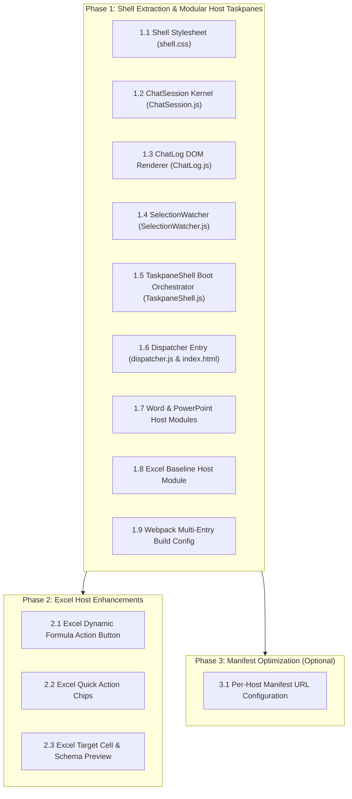
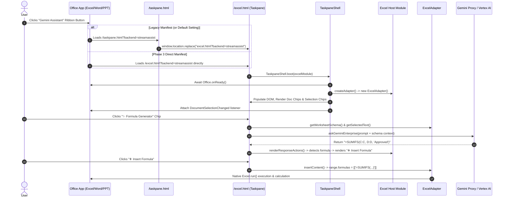

# Implementation Plan: Per-Host Taskpane Architecture (ADR-0001)

## 1. Goal

This implementation plan defines the stepwise execution for [ADR-0001: Split the shared taskpane into a shared shell plus per-host taskpanes](../../docs/cbs/ADR-0001-per-host-taskpane-architecture.md). It refactors the monolithic, host-branching taskpane in [`microsoft-addin/src/taskpane/`](../../microsoft-addin/src/taskpane/) into a reusable shared kernel ([`src/shell/`](../../microsoft-addin/src/shell/)) and decoupled, host-specific taskpanes ([`src/taskpanes/{excel,word,powerpoint}/`](../../microsoft-addin/src/taskpanes/)), mediated by a backward-compatible dispatcher ([`src/taskpanes/dispatcher/`](../../microsoft-addin/src/taskpanes/dispatcher/)). This eliminates three-way merge conflicts across host teams, enables rich host-specific UI and action chips in Excel (such as the Plain English Formula Generator and schema previews from [excel-core-changes.md](../../docs/cbs/excel-core-changes.md)), and maintains 100% backward compatibility with existing sideloaded manifests.

---

## 2. Context & Prior Art

### 2.1 Existing Architecture & Pain Points
The current add-in relies on a single HTML document and JS entry point:
- [`src/taskpane/taskpane.html`](../../microsoft-addin/src/taskpane/taskpane.html) (141 lines): Static HTML containing fixed chip containers (`#chipSummarize`, `#chipRisks`, `#chipActionItems`, `#chipExecBox` and 5 selection chips).
- [`src/taskpane/taskpane.js`](../../microsoft-addin/src/taskpane/taskpane.js) (500 lines): Monolithic script containing four host branching ladders (`if (hostName === "Excel") ... else if (hostName === "PowerPoint") ... else ...`), coupled chat lifecycle logic, selection listeners, and hardcoded DOM manipulation.
- [`src/taskpane/taskpane.css`](../../microsoft-addin/src/taskpane/taskpane.css) (80 lines): Dead, unreferenced boilerplate styling; live styles are inlined in `taskpane.html`.
- [`src/adapters/HostAdapterFactory.js`](../../microsoft-addin/src/adapters/HostAdapterFactory.js): Dynamically inspects `Office.context.host` and instantiates [`WordAdapter`](../../microsoft-addin/src/adapters/WordAdapter.js), [`PPTAdapter`](../../microsoft-addin/src/adapters/PPTAdapter.js), or [`ExcelAdapter`](../../microsoft-addin/src/adapters/ExcelAdapter.js). This causes every host bundle to bundle all three adapters.

### 2.2 Key Files and Modules Involved
- **Core (Unchanged wire & parsing):** [`src/core/geminiClient.js`](../../microsoft-addin/src/core/geminiClient.js), [`src/core/markdownParser.js`](../../microsoft-addin/src/core/markdownParser.js)
- **Adapters (Unchanged contracts):** [`src/adapters/ExcelAdapter.js`](../../microsoft-addin/src/adapters/ExcelAdapter.js), [`src/adapters/WordAdapter.js`](../../microsoft-addin/src/adapters/WordAdapter.js), [`src/adapters/PPTAdapter.js`](../../microsoft-addin/src/adapters/PPTAdapter.js), [`src/adapters/HostAdapterFactory.js`](../../microsoft-addin/src/adapters/HostAdapterFactory.js)
- **Shared Shell (New):** [`src/shell/TaskpaneShell.js`](../../microsoft-addin/src/shell/TaskpaneShell.js), [`src/shell/ChatSession.js`](../../microsoft-addin/src/shell/ChatSession.js), [`src/shell/ChatLog.js`](../../microsoft-addin/src/shell/ChatLog.js), [`src/shell/SelectionWatcher.js`](../../microsoft-addin/src/shell/SelectionWatcher.js), [`src/shell/shell.css`](../../microsoft-addin/src/shell/shell.css)
- **Host Taskpanes (New):** [`src/taskpanes/excel/`](../../microsoft-addin/src/taskpanes/excel/), [`src/taskpanes/word/`](../../microsoft-addin/src/taskpanes/word/), [`src/taskpanes/powerpoint/`](../../microsoft-addin/src/taskpanes/powerpoint/), [`src/taskpanes/dispatcher/`](../../microsoft-addin/src/taskpanes/dispatcher/)
- **Build & Packaging:** [`webpack.config.js`](../../microsoft-addin/webpack.config.js), [`package.json`](../../microsoft-addin/package.json), [`manifest.xml`](../../microsoft-addin/manifest.xml), [`manifest.dev.xml`](../../microsoft-addin/manifest.dev.xml)

### 2.3 Dependencies & Infrastructure
- Webpack 5, `html-webpack-plugin`, `copy-webpack-plugin`, Babel.
- Office.js host environment (`Office.onReady`, `Office.HostType`, `Office.EventType.DocumentSelectionChanged`).
- Nginx static file serving (`nginx.conf`, `Dockerfile`).

---

## 3. Implementation Steps

The plan is organized into three sequential, independently testable phases matching ADR-0001:
- **Phase 1: Shell Extraction & Modular Host Taskpanes (Parity Migration)**
- **Phase 2: Excel Host Enhancements (Formula Detection & Schema UI)**
- **Phase 3: Direct Manifest URL Routing (Optional Hop Optimization)**



---

### Phase 1: Shared Shell Extraction & Host Taskpanes (Parity)

#### Step 1.1: Consolidate Shared Styles into `src/shell/shell.css`
- **What**: Create [`microsoft-addin/src/shell/shell.css`](../../microsoft-addin/src/shell/shell.css) by extracting and consolidating the inlined `<style>` block from [`src/taskpane/taskpane.html`](../../microsoft-addin/src/taskpane/taskpane.html) and cleaning up the legacy [`src/taskpane/taskpane.css`](../../microsoft-addin/src/taskpane/taskpane.css).
- **Where**: `microsoft-addin/src/shell/shell.css`
- **How**:
  - Extract all core layout styles: `.header`, `.header-badge`, `.tip-banner`, `.scan-btn`, `.doc-tools-bar`, `.doc-tools-title`, `.chips-container`, `.quick-chip`, `#debugStatus`, `#chatHistory`, `.chat-bubble` (user, assistant, system), markdown formatting rules (headings, code blocks, executive blockquotes, rich tables), `.response-actions-container`, `.action-btn` (insert, copy), `.response-footer-status`, `#selectionToolbar`, `.input-container`, `textarea`, `.send-btn`, and `#loading`.
  - Include standard Fluent UI font stacks (`"Segoe UI", -apple-system, sans-serif`).
- **Why**: Replaces dead CSS files and prevents duplicate inline style sheets across host HTML templates.

#### Step 1.2: Implement Chat Session Kernel in `src/shell/ChatSession.js`
- **What**: Create [`microsoft-addin/src/shell/ChatSession.js`](../../microsoft-addin/src/shell/ChatSession.js) to encapsulate multi-turn chat state, session persistence, and API communication.
- **Where**: `microsoft-addin/src/shell/ChatSession.js`
- **How**:
  - Encapsulate `sessionId` and `history` arrays.
  - Implement `executeWorkflow({ prompt, displayUserBubble, adapter, chatLog, uiCallbacks })`:
    - Append user bubble to `chatLog`.
    - Set loading state via `uiCallbacks.onLoading(true, message)`.
    - Call `askGeminiEnterprise(prompt, this.history, this.sessionId)`.
    - Update internal `this.sessionId` and `this.history`.
    - Delegate rendering to `chatLog.appendAssistantBubble(resultText, renderResponseActions)`.
    - Catch errors, notify `chatLog.appendSystem("Error: " + err.message)`, and invoke `uiCallbacks.onError(err)`.
    - Reset loading state in `finally` block and scroll log to bottom.
  - Implement `reset()` to clear session ID and conversation history.
- **Why**: Decouples network communication and state tracking from DOM elements and host-specific event handlers.

#### Step 1.3: Implement Message Log Renderer in `src/shell/ChatLog.js`
- **What**: Create [`microsoft-addin/src/shell/ChatLog.js`](../../microsoft-addin/src/shell/ChatLog.js) to manage the `#chatHistory` container.
- **Where**: `microsoft-addin/src/shell/ChatLog.js`
- **How**:
  - Implement `appendUserBubble(text)`: Creates `.chat-bubble.user` with pre-wrapped text.
  - Implement `appendSystem(text)`: Creates `.chat-bubble.system`.
  - Implement `appendAssistantBubble(rawMarkdownText, renderResponseActionsFn, actionContext)`:
    - Parse raw markdown to executive HTML using [`parseMarkdown(rawMarkdownText)`](../../microsoft-addin/src/core/markdownParser.js).
    - Create `.chat-bubble.assistant` containing the formatted text node.
    - Invoke `renderResponseActionsFn({ rawText: rawMarkdownText, formattedHtml, textDiv, bubble, chatLog, ...actionContext })`.
    - Append the generated action container (or fallback copy button) and response footer status to the bubble.
  - Implement `clear(welcomeHtml)`: Resets history container and inserts initial welcome bubble.
  - Implement `scrollToBottom()`: Updates `container.scrollTop = container.scrollHeight`.
- **Why**: Centralizes DOM creation and markdown rendering while delegating button labels and actions to the host module.

#### Step 1.4: Implement Document Selection Listener in `src/shell/SelectionWatcher.js`
- **What**: Create [`microsoft-addin/src/shell/SelectionWatcher.js`](../../microsoft-addin/src/shell/SelectionWatcher.js) to observe host selection events and trigger contextual toolbar updates.
- **Where**: `microsoft-addin/src/shell/SelectionWatcher.js`
- **How**:
  - Register listener with `Office.context.document.addHandlerAsync(Office.EventType.DocumentSelectionChanged, callback)`.
  - On event, call `adapter.getSelectedText()`.
  - If selection text exceeds minimum threshold (> 5 chars):
    - Update word count `#selectionWordCount` and preview snippet `#selectionPreviewText`.
    - Display `#selectionToolbar`.
    - If `hostModule.onSelectionChange` is defined, call `await hostModule.onSelectionChange(selectionText, { adapter, chatLog, chatSession })`.
  - If selection text is empty or <= 5 chars: hide `#selectionToolbar`.
  - Trigger in-document `@gemini` scan via `adapter.checkInDocumentCommands(false, scanCallbacks)`.
- **Why**: Isolates Office.js event registration and error handling while allowing host modules to hook into selection changes.

#### Step 1.5: Implement Shared Orchestrator in `src/shell/TaskpaneShell.js`
- **What**: Create [`microsoft-addin/src/shell/TaskpaneShell.js`](../../microsoft-addin/src/shell/TaskpaneShell.js) providing the main static bootstrapper `TaskpaneShell.boot(hostModule)`.
- **Where**: `microsoft-addin/src/shell/TaskpaneShell.js`
- **How**:
  - Implement `static async boot(hostModule)`:
    1. Await `Office.onReady()`.
    2. Validate host: If `Office.context.host` is available and differs from `hostModule.hostName`, display a prominent warning banner or debug notification.
    3. Instantiate adapter: `const adapter = hostModule.createAdapter ? hostModule.createAdapter() : HostAdapterFactory.getAdapter();`.
    4. Instantiate `ChatSession` and `ChatLog`.
    5. Populate UI copy from `hostModule.strings`:
       - `#tipBannerText` $\leftarrow$ `hostModule.strings.tipBanner`
       - `#docToolsTitle` $\leftarrow$ `hostModule.strings.toolsTitle`
       - `#welcomeSystemBubble` $\leftarrow$ `hostModule.strings.welcome`
       - `#debugStatus` $\leftarrow$ `hostModule.strings.readyStatus`
    6. Dynamically render `hostModule.docChips` into `#docToolsChipsContainer`:
       - For each chip `{ id, label, title, prompt }`, create `.quick-chip` button and bind click event to run prompt through `ChatSession.executeWorkflow()` with full document context from `adapter.getFullDocumentText()`.
    7. Dynamically render `hostModule.selectionChips` into `#selectionChipsContainer`:
       - For each chip `{ id, label, instruction }`, create `.quick-chip` button and bind click event to run selected text instruction.
    8. Wire controls:
       - Send button (`#run`) and textarea (`#promptText`) $\rightarrow$ `callGeminiWorkflow()`.
       - Clear button (`#clearSession`) $\rightarrow$ `chatSession.reset()` and `chatLog.clear()`.
       - In-document scan button (`#scanInDoc`) $\rightarrow$ `adapter.checkInDocumentCommands(true, ...)`.
       - Endpoint override selector (`#endpointSelect`) $\rightarrow$ `setProxyUrlOverride()`.
    9. Initialize `SelectionWatcher`.
    10. Execute `hostModule.onReady({ adapter, chatSession, chatLog })` if defined.
  - **Contract Rule Enforcement**: No `if (hostName === ...)` statements allowed inside `TaskpaneShell.js`.
- **Why**: Serves as the universal shell engine that turns declarative host module descriptors into live, functional taskpane UIs.

#### Step 1.6: Create Compatibility Dispatcher in `src/taskpanes/dispatcher/`
- **What**: Implement [`microsoft-addin/src/taskpanes/dispatcher/index.html`](../../microsoft-addin/src/taskpanes/dispatcher/index.html) and [`microsoft-addin/src/taskpanes/dispatcher/dispatcher.js`](../../microsoft-addin/src/taskpanes/dispatcher/dispatcher.js) to emit `/taskpane.html`.
- **Where**: `microsoft-addin/src/taskpanes/dispatcher/`
- **How**:
  - `dispatcher.js`:
    ```javascript
    /* global Office */
    Office.onReady((info) => {
      const hostMap = {
        [Office.HostType.Excel]: "excel.html",
        [Office.HostType.Word]: "word.html",
        [Office.HostType.PowerPoint]: "powerpoint.html"
      };
      const target = (info && hostMap[info.host]) ? hostMap[info.host] : "word.html";
      const query = window.location.search || "";
      window.location.replace(target + query);
    });
    ```
  - `index.html`: Minimal loading document containing Office.js script tag and a centered "Loading Gemini Assistant..." spinner.
- **Why**: Preserves query strings (e.g. `?backend=streamassist`) and ensures all existing manifests pointing to `/taskpane.html` continue functioning without requiring reinstallations.

#### Step 1.7: Create Word and PowerPoint Host Taskpanes
- **What**: Create directory structures and modules for Word and PowerPoint:
  - `src/taskpanes/word/{boot.js, index.js, chips.js, responseActions.js, index.html, word.css}`
  - `src/taskpanes/powerpoint/{boot.js, index.js, chips.js, responseActions.js, index.html, powerpoint.css}`
- **Where**: `microsoft-addin/src/taskpanes/word/`, `microsoft-addin/src/taskpanes/powerpoint/`
- **How**:
  - `boot.js`:
    ```javascript
    import { TaskpaneShell } from "../../shell/TaskpaneShell.js";
    import hostModule from "./index.js";
    TaskpaneShell.boot(hostModule);
    ```
  - `chips.js`: Extract Word and PPT specific prompts from lines 130–174 of [`taskpane.js`](../../microsoft-addin/src/taskpane/taskpane.js).
  - `responseActions.js`: Implement `renderResponseActions(ctx)`:
    - Word: Render **"➕ Insert into Doc"** (calls `adapter.insertContent(html, rawText, "insert_cursor")`) + **"📋 Copy to Clipboard"**.
    - PPT: Render **"➕ Insert into Slides"** (calls `adapter.insertContent(html, rawText, "insert_cursor")`) + **"📋 Copy to Clipboard"**.
  - `index.html`: HTML template referencing `shell.css` and host-specific CSS, providing container mounts `#docToolsChipsContainer`, `#selectionChipsContainer`, `#chatHistory`, `#promptText`, etc.
- **Why**: Gives Word and PPT independent codebases with 100% byte/functional parity to the current system.

#### Step 1.8: Create Baseline Excel Host Taskpane
- **What**: Create baseline directory structure for Excel:
  - `src/taskpanes/excel/{boot.js, index.js, chips.js, responseActions.js, index.html, excel.css}`
- **Where**: `microsoft-addin/src/taskpanes/excel/`
- **How**:
  - `index.js`: Default export defining `hostName: "Excel"`, `createAdapter: () => new ExcelAdapter()`, `strings` (from lines 92–99 of `taskpane.js`), `docChips`, `selectionChips`, and `renderResponseActions`.
  - `chips.js`: Baseline 4 doc chips (Summarize Sheet, Data & Formula Risks, Action Items, Key Metrics Card) and 5 selection chips.
  - `responseActions.js`: Initial parity action buttons (**"➕ Insert into Sheet"** + **"📋 Copy to Clipboard"**).
  - `index.html` & `excel.css`: Entry document and stylesheet with Excel green branding accents (`#107c41`).
- **Why**: Establishes the clean Excel boundary prior to introducing Phase 2 feature enhancements.

#### Step 1.9: Update Webpack Build Configuration
- **What**: Update [`microsoft-addin/webpack.config.js`](../../microsoft-addin/webpack.config.js) to compile multi-host entries and HTML templates.
- **Where**: `microsoft-addin/webpack.config.js`
- **How**:
  - Define `const HOSTS = ["excel", "word", "powerpoint"];`.
  - Update `entry`:
    ```javascript
    entry: {
      polyfill: ["core-js/stable", "regenerator-runtime/runtime"],
      commands: "./src/commands/commands.js",
      dispatcher: "./src/taskpanes/dispatcher/dispatcher.js",
      ...Object.fromEntries(HOSTS.map(h => [h, `./src/taskpanes/${h}/boot.js`]))
    },
    ```
  - Update `plugins`:
    - Map `HOSTS` to `new HtmlWebpackPlugin({ filename: `${h}.html`, template: `./src/taskpanes/${h}/index.html`, chunks: ["polyfill", h], minify: false })`.
    - Add `new HtmlWebpackPlugin({ filename: "taskpane.html", template: "./src/taskpanes/dispatcher/index.html", chunks: ["polyfill", "dispatcher"], minify: false })`.
    - Preserve `commands.html` and `CopyWebpackPlugin` rules.
  - Add CSS rule in `module.rules` for `.css` files using `style-loader` and `css-loader` (or verify `<link>` asset handling).
- **Why**: Emits `/excel.html`, `/word.html`, `/powerpoint.html`, `/taskpane.html`, and `/commands.html` from a single declarative build configuration.

---

### Phase 2: Excel Host Enhancements (Excel Team Lane)

#### Step 2.1: Implement Dynamic Formula Action Button in `src/taskpanes/excel/responseActions.js`
- **What**: Update Excel's [`responseActions.js`](../../microsoft-addin/src/taskpanes/excel/responseActions.js) to inspect AI responses for formulas using [`extractExcelFormula`](../../microsoft-addin/src/adapters/ExcelAdapter.js#L67-L109).
- **Where**: `microsoft-addin/src/taskpanes/excel/responseActions.js`
- **How**:
  - Import `extractExcelFormula` from `../../adapters/ExcelAdapter.js`.
  - In `renderResponseActions(ctx)`:
    - Call `const detectedFormula = extractExcelFormula(ctx.rawText, ctx.formattedHtml);`.
    - If `detectedFormula`:
      - Set primary button label to **"➕ Insert Formula"**.
      - Set button title to `Insert evaluated formula ${detectedFormula} into active cell`.
      - Add visual badge or formula snippet pill next to button.
    - If no formula detected:
      - Set primary button label to **"➕ Insert into Sheet"**.
      - Set button title to "Insert tabular data or summary into worksheet".
    - Attach click handler calling `ctx.adapter.insertContent(ctx.formattedHtml, ctx.rawText, "smart")`.
- **Why**: Fulfills enhancement #1 from `excel-core-changes.md` §3, providing clear user feedback when an executable formula is ready to be calculated by Excel.

#### Step 2.2: Add Dedicated Excel Quick Action Chips in `src/taskpanes/excel/chips.js`
- **What**: Expand doc chips and selection chips in `src/taskpanes/excel/chips.js` with formula-focused workflows.
- **Where**: `microsoft-addin/src/taskpanes/excel/chips.js`
- **How**:
  - Add dedicated chips to `docChips`:
    - `✨ Formula Generator`: *"Generate an optimal Excel formula (XLOOKUP, SUMIFS, INDEX/MATCH) for the selected cell based on the sheet column schema."*
    - `🔍 XLOOKUP Builder`: *"Build an XLOOKUP formula matching lookup values in the selected column against the table key column."*
    - `📊 Data Anomaly Scan`: *"Scan this worksheet for formula errors, #N/A values, corrupted data types, and structural outliers."*
    - `💡 Executive Metrics`: *"Generate an executive metrics summary card detailing total sums, averages, and key KPIs from this sheet."*
- **Why**: Fulfills enhancement #2 from `excel-core-changes.md` §3 without cluttering Word or PowerPoint interfaces.

#### Step 2.3: Implement Target Cell & Schema Preview in `src/taskpanes/excel/`
- **What**: Implement `onSelectionChange` hook and UI container in `src/taskpanes/excel/index.js` and `src/taskpanes/excel/index.html`.
- **Where**: `microsoft-addin/src/taskpanes/excel/index.js`, `index.html`, `excel.css`
- **How**:
  - Add `#excelSchemaPreview` strip in `index.html` above the chat input.
  - In `onSelectionChange(selectionText, { adapter })`:
    - Call `Excel.run(async (context) => { ... })` or use `adapter.getWorksheetSchema()` to resolve active cell address (e.g. `E2`) and active sheet column count.
    - If single cell is selected: Render badge `🎯 Target Cell: E2` and brief column summary (e.g., `Schema: 8 Cols detected`).
    - If multi-cell range is selected: Render range badge `📊 Selected Range: A1:D50`.
  - Style the preview pill in `excel.css` with subtle border and muted typography.
- **Why**: Fulfills enhancement #3 from `excel-core-changes.md` §3, letting the user verify where generated formulas or data tables will land before insertion.

---

### Phase 3: Manifest Optimization (Optional Hop Optimization)

#### Step 3.1: Add Direct Per-Host URLs in Manifests
- **What**: Update [`microsoft-addin/manifest.xml`](../../microsoft-addin/manifest.xml) and [`microsoft-addin/manifest.dev.xml`](../../microsoft-addin/manifest.dev.xml) to point each host's `<Action xsi:type="ShowTaskpane">` directly to its respective HTML file.
- **Where**: `microsoft-addin/manifest.xml`, `microsoft-addin/manifest.dev.xml`
- **How**:
  - In `<Resources><bt:Urls>`:
    - Add `Taskpane.Url.Word` $\rightarrow$ `https://.../word.html`
    - Add `Taskpane.Url.Excel` $\rightarrow$ `https://.../excel.html`
    - Add `Taskpane.Url.PowerPoint` $\rightarrow$ `https://.../powerpoint.html`
    - Retain `Taskpane.Url` $\rightarrow$ `https://.../taskpane.html` (for `<DefaultSettings>`).
  - Update `<Host xsi:type="Document">` $\rightarrow$ `<SourceLocation resid="Taskpane.Url.Word"/>`.
  - Update `<Host xsi:type="Workbook">` $\rightarrow$ `<SourceLocation resid="Taskpane.Url.Excel"/>`.
  - Update `<Host xsi:type="Presentation">` $\rightarrow$ `<SourceLocation resid="Taskpane.Url.PowerPoint"/>`.
  - Increment manifest `<Version>1.0.1.0</Version>`.
- **Why**: Removes the ~15ms client-side redirect hop upon opening taskpane for freshly sideloaded manifests while maintaining fallback for legacy manifests.

---

## 4. Data Model / Schema Changes

### 4.1 Host Module Descriptor (`HostModuleDescriptor`)
Each host `index.js` exports an object conforming to this interface:

```typescript
interface HostModuleDescriptor {
  // Required: Identifier validated against Office.context.host at boot
  hostName: "Word" | "Excel" | "PowerPoint";

  // Required: UI localized text and banners
  strings: {
    tipBanner: string;      // HTML string for in-doc tip banner
    toolsTitle: string;     // Header for document intelligence section
    welcome: string;        // System bubble greeting text
    readyStatus: string;    // Status text in header/footer
  };

  // Required: Direct constructor avoiding HostAdapterFactory bundling overhead
  createAdapter: () => BaseAdapter;

  // Required: Action chip arrays
  docChips: Array<{
    id: string;
    label: string;
    title?: string;
    prompt: string;
  }>;

  selectionChips: Array<{
    id: string;
    label: string;
    instruction: string;
  }>;

  // Required: Host-specific response button generator
  renderResponseActions: (ctx: ResponseActionsContext) => HTMLElement;

  // Optional: Per-host lifecycle hooks
  onSelectionChange?: (selectionText: string, ctx: SelectionContext) => Promise<void>;
  onReady?: (ctx: ShellContext) => Promise<void>;
}
```

### 4.2 Response Actions Context (`ResponseActionsContext`)
Passed to `renderResponseActions(ctx)` when an assistant response bubble is mounted:

```typescript
interface ResponseActionsContext {
  rawText: string;              // Unparsed markdown response from Gemini
  formattedHtml: string;        // Rendered executive HTML
  textDiv: HTMLElement;         // Response content DOM container
  bubble: HTMLElement;          // Full assistant bubble DOM element
  adapter: BaseAdapter;         // Host document adapter
  chatLog: ChatLog;             // Message log controller
  chatSession: ChatSession;     // Active chat session
}
```

### 4.3 Chat Session State Model
Encapsulated inside `ChatSession.js`:

```typescript
interface ChatSessionState {
  sessionId: string | null;
  history: Array<{
    role: "user" | "model";
    parts: Array<{ text: string }>;
  }>;
  isProcessing: boolean;
}
```

---

## 5. Integration Points



1. **Office.js Runtime Binding**: Initialized via `Office.onReady` in each host's `boot.js`. `Office.context.host` is validated to ensure runtime safety.
2. **Query String Preservation**: The dispatcher extracts `window.location.search` and forwards it cleanly to the target host page, preserving backend overrides (`?backend=streamassist`).
3. **Tree-Shaken Adapter Binding**: Each host module provides `createAdapter: () => new ExcelAdapter()`. Webpack can eliminate `WordAdapter` and `PPTAdapter` from `excel.js` bundle.
4. **Nginx & Cloud Run Compatibility**: Webpack outputs static `.html` and `.js` files into `dist/`, which are copied and served directly by [`nginx.conf`](../../microsoft-addin/nginx.conf) without backend or container changes.

---

## 6. Edge Cases & Risks

| Risk / Edge Case | Impact | Mitigation Strategy |
| :--- | :--- | :--- |
| **Lost Query Parameters on Redirect** | `?backend=streamassist` lost during dispatcher redirect | `dispatcher.js` explicitly concatenates `window.location.search` to target: `window.location.replace(target + window.location.search)`. |
| **Host Mismatch (`excel.html` opened in Word)** | Excel APIs called in Word crash silently or throw `OfficeExtension.Error` | `TaskpaneShell.boot()` compares `hostModule.hostName` against `info.host` (if defined). If mismatched, renders a blocking error alert: `"Host Mismatch: Expected Excel but running in Word"`. |
| **Selection Watcher Race Conditions** | Rapid cursor movement triggers overlapping async read requests | Debounce `handleSelectionChanged()` and use an incrementing sequence counter to discard stale selection promises. |
| **Clipboard API Permissions** | `navigator.clipboard.writeText` fails in restricted iframe/webview | Provide fallback using hidden `<textarea>` and `document.execCommand('copy')` as already implemented in `taskpane.js:435`. |
| **CSS Cascade Leaks** | Host-specific CSS styles alter shared shell layout | Scope host CSS under explicit host container classes or distinct class prefixes (e.g. `.excel-schema-preview`). |
| **Missing In-Document `@gemini` Trigger** | In-cell formula trigger fails if adapter method is missing | `TaskpaneShell` checks `typeof adapter.checkInDocumentCommands === 'function'` before invoking. |

---

## 7. Verification Plan

### 7.1 Automated Verification & Build Checks
Execute the following build and validation commands in [`microsoft-addin/`](../../microsoft-addin/):

```bash
cd microsoft-addin

# 1. Validate dependencies and build all host bundles
npm run build

# 2. Verify all expected dist output files are emitted
test -f dist/excel.html && test -f dist/word.html && test -f dist/powerpoint.html && test -f dist/taskpane.html && test -f dist/commands.html

# 3. Validate Office Manifest XML files
npm run validate
```

### 7.2 Manual Test Scenarios

#### Scenario A: Backward-Compatible Dispatcher Routing
1. Open browser to `https://localhost:3000/taskpane.html?backend=streamassist`.
2. Mock or run within Word Online / Desktop $\rightarrow$ Verify browser redirects to `word.html?backend=streamassist`.
3. Verify proxy URL in network tab targets the StreamAssist Cloud Run service.

#### Scenario B: Word Parity (Phase 1 Acceptance)
1. Launch Word add-in (`npm run start`).
2. Verify banner text displays `"💡 Type @gemini <prompt> in Doc"`.
3. Click `"📑 Summarize Doc"` $\rightarrow$ Verify document text is read, prompt is sent, assistant bubble renders markdown, and clicking `"➕ Insert into Doc"` inserts content into Word via Content Control.
4. Highlight $>5$ characters of text $\rightarrow$ Verify selection toolbar appears with 5 selection chips.

#### Scenario C: Excel Host Enhancements (Phase 2 Acceptance)
1. Launch Excel add-in.
2. Verify banner displays `"💡 Type @gemini <prompt> in Cell"` and status displays `"Excel Ready"`.
3. Select cell `E2` $\rightarrow$ Verify target cell indicator displays `🎯 Target Cell: E2`.
4. Click `"✨ Formula Generator"` $\rightarrow$ Ask for `"Sum revenue in Col C where status in Col D is Approved"`.
5. Verify response renders primary button as **"➕ Insert Formula"**.
6. Click **"➕ Insert Formula"** $\rightarrow$ Verify formula `=SUMIFS(C:C, D:D, "Approved")` is assigned to `E2` and Excel calculates the cell result immediately.

#### Scenario D: PowerPoint Parity (Phase 1 Acceptance)
1. Launch PowerPoint add-in.
2. Click `"📊 Summarize Slides"` $\rightarrow$ Verify slide text is summarized.
3. Click `"➕ Insert into Slides"` $\rightarrow$ Verify new slide is appended with native 2D visuals rendered via Common API.

---

## 8. Open Questions & Alternatives Considered

### 8.1 Resolution of ADR Open Questions
1. **Shared Chrome Mechanism**:
   - *Decision*: **DOM Structure inside Host HTML Templates**. Each host HTML template provides standard container IDs (`#chatHistory`, `#promptText`, `#run`, `#docToolsChipsContainer`, `#selectionChipsContainer`). This avoids complex webpack html-loader partial setups while keeping markup transparent and customizable per host.
2. **Chip Prompt Ownership**:
   - *Decision*: Keep in per-host `chips.js` modules for Phase 1 & 2. If copy editors or PMs require JSON-only editing in the future, `chips.js` can trivially `import docChips from "./chips.json"`.
3. **Host Mismatch Handling**:
   - *Decision*: Explicit error alert in taskpane. Silent fallbacks mask manifest misconfigurations.

### 8.2 Alternatives Summary
- **Option A (Status Quo)**: Rejected due to shared-file merge conflicts and DOM rigidity.
- **Option B (Dynamic `import()` at Runtime with Single HTML)**: Retained as technical fallback, but rejected as primary because it leaves the HTML document and CSS shared.
- **Option C (Per-Host Entries + Per-Host HTML + Dispatcher)**: **Selected approach** — provides true file-level ownership, clean CSS isolation, and individual bundle optimization.

---
