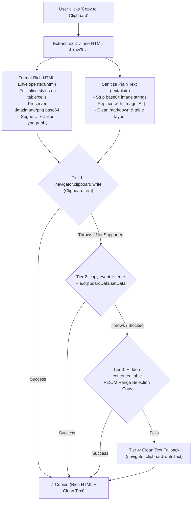

# Feature Specification: Rich Clipboard Multimodal Export (Tables & Generated Images)

## 1. Problem Statement & Motivation

### 1.1 Context & Problem
When users click **"Insights"** or prompt Gemini for table intelligence and executive briefings, the system generates:
1. **Structured Data Tables:** Formatted markdown tables analyzing metrics, variances, and column statistics.
2. **Generated Visual Images / Bar Graphs:** Flat 2D vector charts and infographics encoded as inline data URIs (`data:image/png;base64,...`).

While rendering within the Office add-in taskpane works as intended, copying this content to the clipboard and pasting it into external client applications (e.g., **Microsoft Word (Desktop & Web)**, **Google Docs**, **Apple Pages**, **Microsoft Excel**, **Notion**, **Apple Mail**) currently fails:
- **Raw Base64 Dump:** The previous copy logic only exported a plain-text representation of the raw response text, dumping hundreds of thousands of characters of raw base64 text (``) into the target document instead of rendering the image.
- **Unformatted Tables:** Without a rich `text/html` MIME type on the clipboard, target word processors and spreadsheets could not reconstruct formatted native tables with column headers, cell borders, and background fills.
- **Plain Text Pollution:** Pasting into plain-text editors (Notepad, VS Code, Slack code blocks) resulted in megabytes of unreadable base64 code rather than a concise text summary.

### 1.2 Objective
Implement an enterprise-grade, multi-MIME rich clipboard export system that:
1. Emits a rich `text/html` payload containing complete inline styling, styled native `<table>` elements, and decoded/embedded `` tags so Microsoft Word and Google Docs immediately render images and tables natively upon paste.
2. Emits a sanitized, human-readable `text/plain` payload where base64 data URIs are stripped and replaced with concise descriptive placeholders (e.g., `[Image: Financial Trend Chart]`).
3. Employs a robust, 4-tier fallback mechanism to ensure clipboard writes succeed across all Office host environments (Edge WebView2, Safari WebKit, Chrome, and sandboxed iframes).

---

## 2. Architecture & Clipboard Payload Design

### 2.1 Multi-MIME Clipboard Structure



---

## 3. Payload Specifications

### 3.1 `text/html` Payload Specification
The `text/html` payload is wrapped in a complete, self-contained HTML envelope designed for maximum compatibility with Word and Google Docs clipboard parsers:

```html
<!DOCTYPE html>
<html>
<head>
  <meta charset="utf-8">
  <title>Gemini Export</title>
  <style>
    body { font-family: 'Segoe UI', Calibri, -apple-system, sans-serif; font-size: 11pt; color: #201f1e; line-height: 1.5; }
    table { border-collapse: collapse; width: 100%; margin: 12px 0; }
    th { background-color: #0f6cbd; color: #ffffff; font-weight: 600; border: 1px solid #0f6cbd; padding: 8px 12px; text-align: left; }
    td { border: 1px solid #d2d0ce; padding: 7px 10px; color: #201f1e; vertical-align: top; }
    tr:nth-child(even) td { background-color: #f8f9fa; }
    img { max-width: 100%; height: auto; display: block; margin: 12px auto; }
  </style>
</head>
<body>
  <!-- Clean inline-styled body content with native <table> and  tags -->
  ${richBodyContent}
</body>
</html>
```

#### Inline Style Requirements:
- **Tables:** Every `<table>` element must include `border-collapse: collapse; width: 100%; margin: 14px 0; font-family: 'Segoe UI', Calibri, sans-serif; font-size: 10pt;`.
- **Headers (`<th>`):** `background-color: #0f6cbd; color: #ffffff; font-weight: 600; padding: 8px 12px; border: 1px solid #0f6cbd;`.
- **Cells (`<td>`):** `padding: 8px 12px; border: 1px solid #d2d0ce; color: #201f1e;`.
- **Images (``):** `max-width: 100%; height: auto; display: block; margin: 12px auto; border: 1px solid #c7e0f4; border-radius: 4px;`.
- **Callout Boxes:** `background-color: #f0f6ff; border-left: 4px solid #0078d4; border-top: 1px solid #d2d0ce; border-right: 1px solid #d2d0ce; border-bottom: 1px solid #d2d0ce; padding: 12px 16px; margin: 12px 0;`.

### 3.2 `text/plain` Payload Specification
The `text/plain` payload represents the clean, human-readable text version:
1. **Base64 Image Replacement:** All `` and `!\[([^\]]*)\]\(data:image\/[^\)]+\)` occurrences are replaced with `[Image: $alt]` (e.g., `[Image: Table Trend Bar Graph]`).
2. **HTML Tag Stripping:** Any lingering raw HTML wrapper tags (`<div>`, `<span>`, `<section>`) are normalized into clean text line breaks.
3. **Markdown Preservation:** Tables, headers, bold weights, and lists remain formatted in standard GitHub Flavored Markdown.

---

## 4. Multi-Tier Execution Strategy

| Tier | Mechanism | Target Compatibility | Failure Modes Handled |
| :--- | :--- | :--- | :--- |
| **Tier 1** | `navigator.clipboard.write([new ClipboardItem({ 'text/html': htmlBlob, 'text/plain': textBlob })])` | Modern Chrome, Edge WebView2, Safari 13.1+, Firefox | Sandboxed iframe permissions error, legacy browsers |
| **Tier 2** | Synthetic `copy` event with `e.clipboardData.setData('text/html', ...)` + `document.execCommand('copy')` | Office Taskpanes with restricted async clipboard | Async clipboard policy restrictions |
| **Tier 3** | Hidden `contenteditable` element with DOM Range selection + `document.execCommand('copy')` | Older WebViews without `clipboardData` mutation access | Synthetic event interception failure |
| **Tier 4** | Clean Plain-Text Copy via `navigator.clipboard.writeText` or textarea copy | Universal baseline fallback | Complete HTML clipboard unavailability |

---

## 5. Implementation Steps

1. **Create Clipboard Utility Module (`microsoft-addin/src/core/clipboardUtils.js`):**
   - Implement `formatHtmlForClipboard(htmlContent)` to build the complete HTML envelope.
   - Implement `sanitizePlainTextForClipboard(rawText, textDiv)` to replace base64 images with clean `[Image: ...]` labels and strip junk markup.
   - Implement `copyRichContentToClipboard(htmlContent, plainText)` executing Tiers 1 through 4.
2. **Integrate with `ChatLog.js`:**
   - Update `createCopyButton(text, textDiv)` to invoke `copyRichContentToClipboard`.
   - Ensure visual confirmation feedback (`✓ Copied!`) on success.
3. **Enhance `markdownParser.js` Inline Styles:**
   - Verify all table cells, header cells, callout boxes, and image wrappers contain explicit inline styles required by Word and Docs.
4. **Build & Test:**
   - Execute `npm run build` in `microsoft-addin`.
   - Verify pasting behavior across Microsoft Word, Google Docs, Excel, and text editors.
5. **Deploy to Cloud Run:**
   - Deploy `gemini-frontend` to Cloud Run.

---

## 6. Acceptance Criteria

- [x] **No Raw Base64 Paste:** Pasting copied content into Microsoft Word, Google Docs, or text editors NEVER outputs raw `data:image/png;base64,...` text strings.
- [x] **Image Rendering on Paste:** When content contains generated images (such as bar charts or infographics), pasting into Microsoft Word or Google Docs natively renders the image inline.
- [x] **Table Formatting on Paste:** Pasting into Microsoft Word or Google Docs produces formatted native tables with header fills and borders.
- [x] **Clean Plain-Text Paste:** Pasting into Notepad or code editors outputs clean markdown with `[Image: ...]` placeholders.
- [x] **Cross-Platform Host Support:** Copy works reliably in Excel, Word, and PowerPoint taskpanes across Windows WebView2, Mac Safari, and Web Office.
