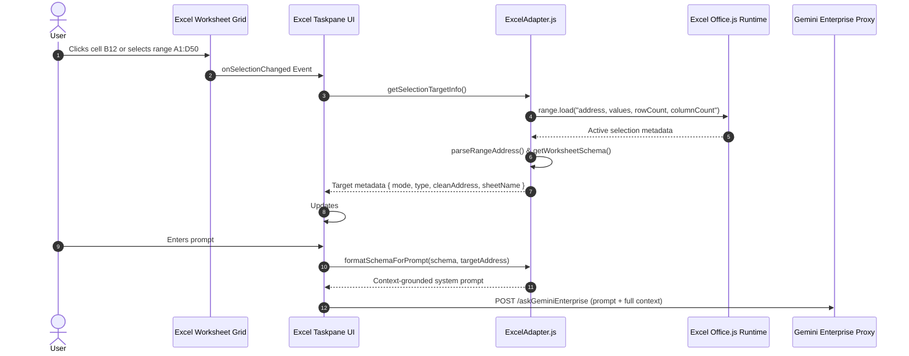

# Feature Specification: Excel Context Discovery, Range Parsing & Active Schema Resolution Engine

## 1. Problem Statement

### 1.1 Background and Current Behavior
In spreadsheet environments, AI assistants face unique challenges compared to standard text documents:
1. **Dynamic 2D Coordinates & Bounding Boxes:** Data is organized in a two-dimensional grid with lettered columns (A, B, C... AA, AB) and numbered rows (1, 2, 3...).
2. **Ambiguous Selection Scope:** Users may be pointing to a single output cell, highlighting a multi-cell data range, focusing on an Excel Structured Table (`ListObject`), or interacting with an existing native chart.
3. **Lack of Sheet Visibility:** Without automated schema extraction, the LLM has no knowledge of which columns hold dates, vendor names, or currencies, leading to invalid formula ranges (e.g., querying `Column Z` when data only spans `A:E`).

### 1.2 User Impact & Limitations
* **Hallucinated Coordinates:** The model invents arbitrary column letters or row bounds when sheet schema metadata is omitted from prompts.
* **Context Blindness:** When switching between creating formulas, formatting cell ranges, and editing charts, generic prompts fail to target the appropriate spreadsheet entity.
* **In-Cell Interaction Friction:** Users had to constantly switch between typing in the taskpane and navigating their worksheet.

### 1.3 Target Persona & Impact
* **Excel End Users & Analysts:** Enjoying seamless, context-aware AI interactions that automatically bind to active cells, selected tables, or focused charts.
* **Power Users:** Utilizing in-cell `@gemini` triggers directly within worksheet cells.

---

## 2. Goals & Non-Goals

### 2.1 Goals
* **Active Worksheet Schema Discovery (`getWorksheetSchema`):**
  - Read used ranges, dimensions (rows × columns), start/end row numbers, and column headers.
  - Map column letters to human-readable header names (`A -> Date`, `B -> Merchant`, `C -> Amount`).
  - Extract structured table definitions (`tbl.name`, `tbl.columns`) and existing charts (`ch.id`, `ch.name`, `ch.chartType`, `ch.title`).
* **Bidirectional Coordinate & Range Decomposition:**
  - `columnIndexToLetter(index)` and `letterToColumnIndex(letter)` with full support for single and multi-letter columns (A..Z, AA..ZZ).
  - `parseRangeAddress(address)` and `resolveRangeAddress(address, usedRangeBounds)` for handling single cells (`B2`), bounded ranges (`Sheet1!$B$2:$D$10`), column-only spans (`A:D`), and unbounded coordinates.
* **Multi-Mode Target Resolution (`getSelectionTargetInfo`):**
  - Intelligently resolve the target based on the active agent mode (`create-formula`, `modify-range`, `modify-chart`).
  - Maintain "sticky" chart selection when user focus transitions from the workbook grid to the taskpane input UI.
* **Structured System Prompt Contextualization (`formatSchemaForPrompt`):**
  - Inject active worksheet metadata, column schemas with sample values, named table structures, existing chart inventories, and grid data snapshots into the Gemini Enterprise prompt.
* **Live Taskpane Schema Preview Bar:**
  - Display real-time UI pills (`#targetCellBadge`, `#sheetSchemaBadge`) showing cursor position, active table name, multi-cell range dimensions, or locked chart title.
* **In-Document `@gemini` Command Watcher (`checkInDocumentCommands`):**
  - Scan for in-cell commands (e.g. `@gemini sum total revenue where status is Complete`), display a temporary placeholder, and automatically evaluate and write the resulting formula or content back to the cell.

### 2.2 Non-Goals
* **Full Multi-Gigabyte Workbook Ingestion:** Context windows cap raw grid text while preserving statistical distributions and column schemas to prevent token overflow.

---

## 3. Proposed Solution

### 3.1 High-Level Architecture



---

## 4. Technical Design

### 4.1 Schema Metadata Structures

```typescript
interface ExcelWorksheetSchema {
  sheetName: string;            // e.g. "Q3 Financials"
  usedRangeAddress: string;     // e.g. "Sheet1!A1:F150"
  rowCount: number;             // Total used rows
  columnCount: number;          // Total used columns
  startRow: number;             // 1-based start row
  endRow: number;               // 1-based end row
  startCol: number;             // 0-based start col index
  columns: Array<{
    letter: string;             // "A", "B", "C"
    index: number;              // 0, 1, 2
    header: string;             // "Transaction Date", "Vendor"
    samples: string[];          // Top 3 sample values
  }>;
  sampleRows: Array<Array<any>>;// Top 5 sample rows
  gridData: Array<Array<any>>;  // Raw cell values matrix
  tables: Array<{
    name: string;               // "TransactionsTable"
    columns: string[];          // ["ID", "Vendor", "Amount"]
  }>;
  charts: Array<{
    id: string;
    name: string;
    type: string;
    title: string;
    width: number;
    height: number;
  }>;
}
```

---

### 4.2 Key Algorithms

#### 4.2.1 Bidirectional Column Conversions & Range Parsing
```javascript
export function columnIndexToLetter(colIndex) {
  let temp = colIndex + 1;
  let letter = "";
  while (temp > 0) {
    const remainder = (temp - 1) % 26;
    letter = String.fromCharCode(65 + remainder) + letter;
    temp = Math.floor((temp - remainder) / 26);
  }
  return letter;
}

export function letterToColumnIndex(letter) {
  const clean = String(letter).toUpperCase().replace(/[^A-Z]/g, "");
  let index = 0;
  for (let i = 0; i < clean.length; i++) {
    index = index * 26 + (clean.charCodeAt(i) - 64);
  }
  return index - 1;
}

export function parseRangeAddress(rangeAddress) {
  if (!rangeAddress) return null;
  const clean = rangeAddress.replace(/^.*?!\$?/, "").replace(/\$/g, "");
  
  if (clean.includes(":")) {
    const [start, end] = clean.split(":");
    const startMatch = start.match(/^([A-Za-z]+)([0-9]*)$/);
    const endMatch = end.match(/^([A-Za-z]+)([0-9]*)$/);
    if (!startMatch || !endMatch) return null;

    const startCol = startMatch[1].toUpperCase();
    const endCol = endMatch[1].toUpperCase();
    const startRow = startMatch[2] ? parseInt(startMatch[2], 10) : null;
    const endRow = endMatch[2] ? parseInt(endMatch[2], 10) : null;

    return {
      startCol,
      startColIndex: letterToColumnIndex(startCol),
      startRow,
      endCol,
      endColIndex: letterToColumnIndex(endCol),
      endRow,
      address: clean
    };
  }

  const singleMatch = clean.match(/^([A-Za-z]+)([0-9]+)$/);
  if (singleMatch) {
    const col = singleMatch[1].toUpperCase();
    const row = parseInt(singleMatch[2], 10);
    return {
      startCol: col,
      startColIndex: letterToColumnIndex(col),
      startRow: row,
      endCol: col,
      endColIndex: letterToColumnIndex(col),
      endRow: row,
      address: `${col}${row}:${col}${row}`
    };
  }
  return null;
}
```

#### 4.2.2 Live Schema Prompt Formatting (`formatSchemaForPrompt`)
Injects:
1. Active Agent Mode directive (`Create Formula`, `Modify Range`, or `Modify Chart`).
2. Exact Column Schema mapping each letter to its full coordinate span, header, and representative sample values.
3. Named Excel Table inventories and existing chart IDs.
4. Tabular grid snapshot formatted in markdown table structure.

---

## 5. UI / UX Integration

1. **Dual-Target 2-Row Header Preview Bar (`#excelSchemaPreview`)**:
   - **Row 1 (`.schema-row.primary-row`)**:
     - Left: `#sheetSchemaBadge` showing active worksheet name and dimension metrics (e.g. `📄 Sheet1 (A1:G150)`).
     - Right: `#targetRangeBadge` displaying cursor position or multi-cell bounds (`🎯 Cell: B2` or `📊 Range: A1:D50 (50×4)`).
   - **Row 2 (`.schema-row.chart-row` / `#targetChartRow`)**:
     - Dedicated sticky chart target badge (`#targetChartBadge`): `📊 Target Chart: [Chart Name] ✕`.
     - Dismissable via `#removeTargetChartBtn` and auto-cleared on session reset (`UT-34`).
2. **In-Cell `@gemini` Execution**:
   - Typing `@gemini average revenue where region is EMEA` in cell C15 triggers automatic formula generation and in-place cell evaluation via `checkInDocumentCommands()`.

---

## 6. Testing & Validation Strategy

1. **Unit Test Coverage ([`microsoft-addin/tests/excel.test.mjs`](file:///Users/ravindranv/Code-Local/For-Excel-GE-Add-In/excel_pod_release/gemini-for-office-365/microsoft-addin/tests/excel.test.mjs))**:
   - `UT-1`: Bidirectional `columnIndexToLetter` & `letterToColumnIndex` conversions across single and multi-letter columns (A, B, Z, AA, AB).
   - `UT-2`: Range address decomposition for single cells, 2D bounded grids (`$B$2:$D$10`), and sheet prefixes.
   - `UT-2b`: Column-only spans (`A:D`, `B:B`) and bounded resolution (`resolveRangeAddress`).
   - `UT-31`: Taskpane 2-row header layout conformance (`.primary-row` and `.chart-row`) and verification of clean hierarchy.
   - `UT-33`: Context ingestion with active selection and document text in `TaskpaneShell.populateDocChips`.
   - `UT-34`: `onSessionReset` clears locked chart targets, hides Row 2 target badge, and resets chat scroll position.

