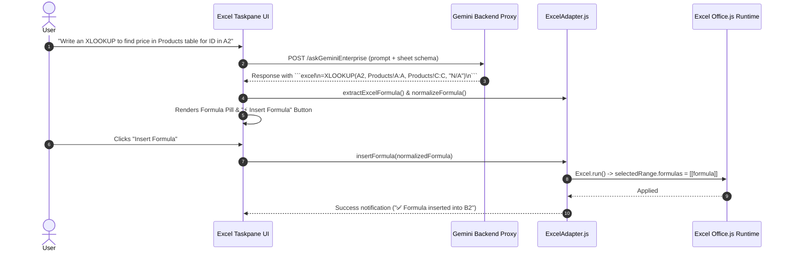

# Feature Specification: Excel AI Formula Generation & Range Formatting Engine

## 1. Problem Statement

### 1.1 Background and Current Behavior
Spreadsheet users frequently struggle with composing advanced Excel formulas (`XLOOKUP`, `INDEX/MATCH`, `SUMIFS`, `COUNTIFS`, `AVERAGEIFS`, `LET`, `LAMBDA`, nested dynamic arrays) and applying clean, consistent corporate styling to messy raw data ranges.

Previously:
1. **Formula Errors & Delimiter Mismatches:** AI assistants frequently emitted formulas with non-standard Unicode characters (e.g. en-dashes `−`, smart quotes `“”`, non-breaking spaces `\u00A0`), invalid single quotes around text criteria (e.g. `=SUMIFS(C:C, D:D, 'Approved')`), or trailing punctuation (semicolons/periods) that caused immediate `#NAME?` or syntax errors in Excel.
2. **Fragile Formula Injection:** Users had to carefully copy formulas into the formula bar, often breaking relative coordinate references.
3. **Manual Table Styling:** Applying alternating row fills, bold blue headers, right-aligned currency formatting, and column autofitting required 5-10 manual ribbon clicks per sheet.

### 1.2 User Impact & Limitations
* **Formula Syntax Failures:** Office.js throws fatal exceptions when setting `.formulas = [["=SUM(...)"]]` if the formula contains invalid Unicode characters or single-quoted string criteria.
* **Loss of Productivity:** Building multi-criteria conditional aggregations or looking up across different sheets consumes significant analyst time.
* **Inconsistent Visual Standards:** Ad-hoc range formatting leads to disjointed executive presentations.

### 1.3 Target Persona & Impact
* **Financial & Data Analysts:** Writing complex lookup and aggregation formulas without memorizing parameter ordering.
* **Business Users & Report Designers:** Instantly formatting raw transaction ranges with professional typography, border styles, and number masks.

---

## 2. Goals & Non-Goals

### 2.1 Goals
* **Automated Formula Sanitization & Normalization (`normalizeFormula`):**
  - Normalize smart quotes (`“”`, `‘’`) to ASCII quotes (`"`).
  - Convert single-quoted criteria literals (`'Approved'`) to double quotes (`"Approved"`) while preserving single quotes for sheet names (e.g. `'Sales Data'!A1`).
  - Strip non-breaking spaces (`\u00A0`, `\u2000-\u200B`), Unicode minuses (`−`), and trailing punctuation.
  - Enforce leading `=` and validate parenthesis balance.
* **Multi-Format Extraction Pipeline (`extractExcelFormula`):** Robustly extract formulas from fenced code blocks (` ```excel `), inline markdown code (`` `=XLOOKUP(...)` ``), standalone lines, and embedded text expressions.
* **Declarative Range Formatting Engine (` ```excel-range-format `):** Support JSON format specifications controlling fill colors, font styles (bold, italic, size, color), text alignment (horizontal/vertical/wrap), borders (edges, colors, weights), number formats, and autofit.
* **In-Cell `@gemini` Trigger Insertion:** Detect in-cell triggers (e.g. `@gemini sum column C where D is Approved`) and insert the computed formula directly into the active cell.
* **Response Action Buttons & Formula Preview Pills:** Render interactive **"⚡ Insert Formula"** and **"🎨 Apply Range Format"** buttons alongside formula badge pills in the taskpane chat.

### 2.2 Non-Goals
* **VBA/Macro Execution:** Operations are strictly implemented using modern JavaScript Office.js APIs (`Excel.run`).
* **Custom XLL Add-in Compilations:** Formula evaluations leverage native Excel computation engines.

---

## 3. Proposed Solution

### 3.1 High-Level Architecture



---

## 4. Technical Design

### 4.1 Data Structures & Schemas

#### 4.1.1 Range Format Specification Schema (`normalizeRangeFormatSpec`)
```typescript
interface ExcelRangeFormatSpec {
  targetRange?: string; // e.g. "A1:D1" or empty for active selection
  fill?: {
    color: string;      // Normalized hex e.g. "#0078D4"
  };
  font?: {
    bold?: boolean;
    italic?: boolean;
    underline?: "Single" | "None";
    strikethrough?: boolean;
    color?: string;     // Hex e.g. "#FFFFFF"
    size?: number;      // Font size in points (e.g. 11)
    name?: string;      // Font family (e.g. "Segoe UI")
  };
  horizontalAlignment?: "Center" | "Left" | "Right" | "Justify" | "General";
  verticalAlignment?: "Center" | "Top" | "Bottom" | "Justify";
  wrapText?: boolean;
  numberFormat?: string; // e.g. "$#,##0.00", "0.0%", "yyyy-mm-dd"
  borders?: {
    edge?: "All" | "Outline" | "EdgeTop" | "EdgeBottom";
    style?: "Continuous" | "Dash" | "Dot";
    weight?: "Thin" | "Medium" | "Thick";
    color?: string;
  };
  autofitColumns?: boolean;
  autofitRows?: boolean;
  rowHeight?: number;
  columnWidth?: number;
  clear?: "formats" | "contents" | "all";
}
```

---

### 4.2 Key Functions & Normalization Logic

#### 4.2.1 Formula Normalization (`normalizeFormula`)
```javascript
export function normalizeFormula(formula) {
  if (!formula) return "";
  let clean = formula.trim();

  // Strip non-breaking spaces and unicode spaces
  clean = clean.replace(/[\u00A0\u2000-\u200B\uFEFF]/g, " ");

  // Normalize smart/curly quotes
  clean = clean.replace(/[\u201C\u201D\u201E\u00AB\u00BB]/g, "\"");
  clean = clean.replace(/[\u2018\u2019\u201A]/g, "'");

  // Normalize unicode math symbols
  clean = clean.replace(/[\u2212\u2013\u2014]/g, "-");
  clean = clean.replace(/[\u00D7]/g, "*");
  clean = clean.replace(/[\u00F7]/g, "/");

  // Strip trailing punctuation
  clean = clean.replace(/[.;]+$/, "").trim();

  // Normalize whitespace
  clean = clean.replace(/\r?\n+/g, " ").replace(/\s+/g, " ").trim();

  // Ensure leading '='
  if (!clean.startsWith("=")) clean = "=" + clean;

  // Convert single-quoted criteria literals to double quotes while preserving sheet references
  clean = clean.replace(/'([^'!\r\n]+)'(?!\s*!)/g, '"$1"');

  return clean;
}
```

#### 4.2.2 Range Formatting Execution (`applyRangeFormatting`)
Located in [`microsoft-addin/src/adapters/ExcelAdapter.js`](file:///Users/ravindranv/Code-Local/For-Excel-GE-Add-In/excel_pod_release/gemini-for-office-365/microsoft-addin/src/adapters/ExcelAdapter.js):
* Resolves explicit address (e.g. `"A1:D1"`) or falls back to `context.workbook.getSelectedRange()`.
* Applies fill colors, typography, alignment, border continuous weights, and number formats.
* Executes `targetRange.format.autofitColumns()` for clean presentation.

---

## 5. UI / UX Integration

1. **Agent Mode Bar**:
   - **"Create formula"**: Pre-configures model prompt for formula synthesis.
   - **"Modify a range"**: Primes prompt for declarative range formatting.
2. **Response Action Toolbar**:
   - **"⚡ Insert Formula"**: Injects normalized formula into active cell.
   - **"🎨 Apply Range Format"**: Applies format specification to target coordinates.
   - **Formula Pill**: Displays syntax-highlighted formula string in chat.

---

## 6. Testing & Validation Strategy

1. **Unit Test Coverage ([`microsoft-addin/tests/excel.test.mjs`](file:///Users/ravindranv/Code-Local/For-Excel-GE-Add-In/excel_pod_release/gemini-for-office-365/microsoft-addin/tests/excel.test.mjs))**:
   - `UT-3`: Verifies formula extraction from fenced blocks, inline code, and standalone lines.
   - `UT-3b`: Validates smart quote normalization (`“”` -> `"`), Unicode symbol translation (`−` -> `-`), and sheet reference preservation (`'Sales Data'!C:C`).
   - `UT-3c`: Multi-line formula parsing and JavaScript comment filtering.
   - `UT-6`: Tests JSON and JS pseudo-code range format specification extraction (`targetRange`, `fill`, `font`, `horizontalAlignment`, `autofitColumns`).
   - `UT-12`: Validates markdown parser visual card rendering for ````excel-range-format```` code blocks.
   - `UT-32`: Validates prompt chips for formula synthesis (`chipFormulaGen`), lookups (`chipXlookup`), formula explanations (`chipExplainFormula`), formula risk audits (`chipFormulaRisks`), and range formatting (`chipFormatRange`).
   - `UT-33`: Validates context ingestion with active selection and document text for formula and formatting workflows.

