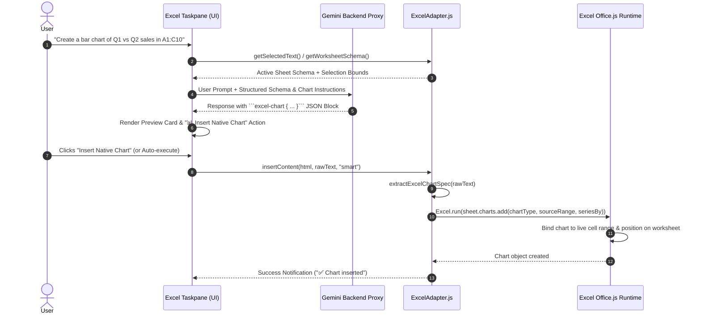
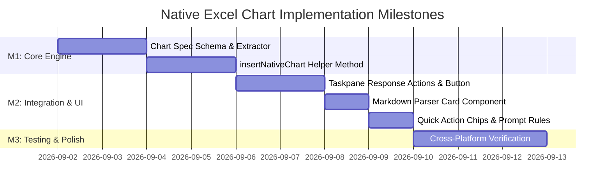

# Feature Specification: Excel Native Chart Generation via Office.js

## 1. Problem Statement

### 1.1 Background and Current Behavior
Currently, when a user asks the Gemini AI assistant to visualize spreadsheet data in Microsoft Excel (e.g., *"Create a column chart comparing quarterly revenue across regions"* or *"Plot sales trends from A1:B12"*), the system falls back to one of two suboptimal rendering modes:
1. **Static 2D Bitmap Images:** The backend proxy ([`geminiproxy/index.js`](file:///Users/ravindranv/Code-Local/For-Excel-GE-Add-In/excel_pod_release/gemini-for-office-365/geminiproxy/index.js)) triggers a secondary multimodal call to Vertex AI (`gemini-2.5-flash-image`), returning a static 2D PNG infographic displayed in the taskpane chat bubble or pasted as a floating image object.
2. **HTML/CSS Mock Visuals:** The client markdown parser ([`microsoft-addin/src/core/markdownParser.js`](file:///Users/ravindranv/Code-Local/For-Excel-GE-Add-In/excel_pod_release/gemini-for-office-365/microsoft-addin/src/core/markdownParser.js)) renders HTML horizontal bar tables in the add-in taskpane, which cannot be placed or used inside the workbook.

### 1.2 User Impact & Limitations
Both existing behaviors fail to provide true spreadsheet utility:
* **No Dynamic Data Binding:** The generated visual is completely detached from the underlying workbook grid. If the user edits numbers in the worksheet, the chart does not update.
* **Non-Interactive & Non-Editable:** Users cannot use Excel's native **Chart Design** or **Format** ribbon tools to adjust series formatting, switch chart types, toggle legends, filter categories, or modify axis scales.
* **Workbook Bloat & Portability Issues:** Embedding raw raster bitmaps inflates `.xlsx` file size and produces pixelated, non-vector visuals upon export or printing.
* **Workflow Friction:** Users are forced to manually highlight ranges and click through the Excel Ribbon to create real charts, defeating the purpose of an AI spreadsheet co-pilot.

### 1.3 Target Persona & Impact
* **Financial Analysts, Business Planners, and Executive Users:** Require immediate, publication-grade, interactive charts anchored directly to their data models for reporting, forecasting, and ad-hoc presentation.

---

## 2. Goals & Non-Goals

### 2.1 Goals
* **Native Office.js Chart Insertion:** Automatically generate and insert native Excel chart objects (`Excel.Chart`) onto the active worksheet linked directly to specified cell ranges via the Office.js Excel API (`sheet.charts.add(...)`).
* **Structured Declarative Chart Schema:** Establish a concise, standardized JSON specification format (````excel-chart ... ````) produced by Gemini that defines chart type, data range, title, series orientation, legend position, and target placement.
* **Comprehensive Chart Type Support:** Support core commercial chart types: Clustered Column, Stacked Column, Clustered Bar, Stacked Bar, Line, Line with Markers, Pie, Doughnut, Area, Stacked Area, Scatter, and Waterfall.
* **Intelligent Grid Positioning:** Position new charts adjacent to the source data range by default (offset by 1-2 columns) or at a specified target cell/coordinate without overwriting existing data.
* **Interactive Taskpane Previews & Response Actions:** Render a structured visual card in the taskpane showing the chart metadata, an interactive **"📊 Insert Native Chart"** action button, and a visual preview pill.
* **In-Cell `@gemini` Trigger Compatibility:** Enable in-cell command triggers (e.g. `@gemini create a pie chart for A1:B6`) to automatically build and insert the chart directly onto the sheet.
* **Graceful Degradation & Schema Validation:** Validate range coordinates, dimension shapes, and chart type compatibility before calling Office.js, providing clear diagnostic feedback if a range is invalid or empty.

### 2.2 Non-Goals
* **Chart-to-Image Exporting:** Generating static raster images of Excel charts for external export is handled by existing PowerPoint/Word adapters and is out of scope for native Excel worksheet insertion.
* **Complex 3D or Legacy Chart Types:** Types such as 3D Surface, Radar/Spider, or deprecated Excel 2003 visual styles will not be supported in the initial release.
* **Direct PivotChart Management:** Linking charts directly to dynamic OLAP PivotTables (as opposed to standard ranges or structured Excel Tables) is deferred to the future PivotTable milestone (Phase 4/6).
* **VBA/Macro Generation:** Chart creation will rely exclusively on supported Office.js JavaScript APIs (`Excel.run`), requiring no legacy VBA code or macro-enabled workbooks (`.xlsm`).

---

## 3. Proposed Solution

### 3.1 High-Level Architecture
Instead of intercepting visual requests to generate static images in [`geminiproxy/index.js`](file:///Users/ravindranv/Code-Local/For-Excel-GE-Add-In/excel_pod_release/gemini-for-office-365/geminiproxy/index.js), the Excel agent prompt pipeline instructs Gemini to output a structured declarative chart manifest:

```json
```excel-chart
{
  "type": "ColumnClustered",
  "dataRange": "A1:F5",
  "hasHeaders": true,
  "seriesBy": "rows",
  "title": "Quarterly Regional Revenue ($M)",
  "legend": {
    "visible": true,
    "position": "Right"
  },
  "position": {
    "placement": "adjacent",
    "offsetColumns": 2
  },
  "dimensions": {
    "width": 480,
    "height": 300
  }
}
```
```

When this block is received:
1. **Taskpane Chat UI:** The markdown parser parses the JSON and renders an interactive **Native Chart Card** showing a formatted summary of the chart to be created.
2. **Action Toolbar:** [`responseActions.js`](file:///Users/ravindranv/Code-Local/For-Excel-GE-Add-In/excel_pod_release/gemini-for-office-365/microsoft-addin/src/taskpanes/excel/responseActions.js) detects the chart manifest and mounts a dedicated **"📊 Insert Native Chart"** button.
3. **Execution Engine:** [`ExcelAdapter.js`](file:///Users/ravindranv/Code-Local/For-Excel-GE-Add-In/excel_pod_release/gemini-for-office-365/microsoft-addin/src/adapters/ExcelAdapter.js) extracts the chart specification, resolves source range bounds and worksheet references, executes `Excel.run()`, creates the chart via `sheet.charts.add()`, applies titles, formatting, and positioning, and synchronizes with Excel.



### 3.2 Key Advantages of this Approach
* **True Interactivity:** The chart is a genuine Office Open XML / Office.js chart object on the sheet canvas. Modifying cell values immediately triggers real-time chart re-rendering.
* **Deterministic & Safe:** The JSON specification separates AI intent from Office.js API invocation, allowing schema validation, bounds checking, and dry-run linting before any canvas modification.
* **Clean Fallback Hierarchy:** If the chart specification is accompanied by explanatory text or tabular data, the agent presents both the textual insights and the chart insertion action cleanly.

---

## 4. Technical Design

### 4.1 Component Architecture & File Modifications

| Component / File | Current Responsibility | Proposed Modifications for Native Charts |
| :--- | :--- | :--- |
| [`microsoft-addin/src/adapters/ExcelAdapter.js`](file:///Users/ravindranv/Code-Local/For-Excel-GE-Add-In/excel_pod_release/gemini-for-office-365/microsoft-addin/src/adapters/ExcelAdapter.js) | Schema discovery, formula extraction, matrix insertion | 1. Implement `extractExcelChartSpec(text, html)` to parse ````excel-chart```` blocks.<br>2. Implement `insertNativeChart(context, sheet, chartSpec)` helper.<br>3. Update `insertContent()` Priority 1 routing to detect and execute chart creation.<br>4. Update `formatSchemaForPrompt()` to include chart generation instructions and supported chart type enums.<br>5. Update `checkInDocumentCommands()` to execute chart generation for in-cell triggers. |
| [`microsoft-addin/src/taskpanes/excel/responseActions.js`](file:///Users/ravindranv/Code-Local/For-Excel-GE-Add-In/excel_pod_release/gemini-for-office-365/microsoft-addin/src/taskpanes/excel/responseActions.js) | Renders formula / table insert buttons and formula pill | 1. Import `extractExcelChartSpec`.<br>2. Detect chart specifications in AI responses.<br>3. Render primary button **"📊 Insert Native Chart"** and chart metadata pill (e.g. `📊 ColumnClustered: A1:F5`). |
| [`microsoft-addin/src/taskpanes/excel/chips.js`](file:///Users/ravindranv/Code-Local/For-Excel-GE-Add-In/excel_pod_release/gemini-for-office-365/microsoft-addin/src/taskpanes/excel/chips.js) | Quick action prompt chips for Excel taskpane | 1. Add `chipChartGen` to `docChips` (*"📊 Native Chart Builder"*).<br>2. Add `selChart` to `selectionChips` (*"📈 Visualize Selection"*). |
| [`microsoft-addin/src/core/markdownParser.js`](file:///Users/ravindranv/Code-Local/For-Excel-GE-Add-In/excel_pod_release/gemini-for-office-365/microsoft-addin/src/core/markdownParser.js) | Converts markdown blocks, tables, and callouts to HTML | 1. Add custom parser handler for ````excel-chart```` code blocks.<br>2. Render an aesthetic UI Preview Card with chart type icon, series range, and title summary. |
| [`geminiproxy/index.js`](file:///Users/ravindranv/Code-Local/For-Excel-GE-Add-In/excel_pod_release/gemini-for-office-365/geminiproxy/index.js) | Gemini Enterprise inference proxy & Vertex image generator | 1. Update system prompt rules: When host is Excel and visual chart is requested, emit ````excel-chart```` JSON manifest rather than raster `image:` links. |

---

### 4.2 Data Structures & Specification Schema

#### 4.2.1 Chart Specification JSON Schema
The ````excel-chart```` code block adheres to the following interface:

```typescript
interface ExcelChartSpec {
  /** Target chart type corresponding to Excel.ChartType enum */
  type:
    | "ColumnClustered"
    | "ColumnStacked"
    | "ColumnStacked100"
    | "BarClustered"
    | "BarStacked"
    | "BarStacked100"
    | "Line"
    | "LineMarkers"
    | "LineStacked"
    | "Pie"
    | "PieExploded"
    | "Doughnut"
    | "Area"
    | "AreaStacked"
    | "Scatter"
    | "Waterfall";

  /** Range address containing category headers and series data (e.g. "A1:D10" or "'Q1 Sales'!A1:B6") */
  dataRange: string;

  /** Chart title text displayed above visual */
  title?: string;

  /** Whether the first row/column contains headers (default: true) */
  hasHeaders?: boolean;

  /** Series orientation: 'auto' | 'columns' | 'rows' (default: 'auto') */
  seriesBy?: "auto" | "columns" | "rows";

  /** Legend configuration */
  legend?: {
    visible?: boolean;
    position?: "Top" | "Bottom" | "Left" | "Right" | "Corner";
  };

  /** Placement options on the worksheet canvas */
  position?: {
    /** 'adjacent' (default: 2 columns right of source data) | 'targetCell' | 'below' */
    placement?: "adjacent" | "targetCell" | "below";
    /** Specific cell address if placement is 'targetCell' (e.g. "G2" or "Sheet2!B5") */
    targetCell?: string;
    /** Number of offset columns if adjacent (default: 2) */
    offsetColumns?: number;
    /** Number of offset rows if below (default: 2) */
    offsetRows?: number;
  };

  /** Pixel/point dimensions on sheet (default: 480 x 300) */
  dimensions?: {
    width?: number;
    height?: number;
  };

  /** Optional data labels configuration */
  dataLabels?: {
    visible?: boolean;
    showValue?: boolean;
    showPercentage?: boolean;
  };
}
```

---

### 4.3 Key Logic Flows & Algorithms

#### 4.3.1 Spec Extraction & Validation (`extractExcelChartSpec`)
Located in [`microsoft-addin/src/adapters/ExcelAdapter.js`](file:///Users/ravindranv/Code-Local/For-Excel-GE-Add-In/excel_pod_release/gemini-for-office-365/microsoft-addin/src/adapters/ExcelAdapter.js):

```javascript
/**
 * Robustly extracts an Excel chart specification from AI response text or HTML
 * @param {string} text - Raw AI response markdown
 * @param {string} htmlContent - Optional HTML content
 * @returns {ExcelChartSpec|null} Parsed chart specification or null
 */
export function extractExcelChartSpec(text, htmlContent = "") {
  const combined = (text || "") + "\n" + (htmlContent ? htmlContent.replace(/<[^>]+>/g, " ") : "");
  if (!combined.trim()) return null;

  // 1. Match ```excel-chart ... ``` or ```chart ... ``` code blocks
  const chartBlockRegex = /```(?:excel-chart|chart|excel_chart)\s*([\s\S]*?)```/i;
  const match = combined.match(chartBlockRegex);
  
  if (match && match[1]) {
    try {
      const parsed = JSON.parse(match[1].trim());
      if (parsed && (parsed.type || parsed.chartType) && (parsed.dataRange || parsed.range)) {
        return normalizeChartSpec(parsed);
      }
    } catch (err) {
      console.warn("Failed to parse chart spec JSON block:", err);
    }
  }

  // 2. Fallback: Check for raw JSON containing chart properties
  const rawJsonRegex = /\{[\s\S]*?"type"\s*:\s*"([A-Za-z]+)"[\s\S]*?"dataRange"\s*:\s*"([A-Za-z0-9:!$]+)"[\s\S]*?\}/;
  const rawMatch = combined.match(rawJsonRegex);
  if (rawMatch) {
    try {
      const parsed = JSON.parse(rawMatch[0].trim());
      return normalizeChartSpec(parsed);
    } catch (e) {
      // Ignored
    }
  }

  return null;
}
```

#### 4.3.2 Chart Type Normalization & Mapping
Maps user-friendly or LLM-generated chart type strings to the exact `Excel.ChartType` enum:

```javascript
const CHART_TYPE_MAP = {
  columnclustered: "columnClustered",
  columnstacked: "columnStacked",
  columnstacked100: "columnStacked100",
  barclustered: "barClustered",
  barstacked: "barStacked",
  barstacked100: "barStacked100",
  line: "line",
  linemarkers: "lineMarkers",
  linestacked: "lineStacked",
  pie: "pie",
  pieexploded: "pieExploded",
  doughnut: "doughnut",
  area: "area",
  areastacked: "areaStacked",
  scatter: "xyscatter",
  xyscatter: "xyscatter",
  waterfall: "waterfall"
};

export function normalizeChartType(rawType) {
  if (!rawType) return "columnClustered";
  const clean = rawType.replace(/[^a-zA-Z0-9]/g, "").toLowerCase();
  return CHART_TYPE_MAP[clean] || "columnClustered";
}
```

#### 4.3.3 Office.js Chart Insertion Factory (`insertNativeChart`)

```javascript
/**
 * Inserts a native Excel chart object onto the worksheet
 * @param {Excel.RequestContext} context - Active Office.js request context
 * @param {Excel.Worksheet} sheet - Target worksheet
 * @param {ExcelChartSpec} spec - Validated chart specification
 * @returns {Promise<Excel.Chart>}
 */
export async function insertNativeChart(context, sheet, spec) {
  // 1. Resolve source data range
  const dataRangeAddress = spec.dataRange.replace(/[$]/g, "").trim();
  const sourceRange = sheet.getRange(dataRangeAddress);
  sourceRange.load("rowIndex, columnIndex, rowCount, columnCount, address");
  await context.sync();

  // 2. Map chart type & series orientation
  const chartTypeKey = normalizeChartType(spec.type);
  const chartType = Excel.ChartType[chartTypeKey] || Excel.ChartType.columnClustered;

  let seriesBy = Excel.ChartSeriesBy.auto;
  if (spec.seriesBy === "rows") seriesBy = Excel.ChartSeriesBy.rows;
  else if (spec.seriesBy === "columns") seriesBy = Excel.ChartSeriesBy.columns;

  // 3. Create chart on sheet
  const chart = sheet.charts.add(chartType, sourceRange, seriesBy);

  // 4. Configure Title
  if (spec.title) {
    chart.title.text = spec.title;
    chart.title.visible = true;
  }

  // 5. Configure Legend
  if (spec.legend) {
    chart.legend.visible = spec.legend.visible !== false;
    if (spec.legend.position) {
      const posKey = spec.legend.position.toLowerCase();
      const posMap = {
        top: Excel.ChartLegendPosition.top,
        bottom: Excel.ChartLegendPosition.bottom,
        left: Excel.ChartLegendPosition.left,
        right: Excel.ChartLegendPosition.right,
        corner: Excel.ChartLegendPosition.corner
      };
      if (posMap[posKey]) {
        chart.legend.position = posMap[posKey];
      }
    }
  }

  // 6. Configure Positioning on Worksheet Canvas
  const pos = spec.position || {};
  if (pos.placement === "targetCell" && pos.targetCell) {
    const targetCellRange = sheet.getRange(pos.targetCell);
    chart.setPosition(targetCellRange, null);
  } else if (pos.placement === "below") {
    const offsetRows = Number(pos.offsetRows) || 2;
    const startRow = sourceRange.rowIndex + sourceRange.rowCount + offsetRows;
    const targetCell = sheet.getCell(startRow, sourceRange.columnIndex);
    chart.setPosition(targetCell, null);
  } else {
    // Default: 'adjacent' (2 columns to the right of source range)
    const offsetCols = Number(pos.offsetColumns) || 2;
    const startCol = sourceRange.columnIndex + sourceRange.columnCount + offsetCols;
    const targetCell = sheet.getCell(sourceRange.rowIndex, startCol);
    chart.setPosition(targetCell, null);
  }

  // 7. Configure Dimensions (Width & Height in points)
  if (spec.dimensions) {
    if (spec.dimensions.width && spec.dimensions.width >= 200) {
      chart.width = Math.min(1200, spec.dimensions.width);
    }
    if (spec.dimensions.height && spec.dimensions.height >= 150) {
      chart.height = Math.min(800, spec.dimensions.height);
    }
  }

  // 8. Data Labels (if requested)
  if (spec.dataLabels && spec.dataLabels.visible) {
    chart.dataLabels.showValue = spec.dataLabels.showValue !== false;
    if (spec.dataLabels.showPercentage) {
      chart.dataLabels.showPercentage = true;
    }
  }

  await context.sync();
  return chart;
}
```

---

### 4.4 Schema Context Prompt Engineering

[`ExcelAdapter.formatSchemaForPrompt()`](file:///Users/ravindranv/Code-Local/For-Excel-GE-Add-In/excel_pod_release/gemini-for-office-365/microsoft-addin/src/adapters/ExcelAdapter.js) is updated to provide explicit instructions and examples for chart generation:

```text
Chart Generation Instructions:
1. When asked to create, plot, or visualize data as a chart or graph in Excel, return a declarative ```excel-chart JSON specification block.
2. Specify the exact 'type' from: ColumnClustered, ColumnStacked, BarClustered, Line, LineMarkers, Pie, Doughnut, Area, Scatter, Waterfall.
3. Specify the exact 'dataRange' covering categories and data values (e.g., "A1:B10" or "'Q1 Sales'!A1:F5").
4. Provide a descriptive 'title'.
5. Include a brief plain-English explanation summarizing what the chart visualizes.

Example Chart Block:
```excel-chart
{
  "type": "ColumnClustered",
  "dataRange": "A1:B6",
  "title": "Revenue by Region",
  "hasHeaders": true,
  "position": { "placement": "adjacent", "offsetColumns": 2 }
}
```
```

---

## 5. UI / UX Design

### 5.1 Taskpane Interaction Workflow
When Gemini returns a chart response, the taskpane renders a dedicated visual card and action button:

```text
+-------------------------------------------------------------+
| 🤖 Gemini Assistant                                         |
|                                                             |
| Here is the visualization for your quarterly sales data:    |
|                                                             |
| +---------------------------------------------------------+ |
| | 📊 Excel Native Chart Preview                           | |
| | Type: Clustered Column (ColumnClustered)                | |
| | Data Source: Sheet1!A1:D6 (6 rows x 4 cols)             | |
| | Title: "Quarterly Revenue by Region"                   | |
| | Position: Adjacent to data (Col F)                      | |
| +---------------------------------------------------------+ |
|                                                             |
| [ 📊 Insert Native Chart ]  [ 📋 Copy Spec ]                |
+-------------------------------------------------------------+
```

### 5.2 State Transitions & User Feedback
1. **Initial State (Response Received):**
   * Primary action button displays: `📊 Insert Native Chart`.
   * Preview pill displays: `Chart: ColumnClustered (A1:D6)`.
2. **Insertion In-Progress:**
   * Button is disabled.
   * Status indicator updates: `⚡ Creating Excel Chart...`.
3. **Success State:**
   * Status indicator updates: `✅ Chart inserted on sheet`.
   * Active selection scrolls or highlights the newly inserted chart.
4. **Error State:**
   * Non-blocking error bubble appears in chat log: `🔴 Chart Creation Error: Range 'A1:Z100' contains no numerical data`.

### 5.3 Quick Action Chips ([`chips.js`](file:///Users/ravindranv/Code-Local/For-Excel-GE-Add-In/excel_pod_release/gemini-for-office-365/microsoft-addin/src/taskpanes/excel/chips.js))
* **Document Chip:**
  * Label: `📊 Native Chart Builder`
  * Prompt: *"Analyze the active worksheet data and generate an optimal native Excel chart specification (Column, Line, Bar, or Pie) visualizing the primary metrics and category breakdowns."*
* **Selection Chip:**
  * Label: `📈 Visualize Selection`
  * Instruction: *"Generate a native Excel chart specification visualizing the selected cell range. Determine the best chart type based on the dimensions and data series."*

---

## 6. Integration Points

### 6.1 Office.js Excel API Surface
* **API Set:** ExcelApi 1.1+ (Supported in Excel 2016+, Excel Online, Microsoft 365 on Windows and Mac).
* **Core Namespaces:**
  * `Excel.ChartCollection.add(type, sourceData, seriesBy)`
  * `Excel.Chart.title`
  * `Excel.Chart.legend`
  * `Excel.Chart.dataLabels`
  * `Excel.Chart.setPosition(startCell, endCell)`
  * `Excel.Chart.width` / `Excel.Chart.height`

### 6.2 Backend Proxy ([`geminiproxy/index.js`](file:///Users/ravindranv/Code-Local/For-Excel-GE-Add-In/excel_pod_release/gemini-for-office-365/geminiproxy/index.js))
* In [`geminiproxy/index.js`](file:///Users/ravindranv/Code-Local/For-Excel-GE-Add-In/excel_pod_release/gemini-for-office-365/geminiproxy/index.js), ensure that requests originating from the Excel Taskpane do **not** trigger the fallback Vertex AI Image generator (`gemini-2.5-flash-image`) when ````excel-chart```` is requested, avoiding redundant latency and API costs.

### 6.3 Shared Client Architecture ([`TaskpaneShell.js`](file:///Users/ravindranv/Code-Local/For-Excel-GE-Add-In/excel_pod_release/gemini-for-office-365/microsoft-addin/src/shell/TaskpaneShell.js))
* `TaskpaneShell.performDocumentInsertion()` routes transparently through `adapter.insertContent(html, rawText, mode)`, allowing chart insertions to benefit from the existing loading state, error catching, and debug status logging.

---

## 7. Edge Cases & Error Handling

### 7.1 Range Bounds & Sheet Validation
* **Invalid or Inverted Range (`B10:A1` or `ZZ1:AAA100`):**
  * *Handling:* Parse address via regex; normalize coordinates. If `sheet.getRange(address)` throws invalid address, catch error, notify user with suggested valid used range.
* **Empty or Non-Numeric Data Range:**
  * *Handling:* Pre-flight inspect `sourceRange.values`. If all values are non-numeric strings or empty, log a warning and fallback to inserting a formatted summary table.
* **Cross-Sheet Data References (`'Q1 Data'!A1:B10`):**
  * *Handling:* Extract sheet name from address if present (`address.includes('!')`). Access the referenced sheet via `context.workbook.worksheets.getItem(sheetName)` before calling `charts.add()`.

### 7.2 Canvas Collisions & Coordinate Overlaps
* **Chart Placement Collision:**
  * *Handling:* If default placement (`adjacent`) would push the chart beyond column `XFD` (Excel max column), wrap placement to `below` the used range (`sourceRange.rowIndex + sourceRange.rowCount + 2`).
* **Protected Worksheet / Read-Only Mode:**
  * *Handling:* If the active worksheet is protected (`sheet.protection.protected === true`), Office.js will throw `AccessDenied` or `WorksheetProtected`. Intercept error and prompt the user: *"Please unprotect the worksheet to insert new charts."*

### 7.3 Concurrency & Lifecycle
* **Multiple Rapid Insert Clicks:**
  * *Handling:* Disable the **Insert Native Chart** button immediately upon first click; re-enable only in the `finally` block of `performDocumentInsertion()`.

---

## 8. Testing & Automated Validation

1. **Automated Unit Tests ([`microsoft-addin/tests/excel.test.mjs`](file:///Users/ravindranv/Code-Local/For-Excel-GE-Add-In/excel_pod_release/gemini-for-office-365/microsoft-addin/tests/excel.test.mjs))**:
   - `UT-4`: `extractExcelChartSpec` correctly extracts fenced ````excel-chart```` JSON blocks and normalizes chart type enums (e.g., `"column"` -> `"ColumnClustered"`).
   - `UT-4b`: `normalizeChartSpec` handles chart synonyms, array ranges, and defaults series orientation to columns.
   - `UT-4c`: `normalizeChartSpec` and `extractExcelChartSpec` handle aggregate specifications (`aggregate: "sum"`) and markdown aggregation badges.
   - `UT-5`: `extractExcelChartEditSpec` parses chart modification directives.
   - `UT-20`: Disambiguates chart update prompts from taxonomy categorization, properly mounting **"🔄 Update Chart"**.
   - `UT-21`: Converts standard chart JSON blocks to edit specifications when user prompt intent is chart modification.
   - `UT-22`: Chart JSON containing `"categories"` keys is guarded against false positive categorization extraction.
   - `UT-24`: Intelligent sub-section chart detection accurately targets categorical breakdown ranges.
   - `UT-25`: Natural language chart modifications produce an **"🔄 Update Chart"** button without misidentifying as taxonomy.

---

## 9. Scope & Milestones



### Milestone Breakdown
* **Milestone 1 (M1) - Chart Engine & Office.js Foundation:**
  * Implement `extractExcelChartSpec()` and `normalizeChartType()`.
  * Implement `insertNativeChart()` in [`ExcelAdapter.js`](file:///Users/ravindranv/Code-Local/For-Excel-GE-Add-In/excel_pod_release/gemini-for-office-365/microsoft-addin/src/adapters/ExcelAdapter.js).
  * Integrate chart insertion as Priority 1 in `ExcelAdapter.insertContent()`.
* **Milestone 2 (M2) - UI, Taskpane Actions & Parser:**
  * Update [`responseActions.js`](file:///Users/ravindranv/Code-Local/For-Excel-GE-Add-In/excel_pod_release/gemini-for-office-365/microsoft-addin/src/taskpanes/excel/responseActions.js) to render "📊 Insert Native Chart" button and metadata pill.
  * Update [`markdownParser.js`](file:///Users/ravindranv/Code-Local/For-Excel-GE-Add-In/excel_pod_release/gemini-for-office-365/microsoft-addin/src/core/markdownParser.js) to render preview cards for ````excel-chart```` blocks.
  * Add quick action chips to [`chips.js`](file:///Users/ravindranv/Code-Local/For-Excel-GE-Add-In/excel_pod_release/gemini-for-office-365/microsoft-addin/src/taskpanes/excel/chips.js).
  * Update prompt schema instructions in [`ExcelAdapter.formatSchemaForPrompt()`](file:///Users/ravindranv/Code-Local/For-Excel-GE-Add-In/excel_pod_release/gemini-for-office-365/microsoft-addin/src/adapters/ExcelAdapter.js).
* **Milestone 3 (M3) - Comprehensive E2E Testing & Polish:**
  * Validate across Excel for Windows, Excel for Mac, and Excel Online.
  * Test all 12 supported chart types and cross-worksheet data ranges.

---

## 9. Success Criteria

### 9.1 Functional Acceptance Criteria
1. **Accurate Spec Detection:** The add-in correctly extracts ````excel-chart```` JSON specifications from Gemini responses across all standard code fence formats.
2. **Native Chart Instantiation:** Clicking **Insert Native Chart** creates an interactive, live `Excel.Chart` object on the active sheet linked to the specified cells.
3. **Real-Time Data Reactivity:** Editing cell values inside the source range immediately updates the chart graphic without requiring add-in intervention.
4. **Correct Positioning:** Charts are anchored cleanly adjacent to or below the data range, respecting specified dimensions.
5. **In-Cell Execution:** Executing `@gemini create a bar chart for A1:B10` in a cell successfully creates the chart object.
6. **Taskpane UI & Action Buttons:** The taskpane dynamically mounts the **"📊 Insert Native Chart"** button and displays chart metadata pills.

### 9.2 Non-Functional & Reliability Metrics
* **Execution Latency:** Chart creation via Office.js must complete within **< 500ms** after button click.
* **Zero Host Crashing:** Must handle invalid ranges or unsupported chart types gracefully without unhandled promise rejections or taskpane crashes.

---

## 10. Open Questions & Alternatives Considered

### 10.1 Alternatives Considered
* **Alternative A: Client-Side QuickChart / Chart.js Image Injection**
  * *Evaluation:* Rejected because injecting raster images defeats the fundamental value proposition of a spreadsheet, preventing user edits and breaking data reactivity.
* **Alternative B: Office OpenXML Direct Raw Injection**
  * *Evaluation:* Rejected due to high complexity and potential file corruption risks; the official Office.js `sheet.charts.add()` API is safe, versioned, and fully supported across all Microsoft 365 platforms.

### 10.2 Open Questions
* **Chart Color Palette Customization:** Should Gemini specify custom hex color fills for individual series (e.g. Google Cloud brand blue `#4285F4`), or should the chart default to the workbook's active Office theme palette?
  * *Recommendation:* Default to workbook theme for consistent corporate branding, allowing optional hex color overrides in future iterations.
