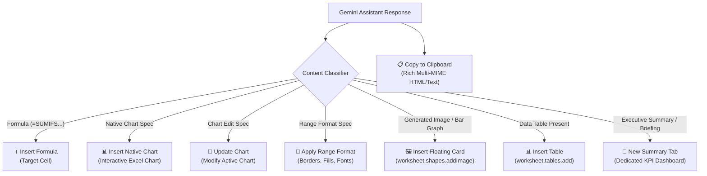

# Technical Specification: Excel Rich Content & Visual Object Insertion Architecture

## 1. Executive Summary & Problem Analysis

### 1.1 The Spreadsheet Rich Content Problem
In Microsoft Word and Google Docs, content flows linearly as paragraphs, inline images, and continuous text flows. In contrast, Microsoft Excel is a **discrete cell matrix calculation engine**:
- **Cell Content Model:** An individual Excel cell only holds `.values` (primitives: string, number, boolean) or `.formulas` (strings starting with `=`).
- **No In-Cell HTML Rendering:** Excel cells **cannot** parse or render HTML tags (`<h1>`, `<p>`, `<table>`, ``, `<blockquote>`, `<div>`).
- **The Failure Mode:** When an AI summary agent returns rich HTML (with headings, callout boxes, bullet points, and embedded base64 images), passing that HTML directly into `range.values` dumps the raw HTML tags as an unreadable text string or fragmented single-column cell blocks.

### 1.2 Objective
Design and specify an enterprise-grade solution for inserting and rendering rich content in Excel workbooks without dumping raw HTML into cells, providing users with high-fidelity visual representations, structured native data, and clean workflow choices.

---

## 2. Evaluation of Potential Spreadsheet Insertion Solutions

| Mechanism | Office.js API Support | Visual Fidelity | Editability | Data Compute | Verdict |
| :--- | :--- | :--- | :--- | :--- | :--- |
| **A. Floating Image / Visual Card** | `worksheet.shapes.addImage(base64)` | ⭐⭐⭐⭐⭐ Pixel-perfect HTML/SVG/Chart rendering | Static visual object (draggable, resizable) | N/A (floats over grid) | **Recommended for visual charts, graphs, and summary cards** |
| **B. Dedicated Summary Worksheet** | `workbook.worksheets.add(name)` + styled KPI blocks | ⭐⭐⭐⭐ Professional branded dashboard | ⭐⭐⭐⭐⭐ Fully editable cells & text | ⭐⭐⭐⭐⭐ Full formula & pivot integration | **Recommended for multi-section executive briefings** |
| **C. Structured Native Excel Table** | `worksheet.tables.add(range, true)` | ⭐⭐⭐⭐ Excel native table design (zebra stripes, headers) | ⭐⭐⭐⭐⭐ Fully editable tabular grid | ⭐⭐⭐⭐⭐ Structured references, sorting & filtering | **Recommended for tabular data extraction** |
| **D. Floating Shape / Text Box** | `worksheet.shapes.addTextBox(text)` | ⭐⭐ Plain text only, uniform font | ⭐⭐⭐ Editable in shape frame | ❌ No table/image support | **Not recommended** (lacks rich HTML/image support) |
| **E. In-Cell HTML Dump** | `range.values = [[html]]` | ❌ Broken / Raw HTML markup | ❌ Corrupted text | ❌ Broken | **Anti-Pattern: Eliminated** |

---

## 3. Recommended Architecture: Intent-Driven Contextual Action System

Instead of a single, ambiguous **"➕ Insert into Sheet"** button that attempts to shoehorn rich multimodal content into a single cell, the add-in adopts an **Intent-Driven Contextual Action System**:



---

## 4. Technical Implementation Details

### 4.1 Floating Visual Card Insertion (`worksheet.shapes.addImage`)
When the response contains a generated base64 image (such as an Insights bar graph or infographic chart):
1. The add-in extracts the clean base64 payload (`data:image/png;base64,...`).
2. Calls `sheet.shapes.addImage(cleanBase64)`.
3. Positions the floating image adjacent to the active selection or at `(left: range.left + range.width + 25, top: range.top)` with default dimensions `(width: 520, height: 290)`.
4. The user can drag, scale, or reposition the floating card anywhere on the worksheet canvas.

```javascript
// Office.js Floating Image Insertion
await Excel.run(async (context) => {
  const sheet = context.workbook.worksheets.getActiveWorksheet();
  const range = context.workbook.getSelectedRange();
  range.load(["left", "top", "width", "height"]);
  await context.sync();

  const cleanBase64 = base64DataUri.replace(/^data:image\/[^;]+;base64,/i, "").trim();
  const shape = sheet.shapes.addImage(cleanBase64);
  shape.name = `Gemini_Visual_Card_${Date.now()}`;
  shape.left = (range.left !== undefined && range.width !== undefined) ? (range.left + range.width + 20) : 300;
  shape.top = range.top !== undefined ? Math.max(range.top, 20) : 20;
  shape.width = 520;
  shape.height = 290;
  await context.sync();
});
```

### 4.2 Structured Native Table Insertion & Text Sanitization (`worksheet.tables.add`)
When the response contains tabular data:
1. All cell values pass through the `cleanCellText()` sanitization engine to strip markdown escape characters (`\$500` -> `$500`, `15.5\%` -> `15.5%`).
2. The add-in parses rows into a 2D matrix of values.
3. Identifies headers from row 0.
4. Injects values into `sheet.getRangeByIndexes(startRow, startCol, rowCount, colCount)`.
5. Creates a native Excel `Table` (`worksheet.tables.add(targetRange, true)`).
6. Applies standard corporate theme styling (e.g. `TableStyleLight1` or `TableStyleMedium2`) and auto-fits columns.

### 4.3 Dedicated Executive Summary Dashboard (`insertExecutiveSummaryWorksheet`)
When the response is an Executive Briefing or Insight analysis:
1. Creates a new dedicated worksheet tab named `Executive Summary (Gemini)` (or timestamped variant if duplicate).
2. Adds a branded executive header band (`#004e8c`, white bold text, 35pt row height).
3. Adds KPI metric callout blocks (Total, Average, Max, Min, Variance) with light blue fill (`#eff6fc`) and 14pt bold metric callouts.
4. Inserts the structured summary table with zebra striping, currency/percent number formatting, and unescaped symbols.
5. Inserts floating trend charts / visual cards adjacent to the KPI blocks.

### 4.4 UI Toolbar Disambiguation & Clean UX Matrix

| Detected Content Type | Primary Action Button | Secondary Action Button | Copy Action Button |
| :--- | :--- | :--- | :--- |
| **Generated Bar Graph / Image** | `🖼️ Insert Floating Card` | `📑 New Summary Tab` | `📋 Copy to Clipboard` |
| **Tabular Data** | `📊 Insert Table` | `📑 New Summary Tab` | `📋 Copy to Clipboard` |
| **Formula** | `➕ Insert Formula` | — | `📋 Copy to Clipboard` |
| **Native Chart Spec** | `📊 Insert Native Chart` | — | `📋 Copy to Clipboard` |
| **Chart Edit Spec** | `🔄 Update Chart` | — | `📋 Copy to Clipboard` |
| **Executive Summary / Narrative** | `📑 New Summary Tab` | `🖼️ Insert Floating Card` (if image exists) | `📋 Copy to Clipboard` |

---

## 5. Testing & Validation Strategy

1. **Automated Unit Tests ([`microsoft-addin/tests/excel.test.mjs`](file:///Users/ravindranv/Code-Local/For-Excel-GE-Add-In/excel_pod_release/gemini-for-office-365/microsoft-addin/tests/excel.test.mjs))**:
   - `UT-16`: Insights response action buttons render **"📊 Insert Table"** and **"📑 New Summary Tab"**.
   - `UT-17`: Markdown table detection parses structured markdown tables into 2D data arrays.
   - `UT-18`: Action button dispatcher isolates taxonomy categorizer from insights summary tables.
   - `UT-19`: Insights response parser robustly handles responses with embedded tables and summaries.
   - `UT-23`: Disambiguates summary table insertion from single-cell formula insertion.
   - `UT-26`: `cleanCellText` sanitizes escaped dollar signs (`\$500` -> `$500`).
   - `UT-27`: `cleanCellText` sanitizes double-escaped currency values (`\\$1,428.25` -> `$1,428.25`).
   - `UT-28`: `cleanCellText` preserves mathematical backslashes and formulas while cleaning formatting escapes.
   - `UT-29`: `cleanMarkdownEscapes` handles escaped currency and percentage strings across markdown tables.
   - `UT-30`: `normalizeInsightsTableData` sanitizes matrix data before writing to worksheet.

