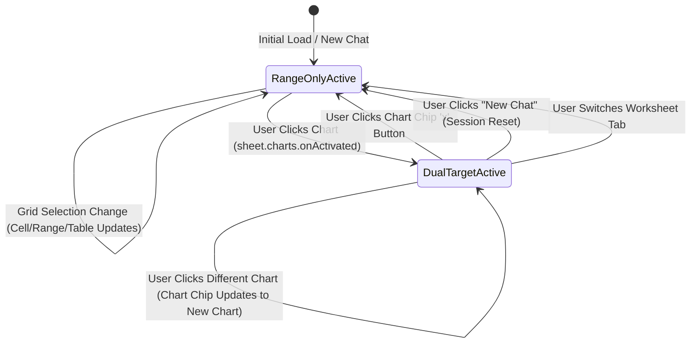
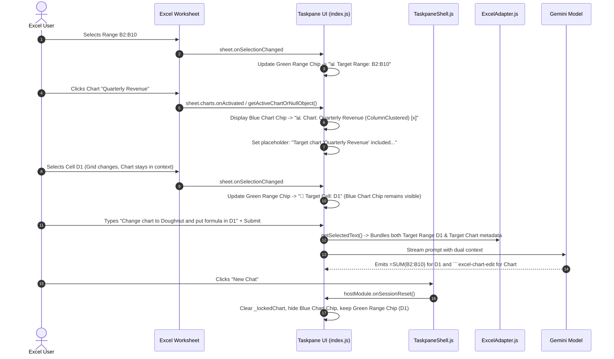

# Feature Specification: Excel Dual-Target Selection & Persistent Object Context

## 1. Problem Statement & Motivation

### 1.1 Background & Context
When users interact with Excel native objects (such as charts) alongside the worksheet grid, focus shifts between the Excel canvas iframe and the web add-in taskpane.

In earlier versions:
- Only a single target could be selected at a time (either a cell/range or a chart).
- When a user clicked into the taskpane to type, Excel deselected the chart object, causing the target context to prematurely drop or revert to an arbitrary cell.
- As a temporary workaround, a three-mode button bar (`Create formula`, `Modify range`, `Modify chart`) was introduced, which added UI clutter and unnecessary cognitive friction.

### 1.2 Dual-Target Solution
To provide a seamless workflow, the add-in adopts a **Dual-Target Coexistence Model**:
1. **Target Range (Green Chip):** Represents the active grid selection (single cell, table, or multi-cell range). It is **always active**, tracks worksheet grid movements dynamically, and is preserved across chat resets.
2. **Target Chart (Blue Chip):** Represents an active or sticky locked chart object. It appears **alongside** the target range chip when a chart is selected, persists across grid selections, provides an explicit dismiss button (`x`), resets on "New Chat", and reminds the user via prompt placeholder guidance to reference the chart in their instructions.

---

## 2. Requirements & Behavior Matrix

### 2.1 Target Range Behavior (Green Chip)
- **Always Active:** A target range is always selected at all times (defaulting to the active cell / single-cell range).
- **Dynamic Selection Tracking:** Automatically updates as the user moves cursor cells, selects multi-cell ranges, or selects structured tables.
- **New Chat Persistence:** When the user clicks "New Chat" (`#clearSession`), the active target range selection is preserved.

### 2.2 Target Chart Behavior (Blue Chip)
- **Selection & Coexistence:** When a chart is clicked on the worksheet, a blue `#targetChartBadge` chip appears alongside the green range chip.
- **Persistence Across Grid Clicks:** Selecting cells or ranges on the grid does *not* dismiss the chart chip.
- **Update on New Chart Selection:** Clicking a different chart immediately switches the blue chip to target the new chart (updating ID, title, type).
- **Dismissible via Close Button:** A small close button (`x` / `#removeTargetChartBtn`) on the chart chip allows the user to explicitly remove the chart from context.
- **New Chat Reset:** Starting a new chat (`#clearSession`) automatically clears/empties the target chart object and hides the blue chip.
- **Prompt Guidance:** When a chart is in context, the prompt input placeholder dynamically guides the user:
  > *"Target chart 'Quarterly Revenue' included. Explicitly reference the chart in your prompt to modify it..."*

---

## 3. Architecture & State Lifecycle

### 3.1 State Diagram



### 3.2 Sequence Diagram: Dual-Target Context Flow



---

## 4. Technical Implementation Details

### 4.1 Taskpane View Controller (`microsoft-addin/src/taskpanes/excel/index.js`)
- **`_lockedChart` State:** Stores metadata of the active chart (`{ id, name, chartType, title, width, height, top, left }`).
- **`onSelectionChange(selectionText, ctx)`:**
  - Evaluates both grid selection and chart status via `adapter.getSelectionTargetInfo()`.
  - Updates `#targetRangeBadge` (Green) with Cell, Range, or Table details.
  - Updates `#targetChartBadge` (Blue) and displays `#removeTargetChartBtn` when `_lockedChart` is present.
  - Calls `updatePromptGuidance()` to adjust the `#promptText` placeholder.
- **`onSessionReset(ctx)`:**
  - Invoked on New Chat button click.
  - Clears `_lockedChart = null`, updates adapter, hides `#targetChartBadge`, and restores default prompt placeholder.
- **`#removeTargetChartBtn.onclick`:**
  - Explicit dismiss handler that clears `_lockedChart`, hides the blue badge, and resets prompt guidance.

### 4.2 Shared Shell Lifecycle Hook (`microsoft-addin/src/shell/TaskpaneShell.js`)
- Extended `clearSessionBtn.onclick` handler:
  ```javascript
  if (typeof ctx.hostModule.onSessionReset === 'function') {
    ctx.hostModule.onSessionReset(ctx);
  }
  ```

### 4.3 Adapter & Prompt Context Routing (`microsoft-addin/src/adapters/ExcelAdapter.js`)
- **`getSelectionTargetInfo(context, overrideMode, overrideLockedChart)`:**
  - Returns `targetInfo` with grid selection details (`type: "cell"|"range"|"table"`, `address`, `cleanAddress`, `table`) and chart selection details (`chart: chartMeta | null`).
- **`formatSchemaForPrompt(schema, targetCellAddress, activeTarget)`:**
  - Injects `🎯 TARGET RANGE (Grid Selection): ...`
  - Injects `📊 TARGET CHART OBJECT (In Context): ...` with clear instruction to emit ````excel-chart-edit```` when referenced in the prompt.
- **`getSelectedText()`:**
  - Prefixes selection payloads with `📊 TARGET CHART (Included in Context)` when a chart is active/locked alongside the target range.

### 4.4 HTML & CSS Markup (`microsoft-addin/src/taskpanes/excel/index.html` & `excel.css`)
- Replaced single row badge with 2-row layout in `#excelSchemaPreview`:
  ```html
  <div id="excelSchemaPreview">
    <div class="schema-row primary-row">
      <span id="sheetSchemaBadge" class="excel-pill schema-info" title="Worksheet Grid Schema">📄 Sheet1 (Ready)</span>
      <span id="targetRangeBadge" class="excel-pill target-cell" title="Target Cell: A1">🎯 Target Cell: A1</span>
    </div>
    <div class="schema-row chart-row" id="targetChartRow" style="display:none;">
      <span id="targetChartBadge" class="excel-pill target-chart" title="Target Chart">
        <span id="targetChartText">📊 Chart</span>
        <button id="removeTargetChartBtn" class="chip-close-btn" title="Remove chart from context">&times;</button>
      </span>
    </div>
  </div>
  ```
- Styled `.excel-pill.target-chart .chip-close-btn` with clean hover states and responsive flex layout.

---

## 5. Verification & Acceptance Criteria

| ID | Test Scenario | Expected Outcome | Status |
|:---|:---|:---|:---|
| **AC-01** | User selects a single cell or range on the worksheet | Green `#targetRangeBadge` updates immediately; blue chart badge is hidden. | Verified |
| **AC-02** | User clicks a chart on the worksheet | Blue `#targetChartBadge` appears in Row 2 with chart title & type. | Verified |
| **AC-03** | User clicks back into cells on the worksheet | Green range badge updates to the new cell; blue chart badge remains visible in context. | Verified |
| **AC-04** | User clicks the "x" button on the chart badge | Blue chart badge is removed; prompt placeholder returns to default; range badge remains active. | Verified |
| **AC-05** | User selects a second chart on the worksheet | Blue chart badge updates seamlessly to the second chart's ID, title, and type. | Verified |
| **AC-06** | User clicks "New Chat" button | Blue chart badge is cleared; chat session resets; green range badge is preserved. | Verified |
| **AC-07** | Prompt guidance inspection | When chart is in context, `#promptText` placeholder reminds user to explicitly reference the chart in their instructions. | Verified |
| **AC-08** | Automated Unit Tests (`excel.test.mjs`) | `UT-31` (2-row header conformance) and `UT-34` (sticky chart target reset lifecycle) pass cleanly. | Verified |
| **AC-09** | Production Webpack Build | `npm run build` completes with exit code 0. | Verified |

