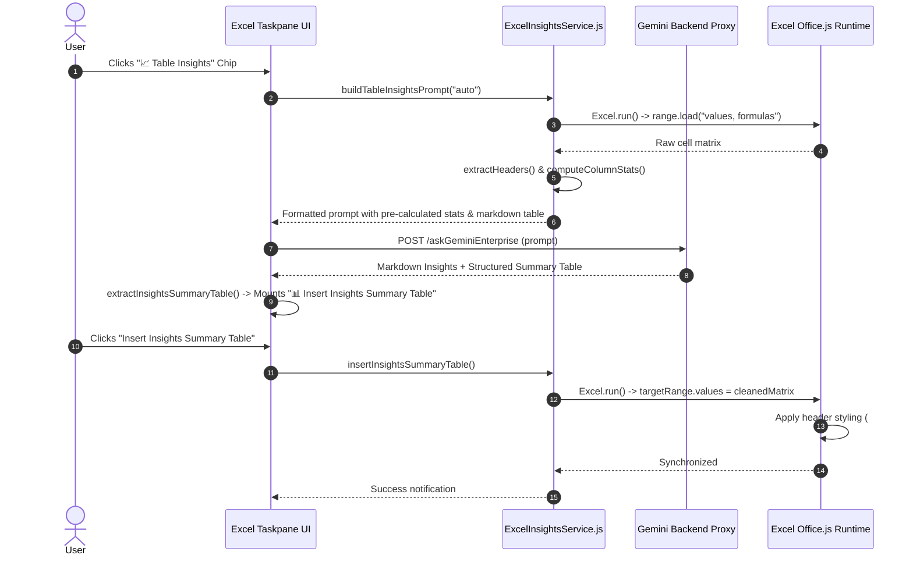

# Feature Specification: Excel Table Insights & Executive Summaries Engine

## 1. Problem Statement

### 1.1 Background and Current Behavior
Spreadsheet users, financial analysts, and corporate leaders frequently need to extract actionable business intelligence from complex tabular data without spending hours manually computing statistical aggregations, writing summary notes, or hand-crafting KPI charts.

Prior to this feature:
1. Users had to manually review large data ranges line by line or build PivotTables to understand key patterns, variance anomalies, or category distributions.
2. AI co-pilots produced generic prose summaries disconnected from the actual spreadsheet cells, lacking statistical pre-calculations or structured insertion capabilities.
3. Users could not easily insert both the summary table and an accompanying linked native chart into their active worksheet in a single workflow.

### 1.2 User Impact & Limitations
* **Cognitive Overload:** Complex spreadsheets with thousands of cells are difficult to parse quickly for executive meetings or quarterly reviews.
* **Lack of Quantitative Grounding:** Without automated statistical pre-parsing (sums, averages, min/max, distinct counts), raw LLMs may hallucinate totals or miss subtle outliers.
* **Manual Grid Transposition:** Markdown tables generated in chat required tedious manual copy-pasting and formatting inside Excel.

### 1.3 Target Persona & Impact
* **Executive Leadership & Managers:** Reviewing high-level department metrics, financial performance, and strategic risks.
* **Financial & Data Analysts:** Generating rapid insights on highlighted data ranges or full worksheets with one-click insertion.

---

## 2. Goals & Non-Goals

### 2.1 Goals
* **Automated Scope Resolution:** Intelligently detect whether the user has highlighted a specific data selection (`getSelectedRangeData()`) or intends to analyze the full active worksheet (`getFullSheetData()`).
* **Statistical Pre-Parsing:** Automatically calculate column statistics (numeric sum, average, min, max, count vs categorical distinct counts and fill rates) on the client side before prompt dispatch to ground AI reasoning.
* **Structured Insights Markdown Output:** Standardize the AI response into four structured sections:
  1. `## 📊 Key Table Patterns & Trends`
  2. `## ⚠️ Anomalies, Outliers & Data Risks`
  3. `## 📋 Structured Insights Summary Table`
  4. Visual infographic chart directive.
* **Data Type Normalization & Matrix Extraction:** Parse markdown tables into typed JavaScript matrices, converting currency strings (`$1,428.25`), percentages (`15.2%`), and numbers into genuine numeric types with appropriate Excel number formats (`$#,##0.00`, `0.0%`).
* **Sub-Section Intelligent Charting:** Detect category breakdowns within summary tables (e.g., *Category Performance*) and link native charts directly to the relevant sub-range.
* **One-Click Native Insertion:** Mount dedicated response actions:
  - **"📊 Insert Insights Summary Table"**: Inserts the formatted table into the active worksheet.
  - **"📊 Insert Summary & Chart"**: Inserts both the summary table and a linked native Excel chart.
  - **"📑 Insert Executive Summary Sheet"**: Generates a dedicated styled executive summary tab.

### 2.2 Non-Goals
* **Cloud Data Warehouse ETL:** The service operates in-memory on the active Excel workbook session; it does not replace BigQuery/Snowflake data pipelines.
* **Direct SQL Generation:** Focuses on spreadsheet analysis and Office.js operations.

---

## 3. Proposed Solution

### 3.1 High-Level Architecture



---

## 4. Technical Design

### 4.1 Component Architecture

| Component / Class | File | Responsibility |
| :--- | :--- | :--- |
| `ExcelInsightsService` | [`microsoft-addin/src/adapters/ExcelInsightsService.js`](file:///Users/ravindranv/Code-Local/For-Excel-GE-Add-In/excel_pod_release/gemini-for-office-365/microsoft-addin/src/adapters/ExcelInsightsService.js) | Data extraction, statistical pre-parsing, prompt synthesis, matrix normalization, and worksheet insertion. |
| `ExcelAdapter` | [`microsoft-addin/src/adapters/ExcelAdapter.js`](file:///Users/ravindranv/Code-Local/For-Excel-GE-Add-In/excel_pod_release/gemini-for-office-365/microsoft-addin/src/adapters/ExcelAdapter.js) | Host adapter exposing `extractInsightsSummaryTable`, `insertInsightsSummaryTable`, and coordinating multi-action buttons. |
| `ResponseActions` | [`microsoft-addin/src/taskpanes/excel/responseActions.js`](file:///Users/ravindranv/Code-Local/For-Excel-GE-Add-In/excel_pod_release/gemini-for-office-365/microsoft-addin/src/taskpanes/excel/responseActions.js) | Renders **"📊 Insert Insights Summary Table"** button with anti-collision checks. |
| `Chips` | [`microsoft-addin/src/taskpanes/excel/chips.js`](file:///Users/ravindranv/Code-Local/For-Excel-GE-Add-In/excel_pod_release/gemini-for-office-365/microsoft-addin/src/taskpanes/excel/chips.js) | Prompt chips: `chipTableInsightsSel`, `chipTableInsightsSheet`, and `chipExecutiveSummary`. |

---

### 4.2 Key Algorithms & Data Structures

#### 4.2.1 Statistical Pre-Parsing (`computeColumnStats`)
```javascript
static computeColumnStats(matrix, headers) {
  if (!matrix || matrix.length <= 1) return [];
  const numCols = headers.length;
  const stats = [];

  for (let c = 0; c < numCols; c++) {
    let sum = 0, numericCount = 0, min = Infinity, max = -Infinity, nonBlankCount = 0;
    const uniqueVals = new Set();

    for (let r = 1; r < matrix.length; r++) {
      const val = matrix[r] ? matrix[r][c] : null;
      if (val !== null && val !== undefined && String(val).trim() !== "") {
        nonBlankCount++;
        uniqueVals.add(String(val));
        const num = Number(val);
        if (!isNaN(num)) {
          sum += num;
          numericCount++;
          if (num < min) min = num;
          if (num > max) max = num;
        }
      }
    }

    if (numericCount > 0 && numericCount >= (matrix.length - 1) * 0.5) {
      stats.push({
        header: headers[c] || `Column ${c + 1}`,
        type: "numeric",
        sum, avg: sum / numericCount,
        min: min === Infinity ? 0 : min,
        max: max === -Infinity ? 0 : max,
        count: numericCount
      });
    } else {
      stats.push({
        header: headers[c] || `Column ${c + 1}`,
        type: "categorical",
        distinctCount: uniqueVals.size,
        nonEmptyCount: nonBlankCount
      });
    }
  }
  return stats;
}
```

#### 4.2.2 Special Character & Escaped Currency Sanitization Engine (`cleanCellText`)
Large language models routinely emit backslash escapes before currency signs (`\$500`, `\\$1,428.25`), percentages (`15.5\%`), and markdown symbols. The `cleanCellText` method cleans raw strings before cell insertion or statistical parsing:

```javascript
static cleanCellText(val) {
  if (val === null || val === undefined) return "";
  let str = String(val).trim();
  // Strip bold/italic markdown wrapper formatting
  str = str.replace(/^\*{1,3}(.*?)\*{1,3}$/g, "$1").trim();
  // Remove backslashes before currency signs ($, €, £, ¥)
  str = str.replace(/\\+([$€£¥])/g, "$1");
  // Remove trailing backslashes after currency/numbers
  str = str.replace(/([$€£¥0-9.,%]+)\\+$/g, "$1");
  // Remove backslashes before percent or math operators
  str = str.replace(/\\+([%+\-*\/^=><])/g, "$1");
  // Remove backslashes before digits
  str = str.replace(/\\+([0-9])/g, "$1");
  return str.trim();
}
```

#### 4.2.3 Data Normalization & Typed Matrix Conversion (`normalizeInsightsTableData`)
Converts string values like `"$1,428.25"`, `"-5.4%"`, and `"\$250"` into genuine JavaScript numbers, cleans backslash markdown escapes, and returns column formatting masks:
* **Currencies**: Parsed into floats (e.g. `1428.25`) with Excel number format `$#,##0.00` or `$#,##0`.
* **Percentages**: Parsed into decimal floats (e.g. `0.152`) with format `0.0%`.
* **Counts & Integers**: Parsed into integers with format `#,##0`.
* **Sub-Section Headers**: Detected when single-cell categories exist (e.g. `Category Performance`) and styled with `#004E8C` bold text and `#F0F4F8` fill.
* **Intelligent Sub-Range Chart Detection**: Automatically targets categorical sub-ranges (e.g. `Travel`, `Meals`, `Supplies`) for linked native chart generation.

---

## 5. UI / UX Integration

1. **Quick Action Chips**:
   - `chipTableInsightsSel`: *"📈 Insights (Selection)"*
   - `chipTableInsightsSheet`: *"📊 Insights (Full Sheet)"*
   - `chipExecutiveSummary`: *"💡 Executive Summary"*
2. **Response Action Buttons**:
   - `<button class="action-btn insert-insights-table-btn">📊 Insert Insights Summary Table</button>`
   - `<button class="action-btn insert-summary-chart-btn">📊 Insert Summary & Chart</button>`
   - `<button class="action-btn insert-exec-summary-btn">📑 Insert Executive Summary Sheet</button>`

---

## 6. Testing & Validation Strategy

1. **Automated Unit Tests ([`microsoft-addin/tests/excel.test.mjs`](file:///Users/ravindranv/Code-Local/For-Excel-GE-Add-In/excel_pod_release/gemini-for-office-365/microsoft-addin/tests/excel.test.mjs))**:
   - `UT-16`: `extractInsightsSummaryTable` extracts full table matrix without false-triggering taxonomy categorizer.
   - `UT-17`: `renderResponseActions` mounts **"📊 Insert Insights Summary Table"** for table insight responses.
   - `UT-18`: Scoped action buttons ensure Taxonomy Categorizer and Insights buttons are disambiguated.
   - `UT-19`: `normalizeInsightsTableData` converts currencies, percentages, and integers to genuine JS numbers and detects number formats.
   - `UT-23`: Markdown parser handles long table separators and single-cell section subheaders cleanly.
   - `UT-24`: Sanitizes backslash escapes and detects intelligent categorical chart sub-ranges.
   - `UT-26`: `cleanCellText` strips escaped backslashes from currency, numbers, and markdown symbols.
   - `UT-27`: `cleanMarkdownEscapes` unescapes markdown text properly.
   - `UT-28`: `parseMarkdown` renders HTML with clean unescaped currency symbols.
   - `UT-29`: `normalizeInsightsTableData` correctly parses escaped `\$` numbers to pure floats.
   - `UT-30`: `parseNumberWithUnit` extracts clean number and unit from escaped strings (e.g. `\$94.5B` -> `94.5`, unit `B`).

