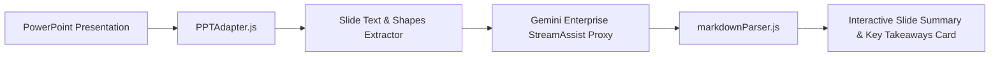

# PPT-01: PowerPoint Slide Summarization & Key Takeaways Specification

## 1. Overview
Enables native, context-aware summarization of single slides or full PowerPoint presentation decks using Gemini Enterprise StreamAssist. Users can trigger multi-slide summarization via quick action chips, conversational prompts, or selection-aware toolbars.

## 2. Architecture & Flow

## 3. Key Capabilities
- **Single vs Multi-Slide Extraction**: Automatically detects active slide index or iterates across all presentation slides via `PowerPoint.run`.
- **Slide Deck Outline**: Generates structured executive key points with bold emphasis and bulleted action items.
- **Smart Replacement / Insertion**: Allows inserting summary notes into speaker notes or creating a dedicated summary slide.
